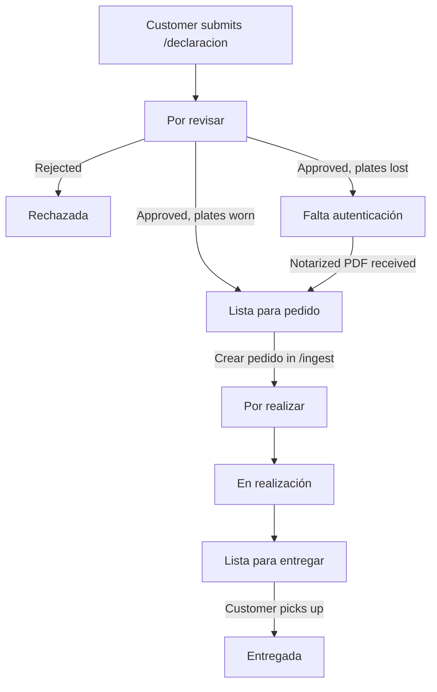

# plates

plates is the internal plate-production and point-of-sale app of INGSE, a
vehicle-plate manufacturer in Colombia. It replaced a spreadsheet-based
workflow: customers file a sworn declaration from their phone, the counter
reviews it and captures the order, and the workshop takes it through
production to delivery. It runs in production and handles the business's
daily work.

## Features

The UI is in Spanish; screen and status names are quoted as staff see them.

### Public sworn-declaration form (`/declaracion`)

- Customers reach it from a QR code at the counter, no login needed.
- One declaration covers one declarant and one to many ownership cards
  (*tarjetas de propiedad*), each with its reason (loss or wear) and number
  of plates.
- Required photos: the declarant's ID and each card, front and back, plus a
  photo of the used plates for each card unless the customer ticks «Perdí mis
  placas».
- A signature drawn on screen, the declarant's personal-data authorization
  under Ley 1581 de 2012, acceptance of the terms, and an optional marketing
  consent.
- Anti-spam: Cloudflare Turnstile, a honeypot field, a signed form token and
  a per-IP rate limit.

### Point of sale

- «Declaraciones» (`/declaraciones`): a review queue with one stage per
  declaration (*Por revisar*, *Falta autenticación*, *Lista para pedido*,
  *Atendida*, *Rechazada*) and automatic flags such as *Placa reciente*,
  *Tarjeta de otro dueño* or *Documento distinto*. Staff approve or reject
  each declaration, view the photos, and download them as a ZIP.
- Notarization step: declarations for lost plates produce a printable PDF the
  customer has authenticated at a notary; staff mark it as received before
  the order can be created.
- «Registrar» (`/ingest`): order capture, pre-filled from an approved
  declaration («Crear pedido») or from an uploaded PDF or Excel order form
  (`/ingest/pdf`), with customer, payment method, per-plate prices and
  duplicate warnings.
- «Cuadre» (`/cuadre`): the daily cash summary by date and payment method,
  with PDF export (`/cuadre/pdf`).
- «Registros» (`/records`): order history and per-order detail.

### Production

- «Producción» (`/produccion`): a status board where each order moves
  *Por realizar* → *En realización* → *Lista para entregar* → *Entregada*,
  with an undo for the last change.
- The order detail (`/produccion/<order_id>`) shows the plates, the linked
  declarations with their photos, and the order's status history, without
  prices or payment data.

### Admin

- «Usuarios» (`/usuarios`): create and edit users, reset passwords, and
  define roles (`/usuarios/roles`) with their permissions. `admin` always
  holds every permission; every other role gets exactly the permissions
  assigned to it.
- «Precios» (`/precios`): suggested price per plate type.
- «Clientes» (`/customers`): customer records with their ownership cards.
- «Inventario» (`/inventory`): stock per material and blank preparation.
- «Revisión» (`/review`): review of flagged possible duplicate plates.

## How it works



The app is a Flask application with one blueprint per domain in
`app/web/blueprints/` and Jinja templates. Business rules live in `app/core/`
as pure, strictly typed Python with no Flask dependency, and data access in
`app/core/db/`, one module per table. Code every domain needs (the connection
pool, normalization, timezones, input models, uploads) lives in `app/shared/`,
which depends on no domain package. Data is stored in PostgreSQL 16; the
schema is `init.sql` plus ordered migrations in `app/migrations/` applied by
`python -m app.schema_migrate`. It runs under gunicorn in Docker Compose
(`docker-compose.yml`, `web.Dockerfile`), with uploaded photos, signatures
and PDFs kept in a dedicated uploads volume.

## Tech stack

- Python 3.11, Flask, Jinja, Flask-WTF (CSRF protection)
- PostgreSQL 16 with psycopg 3 and a connection pool
- pydantic for input models
- pdfplumber and openpyxl to read PDF and Excel order forms; reportlab to
  render PDFs
- gunicorn, Docker Compose
- Cloudflare Turnstile on the public form
- Sentry (optional) for error monitoring, Dozzle for logs
- GitHub Actions for CI/CD

## Quality

- **ruff** for linting and import order (`pyproject.toml`).
- **mypy** over `app` and `tests`, with `disallow_untyped_defs` on
  `app/core` and `app/shared`.
- **pytest** against a real PostgreSQL database (no mocks of the database),
  each test in a transaction that is rolled back.
- **Coverage** reported in CI with `pytest-cov`.
- **CodeQL** code scanning and **Dependabot** updates for pip, GitHub
  Actions and Docker.
- The `factory/checks.sh` gate, which every branch built by the software
  factory has to pass.

## CI/CD

- Tests run on every pull request (`.github/workflows/test.yml`).
- Deploy to the VPS (`.github/workflows/deploy.yml`) happens only from
  `main`, only after the same test workflow passes, and only through a
  protected GitHub environment. Database migrations run as part of the
  deploy.
- Third-party actions are pinned to commit SHAs.

Details in [`docs/ARCHITECTURE.md`](docs/ARCHITECTURE.md).

## Local development

```sh
cp .env.example .env          # set POSTGRES_PASSWORD and SECRET_KEY
docker compose up -d
docker compose exec web python -m app.schema_migrate
```

**First admin.** Hash a password with
`python -m app.auth.hash_password 'the-password'` and put the user in
`AUTH_USERS` (`username:hash`, plus `AUTH_ROLES` as `username:role` if it
should not be `admin`) before the first `python -m app.schema_migrate`. That
backfill runs once, only on a brand-new database; after that, users and
roles are managed at `/usuarios`.

**Compose gotcha.** Password hashes contain `$`, and Docker Compose
interpolates `$VAR` in `.env`. Double every `$` as `$$` or the hash is
silently corrupted and login fails.

**Tests.** Run `pytest` (optionally `pytest -n auto`). Database tests need
the local `db` service on port 5433 and `POSTGRES_PASSWORD` set in the
environment; without them they are skipped.

More gotchas, the test database setup and every environment variable are in
[`docs/LOCAL_DEVELOPMENT.md`](docs/LOCAL_DEVELOPMENT.md).

## Software factory

Work is planned as GitHub issues, and AI agents build each issue into a pull
request through a spec, build, checks and review pipeline. A human always
reviews and merges every PR; the factory never merges on its own. See
[`CLAUDE.md`](CLAUDE.md).

## Documentation

Technical reference, starting at [`docs/README.md`](docs/README.md):

- [`docs/ARCHITECTURE.md`](docs/ARCHITECTURE.md): components, deployment and
  the CI/CD pipeline
- [`docs/DATABASE.md`](docs/DATABASE.md): full schema and ER diagram
- [`docs/CORE.md`](docs/CORE.md): business logic in `app/core/`
- [`docs/WEB.md`](docs/WEB.md): routes, roles and permissions, templates
- [`docs/PRODUCTION.md`](docs/PRODUCTION.md): the production screen and
  order statuses
- [`docs/LOCAL_DEVELOPMENT.md`](docs/LOCAL_DEVELOPMENT.md): local setup,
  testing and environment variables
- [`docs/BACKUPS.md`](docs/BACKUPS.md): backups

## Security

See [`SECURITY.md`](SECURITY.md) for how to report a vulnerability.

## License / status

This is the production code of a private business, published for portfolio
purposes. No license is granted: all rights reserved.
