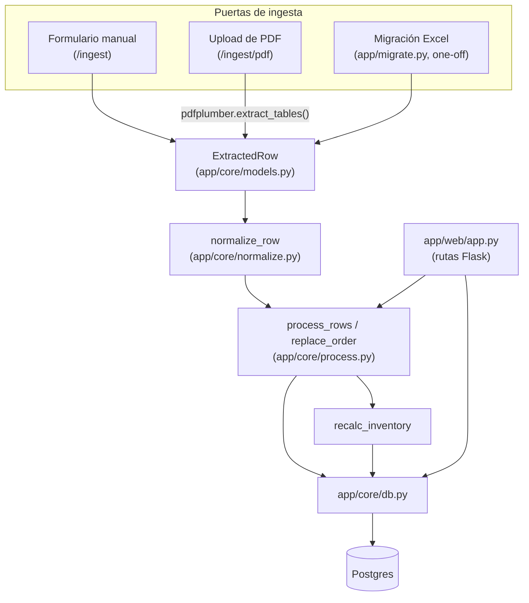
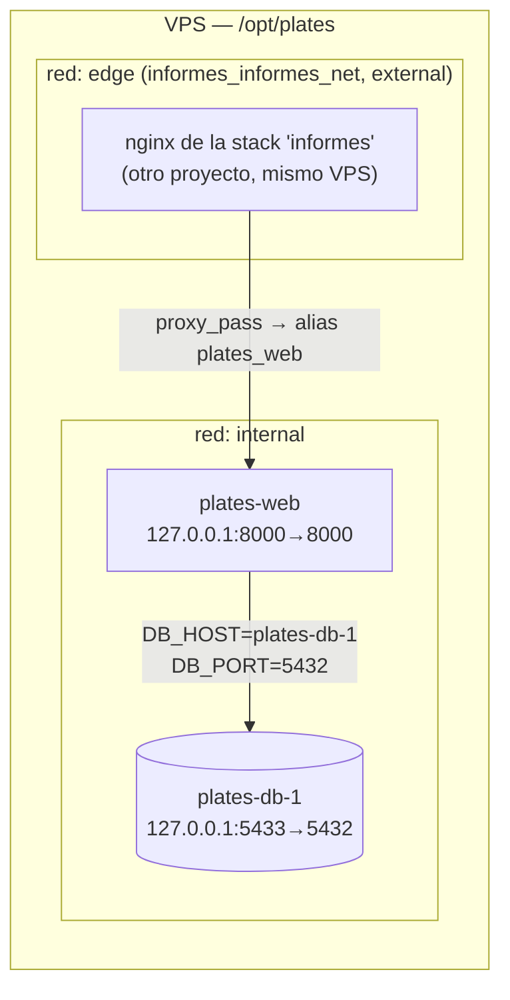

# Arquitectura

[← volver al índice](README.md)

## Componentes

Tres "puertas" de ingesta distintas convergen en el mismo pipeline de
`app/core` — `app/web` nunca escribe SQL directamente ni implementa reglas
de negocio, siempre pasa por `app/core`:

Esto es lo que permite que la migración histórica de Excel
(`app/migrate.py`) reutilice exactamente la misma normalización y
detección de duplicados que usa el formulario web — un solo camino de
validación de reglas de negocio, no dos implementaciones paralelas.

Ver [`CORE.md`](CORE.md) para el detalle de cada módulo de este pipeline y
[`WEB.md`](WEB.md) para las rutas que lo disparan.

## Despliegue (Docker Compose)

**Gotcha real de producción** (documentado también como comentario en
`docker-compose.yml`): `web` está en la misma red `edge` que la stack
vecina **"informes"**, y esa stack tiene su propio servicio llamado
también `db` (su MySQL). El DNS interno de Docker resolvía el hostname
ambiguo `db` hacia el servicio equivocado, causando errores 500 en
producción en cada ruta que tocaba la base de datos. La solución fue fijar
`container_name: plates-db-1` (único entre ambas stacks) y apuntar
`DB_HOST=plates-db-1` explícitamente en vez de depender del nombre de
servicio por defecto de Compose (`db`).

**Regla: nunca volver a `DB_HOST=db`.**

Puertos fijos en el host — solo puede correr una instancia de cada
servicio a la vez en una misma máquina:
- Postgres: host `5433` → contenedor `5432` (5432 en el host ya lo usa otro
  proyecto en el VPS).
- Web: host `8000` → contenedor `8000`.

Detalle de qué implica esto para levantar el proyecto en local (y para
correr agentes/tests en paralelo) en
[`LOCAL_DEVELOPMENT.md`](LOCAL_DEVELOPMENT.md).

## CI/CD

| Workflow | Trigger | Pasos |
|---|---|---|
| `.github/workflows/test.yml` | cada `push` y `pull_request` | Levanta Postgres 16 como servicio (puerto 5433) → `pip install -r requirements-dev.txt` → `ruff check app/` → `mypy app/` → `pytest --cov=app --cov-report=term-missing` |
| `.github/workflows/deploy.yml` | push a `main`, o `workflow_dispatch` manual | SSH al VPS (`appleboy/ssh-action`) → en `/opt/plates`: `git fetch --depth 1 origin main` → `git reset --hard origin/main` → decodifica el secreto `ENV_FILE_B64` a `.env` → `docker compose up -d --build` |

`deploy.yml` **no vuelve a correr los tests** — el gate real es que
`test.yml` ya haya pasado en el push/PR que llega a `main` (no hay branch
protection que lo fuerce a nivel de este workflow). El VPS usa una **deploy
key** de solo lectura registrada en este repo (privado) para poder hacer
`git fetch` sin credenciales de escritura.
