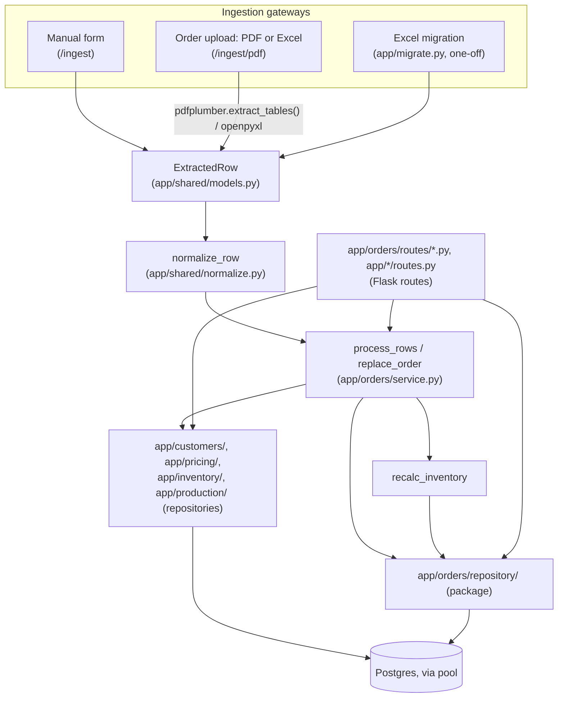
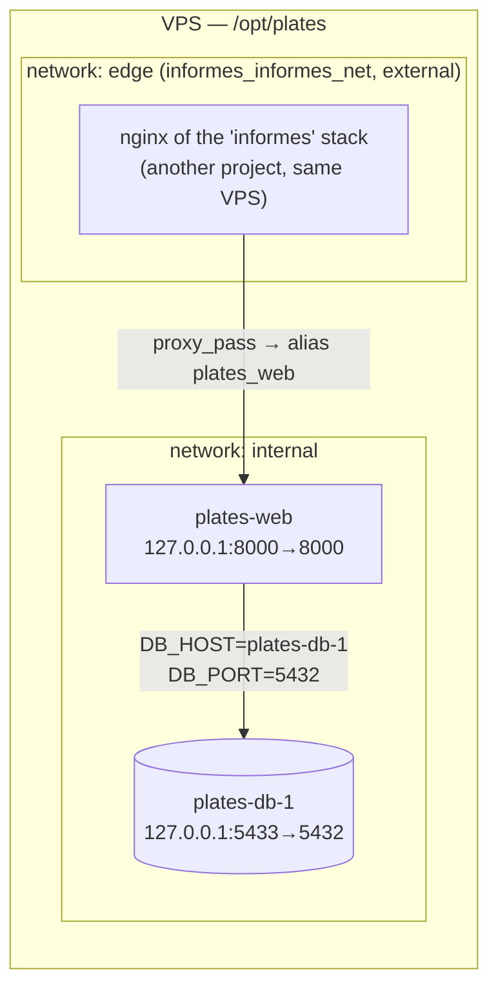

# Architecture

[← back to index](README.md)

## Components

Three distinct ingestion "gateways" converge on the same pipeline in the
domain packages — the routes never write SQL directly or implement business
rules; they always go through a domain's `service.py` or `repository`:

The ingestion module (now `app/orders/service.py`, first renamed from
`process.py`) and the per-table SQL modules (split out of a single `db.py`, now in each domain's repository) are the result of Phase 1d — an
architecture refactor by domain without adding an ORM, a DI framework or a
repository layer, plus a real connection pool (`psycopg_pool`). Full
details in [`DOMAINS.md`](DOMAINS.md).

Login, refresh and logout, the users and roles admin screens and their SQL
form the auth domain, `app/auth/` (its SQL in `app/auth/repository/`).
Every blueprint imports `app.shared.auth.permission_required`, which reads
the user and their permissions from the JWT `access_token` cookie, with no
database read; `app/auth/` imports no other domain
package, only `app/shared/` (and `app.web.navigation` for the landing page).

The customers, pricing and inventory domains follow the same layout:
`app/customers/`, `app/pricing/` and `app/inventory/` each hold their
`routes.py` (the blueprint) and their SQL (`app/customers/repository/`, a
package with `customers.py` and `ownership_cards.py`;
`app/pricing/repository.py`; `app/inventory/repository.py`). Other code may
import them; they import `app/shared/`, `app/auth/` and, until phase 6,
`app.web.helpers` (routes). Their
templates stay in `app/web/templates/`.

The production and cash summary domains add a `service.py` for their
business rules: `app/production/` holds `routes.py`, `service.py` (the
status transitions) and `repository.py` (the production-status SQL);
`app/cash_summary/` holds `routes.py` and `service.py` (the aggregation and
its PDF). `app/production/` imports `app.orders` for the order data and
`app.declarations` (its repository and the declaration-file constants of
`app.declarations.routes`), and the cash summary queries read
`plates` and `production_orders` directly.

The orders domain, `app/orders/`, holds the point of sale, records and
duplicates review blueprints (`routes/ingest.py`, `routes/records.py`,
`routes/review.py`), the ingestion pipeline (`service.py`), the pedido
parsers (`pdf_extract.py`, `xlsx_extract.py`, `pedido_upload.py`) and the
`production_orders`/`plates` SQL (`repository/`, a package with `orders.py`
and `plates.py`). It imports `app/shared/`, `app/auth/`, `app/customers/`,
`app/pricing/`, `app/inventory/` and `app/declarations/` (the declarations
data), and the routes import
`app.web.helpers` until phase 6. Nothing in `app/customers/` imports it:
`relink_plates`, which `update_customer` calls, lives in
`app/customers/repository/ownership_cards.py`.

The declarations domain, `app/declarations/`, holds the staff review screens
(`routes.py`), the public sworn-declaration form (`public_routes.py`) and its
anti-spam checks (`antispam.py`), the submission and review rules
(`service.py`), the printable PDF (`pdf.py`) and the
`declarations`/`declaration_cards` SQL (`repository.py`). It imports
`app/shared/`, `app/auth/`, `app/customers/`, `app/orders/` and
`app/production/`, and the routes import `app.web.csrf` until phase 6. Its
templates stay in `app/web/templates/`.

This is what lets the historical Excel migration (`app/migrate.py`) reuse
exactly the same normalization and duplicate detection that the web form
uses — a single path for validating business rules, not two parallel
implementations.

See [`DOMAINS.md`](DOMAINS.md) for the details of each module in this pipeline
and [`WEB.md`](WEB.md) for the routes that trigger it.

## Deployment (Docker Compose)

**Real production gotcha** (also documented as a comment in
`docker-compose.yml`): `web` is on the same `edge` network as the
neighboring **"informes"** stack, and that stack has its own service also
called `db` (its MySQL). Docker's internal DNS resolved the ambiguous
hostname `db` to the wrong service, causing 500 errors in production on
every route that touched the database. The fix was to pin
`container_name: plates-db-1` (unique across both stacks) and point
`DB_HOST=plates-db-1` explicitly instead of relying on Compose's default
service name (`db`).

**Rule: never go back to `DB_HOST=db`.**

Fixed ports on the host — only one instance of each service can run at a
time on a given machine:
- Postgres: host `5433` → container `5432` (5432 on the host is already
  used by another project on the VPS).
- Web: host `8000` → container `8000`.

Details on what this implies for running the project locally (and for
running agents/tests in parallel) are in
[`LOCAL_DEVELOPMENT.md`](LOCAL_DEVELOPMENT.md).

## CI/CD

| Workflow | Trigger | Steps |
|---|---|---|
| `.github/workflows/test.yml` | `pull_request` (any branch), push to `main`, and `workflow_call` (reused by `deploy.yml`) | Starts Postgres 16 as a service (port 5433) → `pip install -r requirements-dev.txt` (with pip cache) → `ruff check app/` → `mypy app/` → `pytest --cov=app --cov-report=term-missing` |
| `.github/workflows/deploy.yml` | push to `main`, or manual `workflow_dispatch` | Job `test` (reuses `test.yml`) → job `deploy` (only if `test` passed, only on `main` of `nickkmm/plates`, in the `production` environment) → SSH to the VPS (`appleboy/ssh-action`, verifying the host fingerprint if `VPS_SSH_FINGERPRINT` exists) → in `/opt/plates`: `git fetch --depth 1 origin "$DEPLOY_SHA"` → `git reset --hard FETCH_HEAD` (the exact commit that was tested) → decodes the `ENV_FILE_B64` secret into `.env` → `docker compose up -d --build` → `docker compose exec -T web python -m app.schema_migrate` |
| `.github/workflows/codeql.yml` | `pull_request` to `main`, push to `main`, and weekly (`schedule`) | CodeQL analysis of `python` and `actions` (no build) → results in the *Security* tab |

All workflows declare minimal `permissions` (`contents: read`, plus
`security-events: write` and `actions: read` in CodeQL) and pin every
third-party action to a full commit SHA (with a `# vX.Y.Z` comment).
Dependabot (`.github/dependabot.yml`) checks `pip`, `github-actions` and
`docker` (`web.Dockerfile`) every week, and groups minor and patch updates
into a single PR per ecosystem.

The deploy no longer depends on someone having looked at the tests:
`deploy.yml` runs `test.yml` as its first job and the `deploy` job has
`needs: test`, so if the tests fail nothing is deployed. In addition, the
deploy only runs for `main` of `nickkmm/plates` (never from a fork or
another branch), goes through the `production` environment (whose secrets
only `main` can see once the configuration below is applied), and deploys
the exact SHA that was tested, not whatever `main` happens to be at that
moment. Deploys do not cancel each other: they are queued
(`concurrency: deploy-production`). The VPS uses a read-only **deploy key**
registered in this repo so it can run `git fetch` without write
credentials.

The final step (`schema_migrate`) applies any pending migration from
`app/migrations/*.sql` (and their Python backfills) against the real
database, recording it in `schema_migrations` — running the runner twice
is a no-op. See [`DATABASE.md`](DATABASE.md) for the runner and the history
of migrations already applied.

### Manual GitHub configuration

The repo is public. This cannot be done from a workflow or a PR: the repo
owner applies it by hand in the GitHub settings.

- [ ] **Ruleset on `main`**: require a PR to merge, the required check
  `test`, code owner review (`.github/CODEOWNERS`), and block force
  pushes and deletion of the branch.
- [ ] **Secret scanning** enabled, with **push protection**.
- [ ] **Dependabot alerts** and **Dependabot security updates** enabled.
- [ ] **Private vulnerability reporting** enabled (see `SECURITY.md`).
- [ ] **Actions**: require approval for workflows from outside
  collaborators, and require actions to be pinned to a full SHA.
- [ ] **Environment `production`** restricted to the `main` branch, with
  the secrets `VPS_HOST`, `VPS_USER`, `VPS_SSH_KEY`, `ENV_FILE_B64` and
  `VPS_SSH_FINGERPRINT`, and delete the repo-level copies of those
  secrets. The fingerprint is obtained with
  `ssh-keyscan -t ed25519 <host> | ssh-keygen -lf -` (the secret is only
  the `SHA256:...` field of the output). As long as `VPS_SSH_FINGERPRINT`
  does not exist, the deploy works but does not verify the host key.
- [ ] **Non-root deploy user on the VPS**: `VPS_USER` must be a user
  without root privileges (with access to `/opt/plates` and to Docker).

## Monitoring and observability (Phase 1e)

Deliberately minimal scope — no Prometheus/Grafana/ELK/APM; that would be
over-engineering for a VPS running Docker Compose with a handful of users:

- **Sentry** (`sentry-sdk[flask]`): automatically captures any unhandled
  exception (with the full stack trace) and alerts by email. It is
  initialized in `app/web/app.py` right after `app` is created, only if
  the `SENTRY_DSN` environment variable is set — in local dev and in the
  tests nothing is initialized, so they send no data to Sentry.
- **UptimeRobot** (external, does not touch the repo): pings
  `https://placas.ingse.co/healthz` every 5 minutes and alerts by email if
  the site stops responding.
- **Docker log rotation**: `docker-compose.yml` sets
  `logging: {driver: json-file, options: {max-size: "10m", max-file: "3"}}`
  on the `db` and `web` services, so container logs do not grow without
  limit on the VPS disk.
