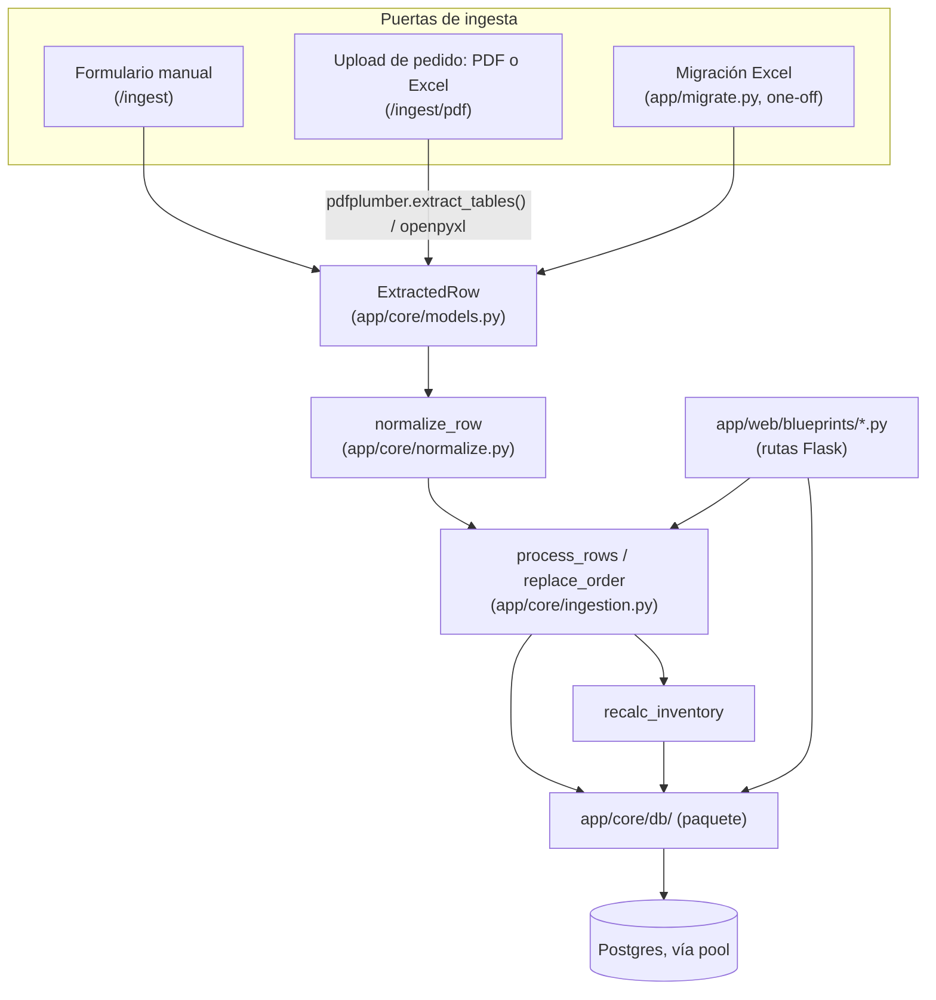
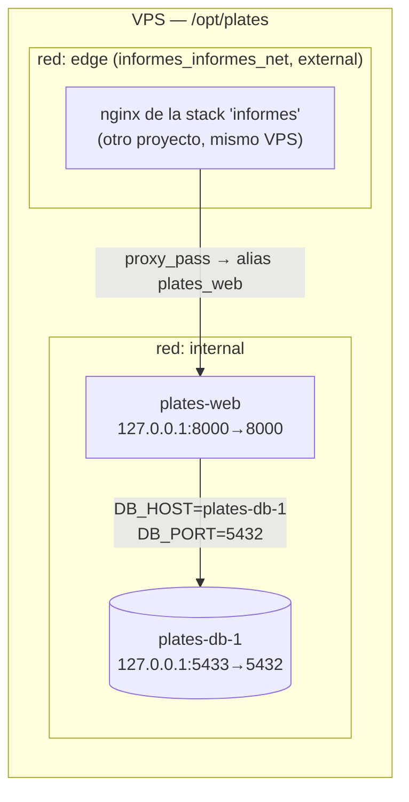

# Arquitectura

[← volver al índice](README.md)

## Componentes

Tres "puertas" de ingesta distintas convergen en el mismo pipeline de
`app/core` — `app/web` nunca escribe SQL directamente ni implementa reglas
de negocio, siempre pasa por `app/core`:

`app/core/ingestion.py` (renombrado de `process.py`) y `app/core/db/`
(dividido de un único `db.py`) son el resultado de la Fase 1d —
refactor de arquitectura por dominios sin agregar ORM/framework de DI/capa
repository, más un pool de conexiones real (`psycopg_pool`). Detalle
completo en [`CORE.md`](CORE.md).

Esto es lo que permite que la migración histórica de Excel
(`app/migrate.py`) reutilice exactamente la misma normalización y
detección de duplicados que usa el formulario web — un solo camino de
validación de reglas de negocio, no dos implementaciones paralelas.

Ver [`CORE.md`](CORE.md) para el detalle de cada módulo de este pipeline y
[`WEB.md`](WEB.md) para las rutas que lo disparan.

## Despliegue (Docker Compose)

**Gotcha real de producción** (documentado también como comentario en
`docker-compose.yml`): `web` está en la misma red `edge` que la stack
vecina **"informes"**, y esa stack tiene su propio servicio llamado
también `db` (su MySQL). El DNS interno de Docker resolvía el hostname
ambiguo `db` hacia el servicio equivocado, causando errores 500 en
producción en cada ruta que tocaba la base de datos. La solución fue fijar
`container_name: plates-db-1` (único entre ambas stacks) y apuntar
`DB_HOST=plates-db-1` explícitamente en vez de depender del nombre de
servicio por defecto de Compose (`db`).

**Regla: nunca volver a `DB_HOST=db`.**

Puertos fijos en el host — solo puede correr una instancia de cada
servicio a la vez en una misma máquina:
- Postgres: host `5433` → contenedor `5432` (5432 en el host ya lo usa otro
  proyecto en el VPS).
- Web: host `8000` → contenedor `8000`.

Detalle de qué implica esto para levantar el proyecto en local (y para
correr agentes/tests en paralelo) en
[`LOCAL_DEVELOPMENT.md`](LOCAL_DEVELOPMENT.md).

## CI/CD

| Workflow | Trigger | Pasos |
|---|---|---|
| `.github/workflows/test.yml` | `pull_request` (cualquier rama), push a `main`, y `workflow_call` (lo reutiliza `deploy.yml`) | Levanta Postgres 16 como servicio (puerto 5433) → `pip install -r requirements-dev.txt` (con caché de pip) → `ruff check app/` → `mypy app/` → `pytest --cov=app --cov-report=term-missing` |
| `.github/workflows/deploy.yml` | push a `main`, o `workflow_dispatch` manual | Job `test` (reutiliza `test.yml`) → job `deploy` (solo si pasó `test`, solo en `main` de `nickkmm/plates`, en el environment `production`) → SSH al VPS (`appleboy/ssh-action`, verificando la huella del host si existe `VPS_SSH_FINGERPRINT`) → en `/opt/plates`: `git fetch --depth 1 origin "$DEPLOY_SHA"` → `git reset --hard FETCH_HEAD` (el commit exacto que se probó) → decodifica el secreto `ENV_FILE_B64` a `.env` → `docker compose up -d --build` → `docker compose exec -T web python -m app.schema_migrate` |
| `.github/workflows/codeql.yml` | `pull_request` a `main`, push a `main`, y semanal (`schedule`) | Análisis CodeQL de `python` y `actions` (sin build) → resultados en la pestaña *Security* |

Todos los workflows declaran `permissions` mínimos (`contents: read`, más
`security-events: write` y `actions: read` en CodeQL) y fijan cada action de
terceros a un SHA de commit completo (con un comentario `# vX.Y.Z`).
Dependabot (`.github/dependabot.yml`) revisa cada semana `pip`,
`github-actions` y `docker` (`web.Dockerfile`), y agrupa las actualizaciones
minor y patch en un solo PR por ecosistema.

El deploy ya no depende de que alguien haya mirado los tests: `deploy.yml`
corre `test.yml` como su primer job y el job `deploy` tiene `needs: test`,
así que si los tests fallan no se despliega nada. Además, el deploy solo
corre para `main` de `nickkmm/plates` (nunca desde un fork o desde otra
rama), pasa por el environment `production` (cuyos secretos solo ve `main`
una vez aplicada la configuración de abajo), y despliega el SHA exacto que
se probó, no lo que `main` tenga en ese momento. Los deploys no se cancelan
entre sí: se encolan (`concurrency: deploy-production`). El VPS usa una
**deploy key** de solo lectura registrada en este repo para poder hacer
`git fetch` sin credenciales de escritura.

El paso final (`schema_migrate`) aplica cualquier migración pendiente de
`app/migrations/*.sql` (y sus backfills en Python) contra la base real,
registrándola en `schema_migrations` — correr el runner dos veces es un
no-op. Ver [`DATABASE.md`](DATABASE.md) para el runner y el historial de
migraciones ya aplicadas.

### Configuración manual en GitHub

El repo es público. Esto no se puede hacer desde un workflow ni un PR: lo
aplica a mano el dueño del repo en la configuración de GitHub.

- [ ] **Ruleset sobre `main`**: exigir PR para mergear, check obligatorio
  `test`, revisión de code owners (`.github/CODEOWNERS`), y bloquear force
  pushes y borrado de la rama.
- [ ] **Secret scanning** activado, con **push protection**.
- [ ] **Dependabot alerts** y **Dependabot security updates** activados.
- [ ] **Private vulnerability reporting** activado (ver `SECURITY.md`).
- [ ] **Actions**: exigir aprobación para workflows de colaboradores
  externos, y exigir que las actions estén fijadas a un SHA completo.
- [ ] **Environment `production`** restringido a la rama `main`, con los
  secretos `VPS_HOST`, `VPS_USER`, `VPS_SSH_KEY`, `ENV_FILE_B64` y
  `VPS_SSH_FINGERPRINT`, y borrar las copias de esos secretos a nivel de
  repo. La huella se obtiene con
  `ssh-keyscan -t ed25519 <host> | ssh-keygen -lf -` (el secreto es solo el
  campo `SHA256:...` de la salida). Mientras `VPS_SSH_FINGERPRINT` no
  exista, el deploy funciona pero no verifica la clave del host.
- [ ] **Usuario de deploy no-root en el VPS**: `VPS_USER` debe ser un
  usuario sin privilegios de root (con acceso a `/opt/plates` y a Docker).

## Monitoreo y observabilidad (Fase 1e)

Alcance deliberadamente mínimo — nada de Prometheus/Grafana/ELK/APM, sería
sobreingeniería para un VPS con Docker Compose y un puñado de usuarios:

- **Sentry** (`sentry-sdk[flask]`): captura automáticamente cualquier
  excepción no manejada (con stack trace completo) y alerta por correo. Se
  inicializa en `app/web/app.py` justo después de crear `app`, solo si la
  variable de entorno `SENTRY_DSN` está seteada — en dev local y en los
  tests no se inicializa nada, así que no mandan datos a Sentry.
- **UptimeRobot** (externo, no toca el repo): ping a
  `https://placas.ingse.co/healthz` cada 5 minutos, alerta por correo si
  el sitio deja de responder.
- **Rotación de logs de Docker**: `docker-compose.yml` fija
  `logging: {driver: json-file, options: {max-size: "10m", max-file: "3"}}`
  en los servicios `db` y `web`, para que los logs de los contenedores no
  crezcan sin límite en el disco del VPS.
