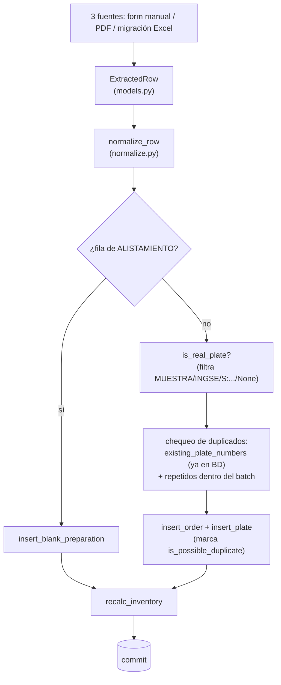

# Core (`app/core/`)

[← volver al índice](README.md)

Lógica de negocio independiente del framework web — compartida entre
`app/web` y la migración histórica de Excel (`app/migrate.py`). Ninguna
consulta SQL ni regla de negocio debería vivir fuera de esta carpeta.

## Pipeline de ingesta completo

Todo el pipeline corre en **una sola transacción** por llamada: el
llamador abre `with db.get_conn() as conn:` y se lo pasa explícito a
`ingestion.process_rows(conn, rows)` / `replace_order(conn, ...)` — un
fallo a mitad de camino revierte tanto los inserts como cualquier borrado
(en el caso de `replace_order`, ver más abajo). Antes de la Fase 1d cada
una de esas funciones abría su propia conexión por separado (un solo `POST
/ingest` corría en varias transacciones no atómicas entre sí); ver la nota
de "Contrato de transacción" más abajo.

## `models.py`

Esquema pydantic de una línea del libro/pedido, compartido tal cual por
cada puerta de ingesta para que `ingestion.py` solo tenga que manejar una
forma de dato.

- **`ExtractedRow`** — `order_number` (str, no int: hay valores como
  `"NT 895"`), `order_date`, `requested_by`, `plate_type`, `city`,
  `plate_number` (celda RANGO cruda), `plate_to`, `quantity` (default 1),
  `material`, `prepared_by`, y tres flags que por defecto son `False` y
  normalmente se infieren después en `normalize_row`.
- **`Extraction`** — `{rows: list[ExtractedRow]}`. Es la forma que
  devolvería un paso de extracción por imagen (mencionado en el docstring
  como "Claude lee la imagen del pedido") — **hoy no está conectado a
  ninguna ruta real**, solo lo usan los tests. Un punto de integración
  documentado pero no implementado, no una feature activa.

Los validadores solo hacen coerción defensiva (floats como `598.0` →
`"598"`, strings vacíos → `None`) — la normalización de negocio real vive
en `normalize.py`.

## `normalize.py`

Normalización pura, sin acceso a base de datos — testeable en aislamiento.

| Función/constante | Qué hace |
|---|---|
| `normalize_requested_by(value)` | Limpia mayúsculas/espacios y mapea ~40 variantes de escritura curadas a mano a un nombre canónico; nunca fusiona entidades distintas de verdad. |
| `PLATE_TYPES` | Los 7 tipos de placa canónicos. |
| `INVENTORY_CATEGORIES` | Las 3 categorías de inventario: `CARRO PARTICULAR`, `MOTO PARTICULAR`, `PÚBLICO`. |
| `inventory_category(plate_type)` | Mapea un tipo de placa a su material de inventario (`ORNAMENTAL` → `None`, no consume material). |
| `normalize_plate_type(value)` | Canonicaliza etiquetas libres, incluyendo el mapeo histórico `MOTO PÚBLICO` → `MOTO CARRO PÚBLICO`. |
| `clean_plate(value)` | Mayúsculas + strip (`"arn 911"` → `"ARN911"`). |
| `validate_plate(value, plate_type)` | Valida contra el patrón regex del tipo; lanza `ValueError` en español. Solo se usa en carga manual, no en datos históricos de migración. |
| `normalize_city(value)` | Mayúsculas/un solo espacio; `None` para basura de puntuación. |
| `is_real_plate(plate_number)` | `TypeGuard[str]` — `False` para `None` y marcadores no-identificadores (`MUESTRA`, `INGSE`, `KWP`, notas `S/...`). Es el filtro que decide qué entra a la detección de duplicados. |
| `annulment_kind(*folded_texts)` | Clasifica texto de anulación encontrado en SOLICITADO/RANGO/CIUDAD en `"order"` (no consumida), `"plate"` (consumida pero perdida) o `"bare"`/`None`. |
| `normalize_row(row)` | Punto de entrada principal — normaliza texto e infiere los 3 flags a partir del token RANGO (`REPOSICION` → `is_batch_replacement=True` + `plate_number=None`) y del resultado de `annulment_kind`; nunca apaga un flag que ya venía en `True`. |

**Lo más difícil de entender:**

- La anulación se registra de forma inconsistente en el libro crudo (la
  palabra puede aparecer en SOLICITADO, RANGO o CIUDAD) — por eso
  `annulment_kind` inspecciona los tres campos juntos como un solo blob, en
  vez de mirar una sola columna.
- `is_plate_annulled` vs. `is_voided` codifica una distinción de negocio
  real: anulación **de orden** = el blank nunca se gastó (no cuenta contra
  inventario); anulación **de placa** = el blank se gastó físicamente
  (sigue contando como consumido, pero se marca como desperdicio). Ver la
  tabla comparativa completa en [`DATABASE.md`](DATABASE.md#los-4-flags-booleanos-de-plates--fácil-confundirlos).
- El default de ciudad se evalúa al final y depende del orden: solo
  `CARRO PARTICULAR`/`CARRO PÚBLICO` son realmente específicos de ciudad;
  el resto recibe `"COLOMBIA"` si queda en blanco — este mismo paso también
  rellena la ciudad de filas cuya celda CIUDAD quedó anulada por la
  detección de "ANULAD" justo antes.
- El mapa de curación de `requested_by` es un registro vivo de decisiones
  humanas puntuales (hay comentarios con fechas de sesiones reales de
  limpieza de datos), no un algoritmo genérico — varios casi-duplicados se
  dejan sin fusionar a propósito, pendientes de confirmación.

## `pdf_extract.py`

Parsea el PDF de "pedido" con formato fijo de INGSE hacia la misma forma
`ExtractedRow` que produce el formulario manual, para que una persona pueda
subir un PDF en vez de tipear cada placa a mano, y revisar/corregir antes
de que llegue a `process_rows`.

| Función/clase | Qué hace |
|---|---|
| `PdfExtractError` | Excepción de mensaje en español ("esto no es un pedido legible") — nunca deja que un PDF malo tumbe la app con un 500. |
| `ParsedLine` | Una línea de la tabla de placas: `line_type` (`"placa"`/`"rango"`), `plate_type`, `plate_number`, `plate_to`, `quantity`, `city`. |
| `ParsedPedido` | Header (`order_number`, `order_date`, `requested_by`) + `lines`; `.to_rows()` convierte a `ExtractedRow`, avisando en español qué campo de header falta si está incompleto — las líneas de placa nunca quedan rehenes de un header malo. |
| `parse_order_date(value)` | Prueba ISO, luego numérico día-primero (convención colombiana), luego nombres de mes en español; devuelve `None` en vez de adivinar. |
| `parse_pedido_pdf(source)` | Parseo principal: extrae tablas de todas las páginas, ubica la fila de header `ITEM \| PLACA \| ...`, lee los campos de arriba (`_find_header_value`), y parsea las líneas de abajo hasta la fila `TOTAL PEDIDO`. |
| `extract_rows_from_pdf(source)` | Atajo: `parse_pedido_pdf(source).to_rows()` para llamadores no interactivos. El flujo web usa `parse_pedido_pdf` directo para poder tolerar un header parcial y dejar que la persona complete lo que falta. |

**Lo más difícil de entender:**

- **Por qué `extract_tables()` y nunca `extract_text()`**: decisión
  documentada y forzada por comentario en el código. `extract_text()`
  recorre el stream de caracteres crudo y se observó que mezclaba
  etiquetas estáticas carácter por carácter en un documento real;
  `extract_tables()` reconstruye celdas a partir de la geometría de líneas
  del PDF y es inmune a eso. **Nunca revertir esta decisión.**
- **Número de orden real vs. campo señuelo**: la orden de producción se
  etiqueta `ORDEN DE PRODUCCION` en las plantillas actuales o `NT` en las
  viejas; `PEDIDO #` es un número de reclamo de cara al cliente,
  **deliberadamente excluido** de esa lista. `_find_header_value` compara
  etiquetas exactas (no por substring) justamente para que `FECHA PEDIDO`
  no matchee por accidente con `PEDIDO #`.

  Esto no fue solo teórico: en producción apareció una orden literalmente
  numerada `"PEDIDO #"` porque una fila del PDF tenía esa etiqueta sin dos
  puntos, empaquetada en la misma fila que el valor real de la orden — el
  escaneo interno la confundió con el valor que buscaba. El fix agregó una
  constante `_LABEL_PEDIDO_HASH_BARE` para que el escaneo reconozca esa
  etiqueta "pelada" (sin `:`) y la trate como un límite, no como un valor.
- Las posiciones de columna se leen dinámicamente desde la propia fila de
  header del documento, no están hardcodeadas por índice — así que un
  cambio de plantilla que mueva/inserte columnas sigue funcionando.
- Una fila cuenta como línea de placa solo si trae un valor de placa o de
  inicio de rango (`_parse_lines`) — esta única regla maneja a la vez filas
  pre-impresas en blanco (se saltan, aunque tengan número de ITEM) y filas
  con placa pero sin ITEM (se conservan). El parser es explícitamente
  "fiel, no inteligente": nunca valida formatos de placa ni reglas de
  negocio, eso es trabajo de `normalize.py` y del humano que revisa.

## `ingestion.py` (antes `process.py`, renombrado en la Fase 1d)

El único backend de ingesta al que convergen todas las puertas. Dado un
batch de `ExtractedRow`: normaliza, detecta duplicados, agrupa por orden,
inserta, recalcula inventario — todo en una transacción.

**Toma `conn` como primer parámetro explícito** en sus tres funciones
públicas (`process_rows(conn, rows)`, `replace_order(conn, order_number,
rows)`, `find_duplicate_plate_numbers(conn, rows)`) y nunca comitea ni
hace rollback — el mismo contrato que sigue todo `app/core/db/` (ver más
abajo). Antes de la Fase 1d cada una abría su propia `db.get_conn()`
internamente, así que un solo `POST /ingest` corría en 3-4 transacciones
separadas (el chequeo de duplicados y el insert que se supone protege no
eran atómicos entre sí); el llamador (la ruta Flask) ahora abre **una
sola** `with db.get_conn() as conn:` que envuelve el chequeo y el insert
juntos. Ver `tests/core/test_ingestion.py`'s test de atomicidad (una
excepción a mitad de `process_rows` revierte el batch entero) para el caso
concreto que esto cierra.

- **`Summary`** — conteos devueltos al llamador: `orders_inserted`,
  `plates_inserted`, `blank_preparations`, `possible_duplicates`,
  `voided`, `plate_annulled`, `batch_replacements`, `review_notes`, más
  `orders_replaced`/`plates_deleted` que solo pone `replace_order` (nunca
  `process_rows`, que jamás borra nada).
- **`find_duplicate_plate_numbers(conn, rows)`** — dry run de solo
  lectura: devuelve el conjunto de números de placa que *quedarían*
  marcados como posible duplicado si se insertaran ahora. Lo usa el
  formulario `/ingest` para avisar antes de guardar, en la misma
  transacción que el guardado real.
- **`process_rows(conn, rows) -> Summary`** — normaliza cada fila → separa
  ALISTAMIENTO de placas reales → cuenta repetidos dentro del batch →
  inserta cada fila de alistamiento, calcula qué placas ya existen en
  vivo, agrupa las placas por `order_number` (un `insert_order` por grupo,
  usando fecha/solicitante de la *primera* fila del grupo), inserta cada
  placa marcando `is_possible_duplicate` → `recalc_inventory`. No comitea:
  eso lo hace el `with db.get_conn()` del llamador al salir limpio.
- **`replace_order(conn, order_number, rows) -> Summary`** — acción
  explícita, opt-in (botón "Reemplazar" en `/ingest`): borra **todas** las
  órdenes existentes que coincidan con `order_number` (puede haber 2+, no
  hay `UNIQUE`) junto con sus placas, y luego inserta una sola orden nueva
  a partir de `rows`. Exige que todas las `rows` compartan el mismo
  `order_number` (si no, `ValueError`) y que haya al menos una fila.
- **`is_alistado(row)`** (pública desde la Fase 1d, antes `_is_alistado`
  privada — `app/migrate.py` la importa cruzando el límite del módulo) —
  detecta una fila ALISTAMIENTO mirando tanto `requested_by` como
  `prepared_by`.
- El filtro `is_real_plate(...) and not is_voided` y el bloque de conteo
  por fila estaban duplicados 8-9 veces entre `process_rows`/
  `replace_order` (y una novena copia divergente, directo en
  `app/web/app.py`, que violaba la regla de este mismo archivo de no tener
  lógica de negocio fuera de `core/`) — factorizados en los helpers
  privados `_dedup_candidates(rows)` y `_count_row(summary, row, is_dup)`,
  usados por ambas funciones; la ruta web ahora pasa por acá también.

**Lo más difícil de entender:**

- `replace_order` existe para arreglar una clase de bug real: una fila de
  reposición no tiene identidad de placa contra la cual comparar, así que
  si sus números reales se recuperan después (ej. resubiendo el PDF
  original) y simplemente se vuelven a procesar con `process_rows`, se crea
  en silencio una **segunda** orden bajo el mismo `order_number` en vez de
  detectarse como duplicado. Esto ya pasó de verdad — caso real
  `WCY449`/pedido 1030, documentado en
  `data/duplicados_revision_2026-08-15.md` — y es exactamente el hueco que
  `replace_order` tapa.
- La detección de duplicados es **solo por número de placa**, calculada de
  forma independiente en `process_rows` y en `replace_order`: ya-presente-
  en-BD (`existing_plate_numbers`) O repetido-dentro-del-batch, y solo
  aplica a filas donde `is_real_plate(...)` es verdadero y `is_voided` es
  falso. Una reposición (sin `plate_number`) por diseño nunca puede
  marcarse como duplicado — de ahí la necesidad de `replace_order` como
  mecanismo separado basado en `order_number`, no en `plate_number`.
- `process_rows` puede insertar varias órdenes en una sola llamada (agrupa
  un batch multi-orden); `replace_order` está deliberadamente limitado a
  un solo `order_number` y no puede abarcar varias órdenes.

## `db/` (paquete — antes un solo `db.py` plano, dividido en la Fase 1d)

Todo el SQL crudo (psycopg 3, sin ORM) para `production_orders`, `plates`,
`blank_preparations` e `inventory_categories`, dividido por dominio en vez
de un único archivo de 556 líneas:

| Módulo | Qué contiene |
|---|---|
| `db/__init__.py` | `get_conn()` (ver pool más abajo) + re-export explícito de cada función pública de los 3 submódulos — `db.insert_order(...)`, `db.recalc_inventory(...)`, etc. siguen llamándose exactamente igual desde fuera del paquete. |
| `db/orders.py` | CRUD de `production_orders` + `OrderSummary` (dataclass tipado, `class_row`) — la forma de fila compartida por `recent_orders`/`find_orders_by_number`/`search_orders_by_number`. |
| `db/plates.py` | CRUD de `plates`, incluida `distinct_cities` (agrupada acá por simetría con `distinct_requested_by` de `orders.py`, aunque ambas leen `plates`). |
| `db/inventory.py` | `blank_preparations`/`inventory_categories`: `insert_blank_preparation`, `recalc_inventory`, `inventory_view`, `ornamental_count`. |

Config de conexión desde variables de entorno (`DB_HOST` default `"db"` —
**nunca usar ese default en Docker Compose**, ver
[`ARCHITECTURE.md`](ARCHITECTURE.md)) más `DB_POOL_MIN_SIZE`/
`DB_POOL_MAX_SIZE` (default `1`/`5`, ver "Pool de conexiones" abajo).
Cada conexión se abre con `row_factory=dict_row` — toda fila que devuelve
una consulta es un dict por nombre de columna, nunca una tupla posicional.

**Contrato de transacción**: cada función de acá recibe una conexión ya
abierta (`conn`) y **nunca hace commit ni rollback** — quien llama es
siempre el dueño de la transacción (`with db.get_conn() as conn: ...`).
Esto es deliberado (Fase 1d): pasar `conn` explícito en vez de esconderlo
detrás de una interfaz deja visible en la firma quién controla el
commit, que es justamente el punto que un bug real (varias funciones de
`ingestion.py` abriendo cada una su propia conexión, ver más abajo) puso
en evidencia.

**Pool de conexiones (Fase 1d)**: `get_conn()` ya no abre un socket nuevo
en cada llamada — es un `@contextmanager` que envuelve un
`psycopg_pool.ConnectionPool`, construido de forma perezosa (recién en la
primera llamada real, nunca al importar el módulo, porque
`tests/conftest.py` importa este paquete incluso sin `POSTGRES_PASSWORD`
seteada). `with db.get_conn() as conn:` se comporta exactamente igual que
antes en los ~21 call sites existentes (commit en salida limpia, rollback
en excepción) — solo que ahora reusa una conexión del pool en vez de abrir
una nueva. Gunicorn corre sin `--preload`, así que cada worker arma su
propio pool en su primer request (si algún día se agrega `--preload`, ese
razonamiento se rompe y la construcción del pool debe moverse a un hook
`post_fork`).

**Escrituras — órdenes/placas**

| Función | Qué hace |
|---|---|
| `insert_order` / `update_order` / `delete_order` | CRUD de `production_orders`. `delete_order` borra placas primero (no hay `ON DELETE CASCADE` en el FK). |
| `insert_plate` | Inserta una placa con su flag `is_possible_duplicate`. |
| `update_plate(plate_id, ...)` | Edición angosta usada por la cola de revisión de duplicados — siempre limpia `is_possible_duplicate` (editar = revisado). |
| `update_plate_full(plate_id, ...)` | Edición completa desde el detalle de Registro. **`is_batch_replacement` se debe pasar explícito** — así, corregir el `plate_number` de una reposición también puede apagar ese flag (bug ya corregido: antes se quedaba marcada como reposición para siempre). |
| `resolve_plate` | Solo limpia `is_possible_duplicate` ("no es duplicado", acción del revisor). |
| `delete_plate` | Borra la placa; si con eso queda exactamente **una** otra fila marcada con el mismo `plate_number`, también le limpia el flag (ya no hay nada más con qué compararla); si quedan 2+, las deja (sigue siendo ambiguo). |

**Escrituras — inventario**

| Función | Qué hace |
|---|---|
| `insert_blank_preparation` | Registra un evento ALISTAMIENTO. |
| `recalc_inventory(conn)` | Recalcula `prepared` (suma de `blank_preparations` por categoría) y `consumed` (suma de placas no anuladas, mapeadas de `plate_type` a material vía `inventory_category`) — **itera explícitamente sobre la lista fija de categorías**, no solo sobre las que devuelve el `GROUP BY`, para que una categoría que se quedó sin placas en vivo también vea su `consumed` puesto en 0 en vez de conservar el último valor (bug real ya corregido). |

**Lecturas (selección — ver el archivo para la lista completa)**

| Función | Qué hace |
|---|---|
| `existing_plate_numbers` | Subconjunto de números candidatos ya en vivo (`is_voided=false`) — primitiva base de la detección de duplicados. |
| `find_orders_for_plate` | Órdenes en vivo que ya usaron un número de placa dado. |
| `inventory_view` | `prepared`, `consumed`, `available = prepared - consumed` (**no suma `initial_stock`**, ver [`DATABASE.md`](DATABASE.md#initial_stock-es-una-columna-muerta)) y `wasted` (recalculado en vivo desde `is_plate_annulled`). |
| `recent_orders(limit=50)` | Ordenado por `order_date DESC`, no por `created_at` — deliberado, para que una corrección de una orden vieja no tape la actividad real de hoy. |
| `find_orders_by_number(order_number)` | Match **exacto** (no `ILIKE`), sin límite — puede devolver 0/1/2+ filas. La consume directamente `replace_order`. |
| `search_plates_by_number` / `search_orders_by_number` | Búsqueda parcial (`ILIKE`) en toda la base, no solo en la ventana de `recent_orders`. |
| `order_detail` / `review_rows` | Detalle de una orden / cola de placas con `is_possible_duplicate = true`. |
