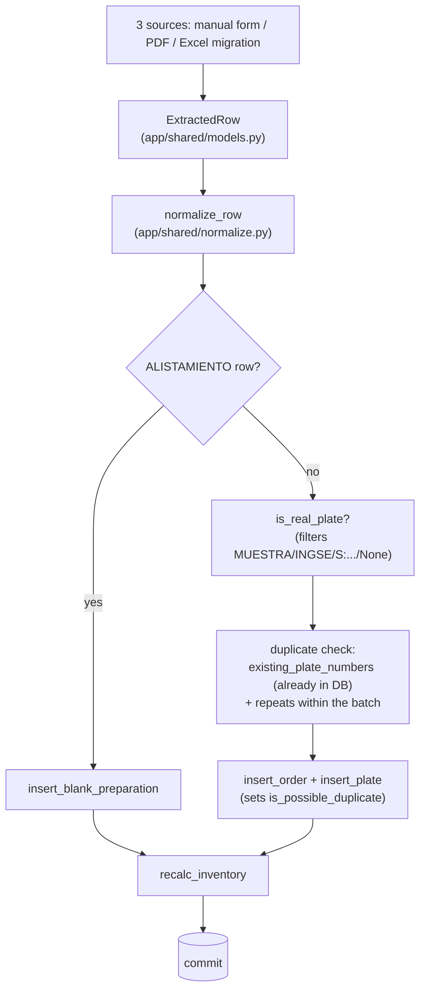

# Core (`app/core/`)

[← back to the index](README.md)

Business logic independent of the web framework — shared between
`app/web` and the historical Excel migration (`app/migrate.py`). No SQL
query or business rule should live outside this folder.

This page also covers `app/shared/`: code every domain needs and that
depends on no domain package — the connection pool (`app/shared/db.py`),
`models.py`, `normalize.py`, `timezones.py` and `uploads.py`. Those modules
live there, not in `app/core/`.

It also covers the rules and SQL of `app/auth/` (the auth domain): the
permission catalog (`app/auth/permissions.py`), the users and roles admin
rules (`app/auth/service.py`) and the `users`/`roles` SQL
(`app/auth/repository/`). Its login, session check and routes are in
[`WEB.md`](WEB.md).

It also covers the SQL of the customers, pricing and inventory domains
(`app/customers/repository/`, `app/pricing/repository.py`,
`app/inventory/repository.py`), and the rules and SQL of the production
domain (`app/production/service.py`, `app/production/repository.py`) and
the cash summary domain (`app/cash_summary/service.py`); their routes are in
[`WEB.md`](WEB.md).

It also covers the orders domain, `app/orders/`: the ingestion pipeline
(`app/orders/service.py`), the pedido parsers (`app/orders/pdf_extract.py`,
`app/orders/xlsx_extract.py`, `app/orders/pedido_upload.py`) and the
`production_orders`/`plates` SQL (`app/orders/repository/`, a package with
`orders.py` and `plates.py`). Its routes (`app/orders/routes/`: `ingest.py`,
`records.py`, `review.py`) are in [`WEB.md`](WEB.md).

## Full ingestion pipeline

The whole pipeline runs in **a single transaction** per call: the
caller opens `with db.get_conn() as conn:` and passes it explicitly to
`service.process_rows(conn, rows)` / `replace_order(conn, ...)` — a
failure midway rolls back both the inserts and any deletes (in the case of
`replace_order`, see below). Before Phase 1d each of those functions opened
its own connection separately (a single `POST /ingest` ran in several
transactions that were not atomic with respect to each other); see the
"Transaction contract" note below.

## `models.py` (`app/shared/models.py`)

Pydantic schema for one ledger/order line, shared as-is by every ingestion
entry point so that `app/orders/service.py` only has to handle one data shape.

- **`ExtractedRow`** — `order_number` (str, not int: there are values like
  `"NT 895"`), `order_date`, `requested_by`, `plate_type`, `city`,
  `plate_number` (raw RANGO cell), `plate_to`, `quantity` (default 1),
  `material`, `prepared_by`, and three flags that default to `False` and
  are normally inferred later in `normalize_row`. **POS fields (Phase
  2)**, all optional with default `None` (so `app/migrate.py`, which never
  fills them, stays untouched): at order level —
  `receipt_type`/`receipt_number`/`payment_method`/`tracking_number`/
  `client_order_number`/`delivery_date`/`payment_date`/`dispatched_by`/
  `received_by`/`notes`; at line/plate level — `reason`/
  `vehicle_brand`/`unit_price`. `delivery_date`/`payment_date` have a
  `mode="before"` validator that maps `""` → `None` (an empty `<input
  type="date">` posts `""`, which pydantic would reject as is) —
  in addition to the existing `_blank_to_none` for the rest.
- **`Extraction`** — `{rows: list[ExtractedRow]}`. It is the shape that an
  image extraction step would return (mentioned in the docstring as
  "Claude reads the order image") — **today it is not wired to any real
  route**, only the tests use it. A documented but unimplemented
  integration point, not an active feature.

The validators only do defensive coercion (floats like `598.0` →
`"598"`, empty strings → `None`) — the real business normalization lives
in `normalize.py`.

## `normalize.py` (`app/shared/normalize.py`)

Pure normalization, no database access — testable in isolation.

| Function/constant | What it does |
|---|---|
| `normalize_requested_by(value)` | Cleans case/whitespace and maps ~40 hand-curated spelling variants to a canonical name; never merges genuinely distinct entities. |
| `PLATE_TYPES` | The 7 canonical plate types. |
| `INVENTORY_CATEGORIES` | The 3 inventory categories: `CARRO PARTICULAR`, `MOTO PARTICULAR`, `PÚBLICO`. |
| `inventory_category(plate_type)` | Maps a plate type to its inventory material (`ORNAMENTAL` → `None`, consumes no material). |
| `normalize_plate_type(value)` | Canonicalizes free-form labels, including the historical mapping `MOTO PÚBLICO` → `MOTO CARRO PÚBLICO`. |
| `clean_plate(value)` | Uppercase + strip (`"arn 911"` → `"ARN911"`). |
| `validate_plate(value, plate_type)` | Validates against the type's regex pattern; raises `ValueError` with a Spanish message. Only used in manual entry, not in historical migration data. |
| `normalize_city(value)` | Uppercase/single spaces; `None` for punctuation garbage. |
| `is_real_plate(plate_number)` | `TypeGuard[str]` — `False` for `None` and non-identifier markers (`MUESTRA`, `INGSE`, `KWP`, `S/...` notes). It is the filter that decides what enters duplicate detection. |
| `annulment_kind(*folded_texts)` | Classifies annulment text found in SOLICITADO/RANGO/CIUDAD as `"order"` (not consumed), `"plate"` (consumed but lost) or `"bare"`/`None`. |
| `normalize_row(row)` | Main entry point — normalizes text and infers the 3 flags from the RANGO token (`REPOSICION` → `is_batch_replacement=True` + `plate_number=None`) and from the result of `annulment_kind`; never turns off a flag that already came in as `True`. |
| `RECEIPT_TYPES`/`CUSTOMER_TYPES`/`DOCUMENT_TYPES`/`DOCUMENT_RELATIONS`/`PAYMENT_METHODS`/`REASONS` | Fixed vocabularies of Phase 2 (POS) — constant names in English, *values* in Spanish (`FACTURA`/`CLIENTE`/`CÉDULA`/`DUEÑO`/`EFECTIVO`/`DETERIORO`, etc.), each one a `<select>` in `/ingest`. `CUSTOMER_TYPES` = `TRÁNSITO`/`EMPRESA`/`GESTOR`/`CLIENTE` (`CLIENTE` is the former `PERSONA NATURAL`; `OTROS` no longer exists) and `DOCUMENT_TYPES` = `NIT`/`CÉDULA`/`CÉDULA DE EXTRANJERÍA`/`OTROS`. |
| `normalize_choice(value, allowed)` | Generic helper behind the 6 vocabularies above: empty → `None`; if it matches `allowed` (comparing folded, accent-insensitive) it returns the canonical entry; if it does not match, `None` — **it never invents a value**, same spirit as `is_real_plate`/`pdf_extract`. An unrecognized value is left as a warning so the person picks it from the dropdown. |

**The hardest parts to understand:**

- Annulment is recorded inconsistently in the raw ledger (the word can
  appear in SOLICITADO, RANGO or CIUDAD) — that is why `annulment_kind`
  inspects the three fields together as a single blob, instead of looking
  at one column.
- `is_plate_annulled` vs. `is_voided` encodes a real business distinction:
  **order** annulment = the blank was never spent (does not count against
  inventory); **plate** annulment = the blank was physically spent
  (still counts as consumed, but is flagged as waste). See the full
  comparison table in [`DATABASE.md`](DATABASE.md#the-4-boolean-flags-of-plates--easy-to-confuse).
- The city default is evaluated last and is order-dependent: only
  `CARRO PARTICULAR`/`CARRO PÚBLICO` are really city-specific;
  the rest get `"COLOMBIA"` if left blank — this same step also
  fills in the city of rows whose CIUDAD cell was blanked by the
  "ANULAD" detection just before.
- The `requested_by` curation map is a living record of one-off human
  decisions (there are comments with dates of real data-cleaning
  sessions), not a generic algorithm — several near-duplicates are
  deliberately left unmerged, pending confirmation.

## `pdf_extract.py` (`app/orders/pdf_extract.py`)

Parses INGSE's fixed-format "pedido" (order) PDF into the same
`ExtractedRow` shape the manual form produces, so a person can upload a PDF
instead of typing each plate by hand, and review/correct it before it
reaches `process_rows`.

| Function/class | What it does |
|---|---|
| `PdfExtractError` | Exception with a Spanish message ("this is not a readable order") — never lets a bad PDF bring the app down with a 500. |
| `ParsedLine` | One line of the plate table: `line_type` (`"placa"`/`"rango"`), `plate_type`, `plate_number`, `plate_to`, `quantity`, `city`. |
| `ParsedPedido` | Header (`order_number`, `order_date`, `requested_by`) + `lines`; `.to_rows()` converts to `ExtractedRow`, warning in Spanish which header field is missing if it is incomplete — the plate lines are never held hostage by a bad header. **Phase 4** added 10 more fields, all raw text with no business interpretation (`customer_document_number`, `tracking_number`, `client_order_number`, `delivery_date`, `payment_date`, `dispatched_by`, `customer_phone`, `received_by`, `payment_method`, `notes`) — mapping vocabularies (`normalize_choice`) and deciding what is required is the job of `app/orders/routes/ingest.py::_form_from_pedido`, not of this module. |
| `parse_order_date(value)` | Tries ISO, then numeric day-first (Colombian convention), then Spanish month names; returns `None` instead of guessing. |
| `parse_pedido_pdf(source)` | Main parser: extracts tables from all pages, locates the `ITEM \| PLACA \| ...` header row, reads the fields above (`_find_header_value`), and parses the lines below up to the `TOTAL PEDIDO` row. |
| `extract_rows_from_pdf(source)` | Shortcut: `parse_pedido_pdf(source).to_rows()` for non-interactive callers. The web flow uses `parse_pedido_pdf` directly so it can tolerate a partial header and let the person fill in what is missing. |

### Excel order (`xlsx_extract.py`) and dispatch (`pedido_upload.py`)

The customer can also send the **order Excel** (`.xlsx`, the `FORMATO_PEDIDOS_INGSE_2026_v2/v3` template) as is. The sheet is the same
grid of cells the parser sees in the PDF tables, so **there is no second parser**: `parse_pedido_xlsx` only converts the sheet rows
to text and passes them to `pdf_extract.parse_pedido_rows` (the same label logic and the same `ITEM | PLACA` row logic).

| Function | What it does |
|---|---|
| `parse_pedido_rows(rows)` (in `pdf_extract.py`) | Shared core: finds the header, the header and footer fields, and the lines. `parse_pedido_pdf` = PDF tables + this core. |
| `parse_pedido_xlsx(source)` | Validates that it is a real `.xlsx` (zip with `xl/workbook.xml`, cap of 50 MB uncompressed and 1000 entries: the file comes from outsiders), opens it with `openpyxl` read-only (`data_only`, max. 500 rows × 40 columns) and uses the first sheet that has the plate table (ignores auxiliary sheets such as the template v3's hidden `LISTAS`). Dates → ISO, `1117521679.0` → `"1117521679"`. |
| `parse_uploaded_pedido(data)` | Single entry point for the routes: decides by content (`%PDF` → PDF; `PK` zip → xlsx; old `.xls` → "save it as .xlsx"; anything else → error). Always `PdfExtractError` with a Spanish message. |

**The hardest parts to understand:**

- **Why `extract_tables()` and never `extract_text()`**: a decision
  documented and enforced by a comment in the code. `extract_text()`
  walks the raw character stream and was observed to mix up
  static labels character by character in a real document;
  `extract_tables()` rebuilds cells from the PDF's line geometry
  and is immune to that. **Never revert this decision.**
- **Real order number vs. decoy field**: the production order is
  labeled `ORDEN DE PRODUCCION` in the current templates or `NT` in the
  old ones; `PEDIDO #` is a customer-facing claim number,
  **deliberately excluded** from that list. `_find_header_value` compares
  exact labels (not by substring) precisely so that `FECHA PEDIDO`
  does not accidentally match `PEDIDO #`.

  This was not just theoretical: in production an order literally
  numbered `"PEDIDO #"` showed up because a PDF row had that label without a
  colon, packed in the same row as the real order value — the internal
  scan mistook it for the value it was looking for. The fix added a
  constant `_LABEL_PEDIDO_HASH_BARE` so the scan recognizes that
  "bare" label (without `:`) and treats it as a boundary, not as a value.
- Column positions are read dynamically from the document's own header
  row, not hardcoded by index — so a template change that moves/inserts
  columns keeps working.
- A row counts as a plate line only if it carries a plate value or a
  range-start value (`_parse_lines`) — this single rule handles both
  pre-printed blank rows (skipped, even if they have an ITEM number) and
  rows with a plate but no ITEM (kept). The parser is explicitly
  "faithful, not smart": it never validates plate formats or business
  rules, that is the job of `normalize.py` and of the human reviewing.
- **The page footer (Phase 4)**: six new labels (`RESPONSABLE
  DESPACHO (INGSE SAS):`, `TELÉFONO:`, `NOMBRE QUIEN RECIBE EL PEDIDO:`,
  `FORMA DE PAGO:`, `OBSERVACIONES:`) are physically BELOW the
  `TOTAL PEDIDO` row, invisible to `header_rows`. `parse_pedido_pdf` adds
  a second slice, `footer_rows` (from the `TOTAL PEDIDO` row
  onward), and calls `_find_header_value` against that slice too —
  the function itself **was not touched**, the `_LABEL_PEDIDO_HASH_BARE` guard
  still applies for free. The labels remain exact text, never
  abbreviated. `PEDIDO #:` (with a colon, in the header's declarative
  table) deliberately uses the same folded text as
  `_LABEL_PEDIDO_HASH_BARE` (the guard for the bare `PEDIDO #` without a colon)
  — they are distinct cases that `_split_label` tells apart safely
  because one has `:` and the other does not; keeping them as a single constant
  prevents the two concepts from drifting out of sync.
- **NIT / CÉDULA may legitimately come back as `""`** when the value cell
  falls in a different row than the label (a merged-cell artifact) —
  the "same row only" scan of `_find_header_value`
  already handles it that way; **never** add a "look at the next row"
  heuristic, it risks pulling in the value of another field.
- **The money fields of the PDF are ignored on purpose**: the header's `VALOR:`,
  the lines' `VALOR PLACA`/`VALOR TOTAL`, and the footer's `TOTAL PEDIDO:`
  (its row still marks the end of the plate table and now also
  the start of the footer block, but its *value* is not read) — `unit_price`
  always comes from the current rate (`plate_type_prices`), never from the PDF.

## `service.py` (`app/orders/service.py`)

Formerly `ingestion.py` in `app/core/` (and before Phase 1d, `process.py`).

The single ingestion backend that all entry points converge on. Given a
batch of `ExtractedRow`: normalizes, detects duplicates, groups by order,
inserts, recalculates inventory — all in one transaction.

**Takes `conn` as an explicit first parameter** in its three public
functions (`process_rows(conn, rows)`, `replace_order(conn, order_number,
rows)`, `find_duplicate_plate_numbers(conn, rows)`) and never commits or
rolls back — the same contract followed by every repository (see
below). Before Phase 1d each one opened its own `db.get_conn()`
internally, so a single `POST /ingest` ran in 3-4 separate
transactions (the duplicate check and the insert it is supposed to protect
were not atomic with respect to each other); the caller (the Flask route) now opens **a
single** `with db.get_conn() as conn:` that wraps the check and the insert
together. See the atomicity test in `tests/core/test_ingestion.py` (an
exception midway through `process_rows` rolls back the entire batch) for the
concrete case this closes.

- **`Summary`** — counts returned to the caller: `orders_inserted`,
  `plates_inserted`, `blank_preparations`, `possible_duplicates`,
  `voided`, `plate_annulled`, `batch_replacements`, `review_notes`, plus
  `orders_replaced`/`plates_deleted`, which only `replace_order` sets (never
  `process_rows`, which never deletes anything).
- **`find_duplicate_plate_numbers(conn, rows)`** — read-only dry run:
  returns the set of plate numbers that *would* be flagged as possible
  duplicates if inserted now. Used by the `/ingest` form to warn before
  saving, in the same transaction as the actual save.
- **`process_rows(conn, rows, created_by=None) -> Summary`** — normalizes
  each row → separates ALISTAMIENTO from real plates → counts repeats
  within the batch → inserts each preparation row (mapping
  `plate_type` to material via `normalize.inventory_category()` — before
  Phase 2 it passed `plate_type` directly as `category`, a real bug,
  dead code in practice because the real `/inventory/alistado` flow
  did not go through here, fixed while at it), computes which plates already exist
  live, takes a single snapshot of `pricing_repository.current_prices(conn)` for the whole
  batch, groups the plates by `order_number` (resolves/creates the group's
  customer via `customers_repository.resolve_or_create_customer` and does one
  `insert_order` per group, using the group's *head* row), inserts
  each plate (applying the price snapshot as a fallback only if the
  row does not already carry its own `unit_price`) setting `is_possible_duplicate`
  → `recalc_inventory`. It does not commit: the `with db.get_conn()` of
  the caller does that on clean exit. `created_by` (Phase 2, optional) is the
  `users.id` of whoever saved, going to `production_orders.created_by`.
  **It generalizes to `_ORDER_LEVEL_FIELDS`** (10 fields: `requested_by` +
  the 9 POS order columns, excluding `reason`/`vehicle_brand`/
  `unit_price`, which are genuinely per line) the "do all
  rows of the group agree?" check that previously existed only for
  `requested_by` — any disagreement within the same `order_number` generates a
  `review_notes` per field.
- **`replace_order(conn, order_number, rows, created_by=None) -> Summary`**
  — explicit, opt-in action ("Reemplazar" button in `/ingest`): deletes
  **all** existing orders matching `order_number` (there can be
  2+, there is no `UNIQUE`) along with their plates, and then inserts a
  single new order from `rows`. It requires all `rows`
  to share the same `order_number` (otherwise `ValueError`) and at
  least one row. **The new plates take the rate in effect AT THE TIME
  OF THE REPLACEMENT**, not the one in effect on the order's original date —
  documented, not a bug (the `confirm()` text of "Reemplazar" in
  `ingest.html` also warns about this).
- **`is_alistado(row)`** (public since Phase 1d, formerly the private
  `_is_alistado` — `app/migrate.py` imports it across the module boundary) —
  detects an ALISTAMIENTO row by looking at both `requested_by` and
  `prepared_by`.
- The `is_real_plate(...) and not is_voided` filter and the per-row counting
  block were duplicated 8-9 times between `process_rows`/
  `replace_order` (and a ninth, divergent copy, directly in
  `app/web/app.py`, which violated this very file's rule of having no
  business logic outside `core/`) — factored into the private helpers
  `_dedup_candidates(rows)` and `_count_row(summary, row, is_dup)`,
  used by both functions; the web route now goes through here too.

**The hardest parts to understand:**

- `replace_order` exists to fix a class of real bug: a replacement
  row has no plate identity to compare against, so
  if its real numbers are recovered later (e.g. by re-uploading the original
  PDF) and simply reprocessed with `process_rows`, a **second**
  order is silently created under the same `order_number` instead of being
  detected as a duplicate. This really happened — real case
  `WCY449`/order 1030, documented in
  `data/duplicados_revision_2026-08-15.md` — and it is exactly the gap that
  `replace_order` closes.
- Duplicate detection is **by plate number only**, computed
  independently in `process_rows` and in `replace_order`: already-present-
  in-DB (`existing_plate_numbers`) OR repeated-within-the-batch, and it only
  applies to rows where `is_real_plate(...)` is true and `is_voided` is
  false. A replacement (with no `plate_number`) can by design never be
  flagged as a duplicate — hence the need for `replace_order` as a separate
  mechanism based on `order_number`, not on `plate_number`.
- `process_rows` can insert several orders in a single call (it groups
  a multi-order batch); `replace_order` is deliberately limited to
  a single `order_number` and cannot span several orders.

## `db/` (package — formerly a single flat `db.py`, split in Phase 1d)

The raw SQL (psycopg 3, no ORM) for `declarations`/`declaration_cards`; the
rest of the old 556-line file moved to the domain packages:

| Module | What it contains |
|---|---|
| `db/__init__.py` | `get_conn()` re-exported from `app/shared/db.py` (see pool below) + explicit re-export of every public function of all the submodules — `db.get_declaration(...)` etc. are still called exactly the same from outside the package. The orders, plates, customers, ownership cards, pricing, inventory and production-status SQL moved to their domain packages (see the table below) and is no longer re-exported here. |
| `db/declarations.py` (Phase 3 declarations) | Read/write of `declarations` and `declaration_cards` — see details below. |

The SQL for `users`, `user_roles`, `roles`, `role_permissions` and
`permissions` lives in the auth domain, `app/auth/repository/` (`users.py`
and `roles.py`, re-exported by its `__init__.py`), and is called as
`repository.<function>(conn, ...)`; see the `app/auth/` sections below.

The SQL for `production_orders`, `plates`, `customers`, `ownership_cards`, `plate_type_prices`,
`blank_preparations`, `inventory_categories`,
`production_orders.production_status` and `production_order_events` lives in
the orders, customers, pricing, inventory and production domains (`app/orders/`,
`app/customers/`, `app/pricing/`, `app/inventory/`, `app/production/`, each
with its routes). Code outside a domain calls it through the module, as
`orders_repository.<function>(conn, ...)`, `customers_repository.<function>(conn, ...)`,
`pricing_repository.<function>(...)`, `inventory_repository.<function>(...)`
and `production_repository.<function>(...)`; a domain's own `routes.py` and
`service.py` call `repository.<function>(...)`.
`app/orders/repository/` (`orders.py` and `plates.py`) and
`app/customers/repository/` (`customers.py` and `ownership_cards.py`) are
packages, each re-exported by its `__init__.py`.

| Module | What it contains |
|---|---|
| `app/orders/repository/orders.py` | CRUD of `production_orders` + `OrderSummary` (typed dataclass, `class_row`) — the row shape shared by `recent_orders`/`find_orders_by_number`/`search_orders_by_number`. |
| `app/orders/repository/plates.py` | CRUD of `plates`, including `distinct_cities` (grouped here for symmetry with `distinct_requested_by` in `orders.py`, although both read `plates`). |
| `app/customers/repository/customers.py` (Phase 2) | CRUD of `customers` — see details below. |
| `app/customers/repository/ownership_cards.py` (Phase 2 declarations) | CRUD of `ownership_cards` (ownership card) and `find_card_conflicts` — see details below. |
| `app/pricing/repository.py` (Phase 2) | CRUD of `plate_type_prices` — see details below. |
| `app/inventory/repository.py` | `blank_preparations`/`inventory_categories`: `insert_blank_preparation`, `recalc_inventory`, `inventory_view`, `ornamental_count`. |
| `app/production/repository.py` | `production_orders.production_status`/`production_order_events` — see details below. |

Connection config from environment variables (`DB_HOST` default `"db"` —
**never use that default in Docker Compose**, see
[`ARCHITECTURE.md`](ARCHITECTURE.md)) plus `DB_POOL_MIN_SIZE`/
`DB_POOL_MAX_SIZE` (default `1`/`5`, see "Connection pool" below).
Every connection is opened with `row_factory=dict_row` — every row returned by
a query is a dict by column name, never a positional tuple.

**Transaction contract**: every function here receives an already
open connection (`conn`) and **never commits or rolls back** — the caller is
always the owner of the transaction (`with db.get_conn() as conn: ...`).
This is deliberate (Phase 1d): passing `conn` explicitly instead of hiding it
behind an interface keeps visible in the signature who controls the
commit, which is precisely the point that a real bug (several functions of
`app/orders/service.py` (then `ingestion.py`) each opening its own connection, see below) brought
to light.

**Connection pool (Phase 1d)**: the pool lives in `app/shared/db.py`
(`_conninfo_kwargs`, `_get_pool`, `get_conn`) and `app/core/db/__init__.py`
re-exports `get_conn`, so call sites keep using `db.get_conn()`.
`get_conn()` no longer opens a new socket
on every call — it is a `@contextmanager` that wraps a
`psycopg_pool.ConnectionPool`, built lazily (only on the
first real call, never on module import, because
`tests/conftest.py` imports it even without `POSTGRES_PASSWORD`
set). `with db.get_conn() as conn:` behaves exactly as
before at the ~21 existing call sites (commit on clean exit, rollback
on exception) — except that it now reuses a connection from the pool instead of opening
a new one. Gunicorn runs without `--preload`, so each worker builds its
own pool on its first request (if `--preload` is ever added, that
reasoning breaks and the pool construction must move to a
`post_fork` hook).

**Writes — orders/plates** (`app/orders/repository/`)

| Function | What it does |
|---|---|
| `insert_order(conn, *, row, customer_id, created_by)` | Inserts `production_orders` from the full `ExtractedRow` (Phase 2 — like `insert_plate`, instead of listing each POS field as a loose kwarg) + `customer_id`/`created_by`, both required (no default) so every caller chooses explicitly. `row.plate_type`/etc. are ignored (irrelevant for the header). |
| `update_order(conn, order_id, *, ..., customer_id=_UNSET, receipt_type=None, ...)` | Edits the header + the 10 POS fields. `customer_id` uses a private sentinel `_UNSET` (not `None`) as default — passing it explicitly (an int, or `None` to really clear it) changes it; omitting it leaves it untouched. This is deliberate: if the default meant "set `NULL`", any Registro save that does not yet resolve a customer would wipe it by accident. |
| `delete_order` | Deletes plates first (there is no `ON DELETE CASCADE` on the FK), then the order. |
| `insert_plate` | Inserts a plate with its `is_possible_duplicate` flag (+ `unit_price`/`reason`/`vehicle_brand`, Phase 2/3). It also sets `ownership_card_id`: it does not come from the row, it is computed from the order's customer type (`customers_repository.card_id_for_order_plate`, see `resolve_card_id_for_plate`). |
| `update_plate(plate_id, ..., plate_type)` | Narrow edit used by the duplicate review queue — always clears `is_possible_duplicate` (editing = reviewed). Applies the `unit_price` re-snapshot rule (see below), because it also allows changing `plate_type`. Recomputes `ownership_card_id` (cleared if the plate becomes annulled). |
| `update_plate_full(plate_id, ..., plate_type, reason=None, vehicle_brand=None)` | Full edit from the Registro detail. **`is_batch_replacement` must be passed explicitly** — this way, correcting the `plate_number` of a replacement can also turn that flag off (a bug already fixed: before, it stayed marked as a replacement forever). `unit_price` is **not a parameter** — the re-snapshot rule below is the only path that sets it, never a direct caller. |
| `resolve_plate` | Only clears `is_possible_duplicate` ("not a duplicate", the reviewer's action). |
| `delete_plate` | Deletes the plate; if that leaves exactly **one** other row flagged with the same `plate_number`, it also clears its flag (there is nothing left to compare it with); if 2+ remain, it leaves them (still ambiguous). |

**`unit_price` re-snapshot rule** (Phase 2, `app/orders/repository/plates.py::_resnapshot_unit_price`, shared by `update_plate`/`update_plate_full`): reads the plate's current `plate_type`/`unit_price` in the same cursor, before the `UPDATE` —
if the `plate_type` **does not change**, the old `unit_price` is kept as is (regardless of whether `quantity` changes); if the `plate_type` **does change**, it takes `pricing_repository.current_prices(conn).get(new_type)` again (it can end up `None` if that type has no configured rate — never a silent `0`). New plate (`/ingest`, PDF, "+ agregar placa"): `app/orders/service.py::_snapshot_unit_price` applies the same principle but as a fallback — only if the row does not already carry its own `unit_price` (the `/ingest` form always sends one, pre-filled by JS but editable).

**Writes — inventory** (`app/inventory/repository.py`)

| Function | What it does |
|---|---|
| `insert_blank_preparation` | Records an ALISTAMIENTO event. |
| `recalc_inventory(conn)` | Recomputes `prepared` (sum of `blank_preparations` per category) and `consumed` (sum of non-annulled plates, mapped from `plate_type` to material via `inventory_category`) — **explicitly iterates over the fixed list of categories**, not only over those returned by the `GROUP BY`, so that a category that ran out of live plates also has its `consumed` set to 0 instead of keeping the last value (a real bug, already fixed). |

**Reads (selection — see the file for the full list)**

| Function | What it does |
|---|---|
| `existing_plate_numbers` | Subset of candidate numbers already live (`is_voided=false`) — base primitive of duplicate detection. |
| `find_orders_for_plate` | Live orders that already used a given plate number. |
| `inventory_view` | `prepared`, `consumed`, `available = prepared - consumed` (**does not add `initial_stock`**, see [`DATABASE.md`](DATABASE.md#initial_stock-is-a-dead-column)) and `wasted` (recomputed live from `is_plate_annulled`). |
| `recent_orders(limit=50)` | Ordered by `order_date DESC`, not by `created_at` — deliberate, so that a correction to an old order does not bury today's real activity. |
| `find_orders_by_number(order_number)` | **Exact** match (not `ILIKE`), no limit — can return 0/1/2+ rows. Consumed directly by `replace_order`. |
| `search_plates_by_number` / `search_orders_by_number` | Partial search (`ILIKE`) across the whole database, not only in the `recent_orders` window. |
| `order_detail(conn, order_id)` | `(order, plates)` — the order comes with a `LEFT JOIN customers` (`customer_*` columns, `LEFT` because `customer_id` is nullable) to bring the attributes of the resolved customer in a single round trip; the plates include `unit_price`/`reason`/`vehicle_brand` (Phase 2/3). |
| `review_rows` | Queue of plates with `is_possible_duplicate = true`. |

### `app/customers/repository/customers.py` (Phase 2)

| Function | What it does |
|---|---|
| `resolve_or_create_customer(conn, name, *, type=None, document_type=None, ...)` | Looks up by canonical `name` (`normalize_requested_by`); if it exists, `ON CONFLICT (name) DO UPDATE SET name = EXCLUDED.name, type = COALESCE(customers.type, EXCLUDED.type), ...` for each attribute — it never overwrites an attribute the customer ALREADY has, but it does fill in any that is still NULL (so the customers from the historical backfill, all with NULL attributes, fill themselves in through normal use instead of staying blank forever). The attributes of a genuinely new customer are written in the INSERT branch as usual. `app/orders/service.py` (`process_rows`/`replace_order`) and `record_save` call this function with the name only (everything `None`), so for them `COALESCE(existing, NULL) = existing` — a no-op, same as before; `app/orders/routes/ingest.py` calls it with the attributes typed in the "cliente" fieldset. The attributes are `type`/`document_type`/`document_number`/`document_relation`/`phone`/`email` plus the person data `address`/`neighborhood`/`municipality` (also with `COALESCE`: never overwritten). |
| `get_customer(conn, customer_id)` / `get_customer_by_name(conn, name)` | Point lookups. |
| `list_customers(conn)` | All customers, alphabetical — embedded whole as JSON in `ingest.html` (Phase 3) so the JS auto-fills the customer fieldset when a typed name matches, same pattern as `distinct_requested_by`/`distinct_cities` (this app has no AJAX endpoints); also used by the `/customers` list (Phase 6). |
| `update_customer(conn, customer_id, *, name, type, document_type, ...)` | REAL overwrite, no `COALESCE` — unlike `resolve_or_create_customer`, this one does replace (or delete, if `None` is passed) an attribute the customer already had. It is the only function that can do so (including `address`/`neighborhood`/`municipality`; `transit_license` no longer exists in `customers`); it is used exclusively by `/customers` (Phase 6), the admin screen for manually correcting a mistyped value or completing one of the 191 customers from the historical backfill. No uniqueness pre-check on `name` — a rename that collides with another existing customer raises `psycopg.errors.UniqueViolation`, which the web route catches to show an error in Spanish instead of a 500. |

### `app/customers/repository/ownership_cards.py` (Phase 2 declarations)

Normalizes inputs inside the layer: license with `strip` + uppercase,
plate with `normalize.clean_plate`, free text with `strip` (empty →
`None`). It does not pre-check uniqueness: `UniqueViolation`/`ForeignKeyViolation`
propagate as is (the DB is the source of truth). See
[`DATABASE.md`](DATABASE.md) for the columns and the conflict states.

| Function | What it does |
|---|---|
| `create_ownership_card(conn, customer_id, *, transit_license, plate_number, engine_number=None, chassis_number=None, vehicle_type=None, registered_in=None, vehicle_brand=None)` | Inserts a card and returns its `id`. |
| `get_ownership_card(conn, card_id)` | `OwnershipCardRecord` or `None`. |
| `get_ownership_card_by_transit_license(conn, transit_license)` / `get_ownership_card_by_plate_number(conn, plate_number)` | Exact lookup by the normalized form; `OwnershipCardRecord` or `None`. |
| `list_ownership_cards_for_customer(conn, customer_id)` | A customer's cards, ordered by `id`. |
| `reassign_ownership_card(conn, card_id, new_customer_id)` | Changes the card's owner (simple `UPDATE`; admin action of the review flow). |
| `resolve_card_id_for_plate(conn, plate_number, customer_type, *, plate_to=None, is_voided=False, is_plate_annulled=False, is_batch_replacement=False)` | Read-only. Returns the `id` of the card a manufactured plate must be linked to (`plates.ownership_card_id`) or `None`. Never links if the customer is `EMPRESA`/`TRÁNSITO` (`CARD_LINK_EXCLUDED_CUSTOMER_TYPES`), if it is a range, replacement, annulled or has no real plate; with a `NULL` type it does try. Compares with `clean_plate(plate_number)`. |
| `card_id_for_order_plate(cur, *, order_id, plate_number, plate_to, is_voided, is_plate_annulled, is_batch_replacement)` | Read-only, on the caller's cursor. Looks up the customer type of the plate's order and delegates to `resolve_card_id_for_plate`. Used by `insert_plate`, `update_plate`, `update_plate_full` and `relink_plates`. |
| `relink_plates(conn, *, order_id=None, customer_id=None)` | Recomputes `plates.ownership_card_id` for all plates of an order or of all orders of a customer (exactly one parameter). Called by `update_order` (if `customer_id` is passed) and `update_customer` (`customers.py`), because changing the customer or their type changes which plates can have a card. |
| `find_card_conflicts(conn, *, customer_id, transit_license, plate_number)` | Read-only. Returns `CardLookup(by_transit_license, by_plate_number, status)` with `status` in `new` / `same_card` / `other_owner` / `data_mismatch` (`CARD_STATUS_*` constants). The pure decision is in `classify_card_lookup`. |

`card_id_for_order_plate` and `relink_plates` read and write the orders
domain's `production_orders` and `plates` tables, but they live here so the
dependency only points `app.orders` → `app.customers`: `update_customer` has
to relink a customer's plates, and importing `app.orders` from
`app.customers` would make a cycle. A `TODO(phase 4)` marks them.

### `db/declarations.py` (Phase 3 declarations)

Data layer only; the decision rules are in `app/core/declarations.py`
(below). A declaration has one declarant and several ownership cards
(`declaration_cards`). Columns, states and alerts: [`DATABASE.md`](DATABASE.md).
Constants: `STATUS_PENDING_REVIEW` / `STATUS_APPROVED` / `STATUS_REJECTED` and
`FLAG_PLATE_MADE_RECENTLY` / `FLAG_CARD_OTHER_OWNER` / `FLAG_CARD_DATA_MISMATCH` /
`FLAG_CUSTOMER_TYPE_MISMATCH`, `FLAG_CUSTOMER_DOCUMENT_MISMATCH`. Records:
`DeclarationRecord` (row of `declarations`) and `DeclarationCardRecord` (row of
`declaration_cards`).

| Function | What it does |
|---|---|
| `insert_declaration(conn, *, acting_as, status, submitted_data, review_flags=None, gestor_id=None, declarant_signature_path=None, notarized_pdf_path=None, submitter_ip=None, user_agent=None, accepted_terms_at=None, declarant_id_front_path=None, declarant_id_back_path=None, accepted_data_policy_at=None, accepts_marketing=None)` | Inserts the header and returns the `id`. |
| `insert_declaration_card(conn, declaration_id, *, position, reason, plate_quantity, plate_number, transit_license, owner_data, engine_number=None, ..., owner_relation=None, review_flags=None, customer_id=None, ownership_card_id=None)` | Inserts a card of the declaration and returns the `id`. |
| `get_declaration(conn, declaration_id)` | `DeclarationRecord` or `None`. |
| `list_declaration_cards(conn, declaration_id)` | The cards of a declaration, ordered by `position`. |
| `list_cards_for_declarations(conn, declaration_ids)` | The cards of several declarations in a single query: `{declaration_id: [DeclarationCardRecord, ...]}` (for list screens, no N+1). |
| `list_declarations(conn, *, status=None, query=None)` | `pending_review` first, then the newest. `query` searches (case-insensitive, with `%`/`_`/`\` literal) the declarant's name and document (and the linked gestor's) and, in **any** of the cards, plate, license, declared owner's name and document, and the linked customers/cards. |
| `count_recent_by_ip(conn, ip, *, since)` | Declarations from that IP with `created_at >= since` (the form's per-IP limit). |
| `set_declaration_review(conn, declaration_id, *, status, reviewed_by, note=None, gestor_id=None)` | Records the decision (`reviewed_at = now()`) and the `gestor_id`. It does not validate the previous state. |
| `set_declaration_card_links(conn, declaration_card_id, *, customer_id, ownership_card_id)` | Links a card of the declaration to the owner and the ownership card created/linked on approval. |
| `set_declaration_production_order(conn, declaration_id, production_order_id)` | Marks the declaration as served by an order (or `None` to clear it). It does not check the state: the caller does (`/ingest`). |
| `list_declarations_by_production_order(conn, order_id)` | The declarations served by that order (`production_order_id`), ordered by `id`; `[]` if it has none. |

`app/orders/repository/plates.py` adds `last_fabrication_date(conn, plate_number)`: read-only,
the most recent `order_date` of a plate with that exact number, **ignoring**
`is_voided` or `is_plate_annulled` plates; `None` if it was never manufactured.

### `declarations.py` (Phase 3 declarations)

Business logic without Flask; receives `conn` and never commits/rolls back.

Input model: `DeclarationInput(acting_as, declarant: PersonInput, cards:
list[OwnershipCardInput], signature_file, ...)`, which also carries
`accepted_data_policy: bool = False` and `accepts_marketing: bool | None = None`
(authorization for personal data processing under Law 1581 and YES/NO to
commercial information; `submit_declaration` stores `accepted_data_policy_at` and
`accepts_marketing`). The legal text of that authorization lives **only once**
in constants of this module (`DATA_POLICY_TITLE`, `DATA_POLICY_PARAGRAPH_1`,
`DATA_POLICY_PARAGRAPH_2` and `_PARTS`, `DATA_POLICY_EMAIL`, `DATA_POLICY_URL`,
`MARKETING_STATEMENT`, `MARKETING_LINE`), which the form and the PDF read;
`parse_marketing_choice` converts the form's `SI`/`NO` into `True`/`False` and
everything else into `None`. There is **a
single declarant** (the owner/holder themself, or a gestor) and **a single
signature**, which covers all the cards. **No PDF is uploaded with the
declaration**: for a loss, staff hand over the declaration as a PDF,
the customer has it authenticated at a notary office and brings it back (a flow outside the
form), so no reason requires a file. Each `OwnershipCardInput` carries its
card fields, its `reason` (`DETERIORO` / `PÉRDIDA`), its `plate_quantity`
(1..`normalize.max_plates_per_card`: 2 for cars, 1 for the rest; the total is
derived by summing) and, only if the declarant is `GESTOR`, its own `owner`
(`PersonInput`) and `owner_relation` (`DUEÑO` / `POSEEDOR`). If the declarant is
the owner or holder, all the cards are theirs. Maximum `MAX_CARDS` = 30
cards per declaration.

| Function | What it does |
|---|---|
| `validate_declaration(inp)` | List of errors in Spanish (empty = valid): declarant (the name, of declarant or owner, cannot contain digits, same as "Solicitado por" in `/ingest`), single signature, terms, authorization for personal data processing («Debe autorizar el tratamiento de datos personales.») and YES/NO answer to commercial information («Indique si autoriza el envío de información comercial.») always; 1..`MAX_CARDS` cards; per card (prefixed with `Tarjeta N: `): required fields (including «Matriculado en» and the front/back photos of the card and that of the plate(s) used, whether the reason is `DETERIORO` or `PÉRDIDA`, unless the card carries `plates_lost` («Perdí mis placas»); at declaration level, those of the ID document), vocabulary with `normalize_choice`, plate with `validate_plate`, plate quantity within the type's range, owner and relation if gestor; plate or license repeated within the submission. A loss does not require any additional file (notary authentication happens outside). |
| `submit_declaration(conn, inp, *, today=None)` | Computes the alerts of each card, stores the declaration **always** as `pending_review` (with or without alerts) and **creates nothing** (no customers, no gestor, no ownership cards). Returns `SubmitResult(declaration_id, status, flags)`. `today` defaults to the Bogotá date. |
| `approve_declaration(conn, id, reviewer_user_id, *, reassign_card_ids=(), note=None)` | Only from `pending_review` (the point of sale reviews it). This is where the gestor (if any) and, for **each** card, its owner and its ownership card are created/linked; it works the same with or without alerts. `reassign_card_ids` are ids of `declaration_cards` whose existing card belongs to another customer and can be moved. An existing customer with `NULL` type is switched to the expected type; with another type, `ValueError`. A card of another owner not in `reassign_card_ids`: `ValueError`; license/plate that do not match: always `ValueError`. A conflict that appeared **after** submission (the declaration was saved without alerts) is detected here: a clear `ValueError` and nothing changes. Everything is verified **before** writing (all or nothing); the messages name the card and its plate. |
| `reject_declaration(conn, id, reviewer_user_id, note)` | Marks `rejected` (note required); creates nothing. |

Flow: **all declarations arrive as «Por revisar» (pending review)**; the point of sale approves them and only then are the customer and the ownership cards created. The alerts (evaluated **per card**) only tell the reviewer what to look at:

| Situation on submission | Result |
|---|---|
| Any alert (`plate_made_recently`, `card_other_owner`, `card_data_mismatch`, `customer_type_mismatch`, `customer_document_mismatch`) on **any** card | The whole declaration stays `pending_review`; **nothing is created** (no customers, no gestor, no cards); the links stay `NULL`. Each card stores its alerts and `declarations.review_flags` is the union. |
| No alerts | Also `pending_review`, with empty `review_flags`; nothing is created either. **There is no automatic approval.** |
| On approval: new owners + new cards | `approved`; in the same transaction the GESTOR (if any), the CUSTOMERS and the cards are created. |
| On approval: the same owner repeated across several cards (or several declarations) | A **single** customer (identified by canonical name). |
| On approval: existing customer (type `CLIENTE`) with another card | `approved`; the customer is linked without modifying it and the new card is created. |
| On approval: same customer, same license and plate, after 6 months | `approved`; the existing card is linked **without modifying it** (the differing secondary data stays only in `submitted_data`). |
| On approval: existing customer/gestor | They are only linked, never modified. |

`submitted_data` ends up with the canonical shape `{"acting_as", "declarant",
"cards": [{..., "owner", "owner_relation"}], "raw"}` (see
[`DATABASE.md`](DATABASE.md)).

**Privacy:** `SubmitResult.flags` is for staff and logs only. The web layer
must **never** show them to the anonymous person submitting (nor anything about the previous owner or
the manufacturing date); only "Recibimos tu declaración" (We received your declaration).

### `app/auth/repository/users.py` (Phase 2)

Real backend of the login — replaces the `AUTH_USERS`/`AUTH_ROLES` env vars.

| Function | What it does |
|---|---|
| `get_user_by_username(conn, username)` | Used by `app/auth/decorators.py::authenticate` on every login. Returns the row even if `active=False` — it is `authenticate` that decides that an inactive user cannot log in, not this lookup. |
| `get_user_by_id(conn, user_id)` | For `session["user_id"]` → `production_orders.created_by`, and for `current_user()` on every request. |
| `create_user(conn, *, username, password_hash, roles, active=True, assigned_by=None)` | Inserts the user and one `user_roles` row for each distinct role (repeats are ignored). A nonexistent role is rejected by the `user_roles_role_fkey` FK (`ForeignKeyViolation`). |
| `list_users(conn)` | All users, by `id`. |
| `list_users_with_role(conn, role)` | The users (active or not) that have that role, by `id`. |
| `update_user(conn, user_id, *, active)` | Changes only the active state. `False` if the user does not exist. |
| `set_user_roles(conn, user_id, roles, *, assigned_by=None)` | **Replaces** the set of roles: deletes those not in `roles` and inserts the missing ones with `assigned_by`; those that stay keep their `assigned_at`. `False` without writing anything if the user does not exist. |
| `assign_role(conn, user_id, role, *, assigned_by=None)` | Adds a role. `True` if it added the row, `False` if the user already had it. |
| `unassign_role(conn, user_id, role)` | Removes a role. `True` if it deleted the row. |
| `get_user_permissions(conn, user_id)` | The union of the codes stored in `role_permissions` for all the user's roles, in a single query (`frozenset`). It does not apply `effective_permissions`: the caller does (`current_user()`). |
| `set_user_password(conn, user_id, password_hash)` | Replaces the hash (werkzeug format, computed by the caller). `False` if the user does not exist. |
| `count_active_users_with_role(conn, role)` | How many **active** users have that role in `user_roles` — so that a future management screen does not leave the system without any active admin. |

`UserRecord` carries `roles`, the names of the user's roles in alphabetical
order (empty list if none), and `created_at` (default
`None`, so as not to break anyone constructing it by hand). The role write
functions are not yet used by any route: they are for the future
user management screen.

### `app/auth/permissions.py` (permission catalog)

Pure Python, no Flask or database. `PERMISSIONS` is the ordered tuple
of the 13 `(code, label)` pairs: the code is an English identifier
(`orders.capture`, `records.view`, `users.manage`, ...) stored
in `role_permissions.permission`, and the label is the Spanish text
that staff will see. `PERMISSION_CODES` is the `frozenset` of those codes and
`ADMIN_ROLE = "admin"`. The catalog has a mirror in the `permissions`
table (same codes, labels and order; see
[`DATABASE.md`](DATABASE.md)) and a test requires them to be identical: adding a
code requires a new migration and an entry in the tuple.

`effective_permissions(roles, stored)` returns the real permissions of a
user with those roles: if `ADMIN_ROLE` is among them, always all 13
codes (regardless of what is stored, so no admin is left without
access to a new permission); otherwise, the stored codes that still
exist in the catalog (unknown ones are discarded). `stored` is the
union of the `role_permissions` codes of all the user's roles
(`repository.get_user_permissions`). `app/auth/decorators.py` applies it on every request:
each protected route asks for a code with `@permission_required` (see
[`WEB.md`](WEB.md)).

### `app/auth/repository/roles.py`

Read/write of `roles` and `role_permissions`, and read of
`permissions` (see [`DATABASE.md`](DATABASE.md)). `get_role_permissions` reads
the codes of a single role (for per-request access, `app/auth/decorators.py`
uses `repository.get_user_permissions`, the union of all the user's roles); the
writes and `list_permissions` are for a future role management
screen. The `permissions.PERMISSIONS` catalog has a mirror in the `permissions`
table. Permission codes are validated against
`permissions.PERMISSION_CODES` in Python before writing, which gives a clear
`ValueError`, and are also enforced by the FK
`role_permissions_permission_fkey` (migration `0017`). It does not protect the system roles
nor the last active admin: the management screen will decide that
with `is_system` and `count_active_users_with_role`.

`RoleRecord(name, label, is_system, permissions, user_count)`:
`permissions` are the stored codes in alphabetical order and `user_count`
counts all users that have that role in `user_roles`, active or not.
`PermissionRecord(code, label)`: a row of `permissions`, a code of the
catalog and its Spanish label.

| Function | What it does |
|---|---|
| `list_roles(conn)` | All roles: system ones first, then by `label`. |
| `list_permissions(conn)` | The whole `permissions` catalog as `PermissionRecord`, in `sort_order` order (that of `PERMISSIONS`). |
| `get_role(conn, name)` | `RoleRecord` or `None`. |
| `get_role_permissions(conn, name)` | The stored codes (`frozenset`, empty if the role does not exist). It does not apply `effective_permissions`: the caller does. |
| `create_role(conn, *, name, label, permissions)` | Inserts a non-system role and its permissions. `ValueError` before writing if any code is not in the catalog; a repeated `name` or `label` raises `UniqueViolation` (no pre-check). |
| `update_role(conn, name, *, label, permissions)` | Changes the label and **replaces** (does not merge) the permissions. Same `ValueError` validation; `False` without writing anything if the role does not exist. |
| `delete_role(conn, name)` | Deletes the role and, in cascade, its permissions. `False` if it did not exist. If any user still has it, the FK `user_roles_role_fkey` raises `ForeignKeyViolation` (no pre-check). |

### `app/production/repository.py` (production status)

Data layer only for the production status of orders
(`production_orders.production_status` and `production_order_events`, see
[`DATABASE.md`](DATABASE.md)); the transition rules are in
`app/production/service.py` (below). It never commits. Constants: `STATUS_PENDING`,
`STATUS_IN_PROGRESS`, `STATUS_READY`, `STATUS_DELIVERED`,
`PRODUCTION_STATUSES` (all four, in that order) and `ACTIVE_STATUSES` (the first
three: what is still in the workshop). Records: `ProductionOrderSummary` (an
order as the board lists it: `plate_count` sums `quantity` of the
non-annulled plates, `plates` is built the same as `OrderSummary.plates`,
`declaration_ids` are the declarations served by the order and
`status_changed_at` is the last event or, if there is none, the order's
`created_at`) and `ProductionEvent` (`from_status`, `to_status`, `username`,
`created_at`).

| Function | What it does |
|---|---|
| `list_production_orders(conn, *, status, query=None, limit=200)` | Orders for the board, excluding those whose plates are **all** `is_voided` (an order with no plates does appear). `status=None` = all. `query` (if not blank) searches partially, case-insensitive, in `order_number` or in any plate of the order, cleaned with `normalize.clean_plate` (`"abc 123"` finds `ABC123`). Active statuses come out oldest to newest (`order_date`, `id`); `delivered` and "all", newest to oldest. |
| `count_by_production_status(conn)` | `{status: count}` with all four keys always (0 if none), with the same exclusion of fully annulled orders. |
| `get_production_status(conn, order_id)` | The status, or `None` if the order does not exist. |
| `set_production_status(conn, order_id, *, from_status, to_status, user_id)` | `UPDATE ... WHERE id = %s AND production_status = from_status`: only if exactly one row changed it inserts the event and returns `True`; otherwise it writes nothing and returns `False`. |
| `list_production_events(conn, order_id)` | The order's history, oldest to newest; `username` is `None` if the event has no user. |
| `production_statuses_for_orders(conn, order_ids)` | `{order_id: status}` in a single query; `{}` without querying if the list is empty. |

### `app/production/service.py` (production status rules)

Business logic without Flask; receives `conn` and never commits/rolls back. An
order advances one step at a time: `pending` → `in_progress` → `ready` →
`delivered`. `next_status(status)` / `previous_status(status)` follow
`PRODUCTION_STATUSES` and return `None` past either end or
for an unknown status.

`advance_order(conn, order_id, user_id, *, expected_status)` advances one step and
returns the new status; `revert_order(...)`, with the same signature, goes back one
step (undo), also from `delivered` to `ready` to correct a delivery
marked by mistake. Both raise `ValueError` with the message for staff,
in this order, and without changing anything:

1. The order does not exist: `"La orden no existe."`
2. Only `advance_order`, with `expected_status == "delivered"`: `"La orden ya fue entregada."`
   Only `revert_order`, with `expected_status == "pending"`: `"La orden todavía no ha empezado."`
3. The current status is no longer `expected_status`, or the conditional update
   changed no row: `"El estado de la orden cambió mientras tanto. Revisa el estado actual e inténtalo de nuevo."`

**Optimistic concurrency**: `expected_status` is the status the person
saw on screen. The change only happens if the order is still in that status (it is
checked on read and enforced again in the conditional `UPDATE` of
`set_production_status`), so two people clicking at the same time never
move the order two steps: the second one gets the "cambió mientras
tanto" (changed in the meantime) message. **No roles**: these functions take no role or permission; who can
make each transition (production moves all steps, the point of sale
can also mark `ready` → `delivered`) is decided by the web layer.

### `app/pricing/repository.py` (Phase 2)

Suggested rates per plate type (`plate_type_prices`) — see
[`DATABASE.md`](DATABASE.md) for the namespace warning
(`plate_type`, 7 values, never `inventory_categories.category`, 3
values).

| Function | What it does |
|---|---|
| `current_prices(conn) -> dict[str, Decimal]` | `{plate_type: unit_price}` only for the types that ALREADY have a row — a type with no configured rate simply does not appear (never a `0`). Consumed by `app/orders/service.py` (snapshot on insert) and `app/orders/repository/plates.py` (re-snapshot on edit). |
| `price_list(conn) -> list[PriceRow]` | One row for each `normalize.PLATE_TYPES`, in that order — a type with no rate appears anyway, with `unit_price=None` ("sin tarifa", no rate). Consumed by `/precios`. |
| `set_price(conn, plate_type, unit_price, updated_by)` | Validates `plate_type` against `normalize.PLATE_TYPES` in Python (message in Spanish before reaching the real FK of Phase 1b) and does `INSERT ... ON CONFLICT (plate_type) DO UPDATE` — it works the same whether the row exists or not, because the table starts empty on purpose. |

### `app/cash_summary/service.py` (Phase 5b)

The cash summary domain's business logic — it has its own rules beyond CRUD
(grouping, exclusions, "never turn a missing price into 0"), enough to
justify its own module, per the plan. It follows the same connection
contract as the repositories (receives an open `conn`, never commits). Its
two queries still read the orders domain's `plates` and `production_orders`
tables directly (a `TODO(phase 4)` marks them).

| Function | What it does |
|---|---|
| `build_cash_summary(conn, *, desde, hasta) -> CashSummary` | Aggregates `plates JOIN production_orders` in `[desde, hasta]` (both inclusive), always grouped by `order_date` and then by `payment_method` (`COALESCE(..., 'SIN FORMA DE PAGO')` — almost every historical order has this as `NULL`; without the explicit bucket a `GROUP BY` would hide them). Excludes `is_voided`/`is_plate_annulled` from every total. A plate with `unit_price IS NULL` is **never** counted as `0` — Postgres `SUM()` already skips it in the total, and in addition it is returned in full (order + plate type) in `CashSummary.missing_price`, so that it shows up as an explicit warning, never as silently lost money. |
| `render_cash_summary_pdf(summary, *, desde, hasta) -> bytes` | The same `reportlab` (`SimpleDocTemplate`/`Table`/`TableStyle`, `letter` size) already used by `tests/pdf_fixtures.py` for the synthetic test PDFs — a simple totals table, no logos or charts, so that PTO.V can print it and take it to the admin. |

Money (`Decimal`) from end to end, never mixed with `float` — see
[`DATABASE.md`](DATABASE.md) for the `NUMERIC` columns involved.

### `timezones.py` (Colombian time, `app/shared/timezones.py`)

The containers and PostgreSQL run in UTC and the columns are `TIMESTAMP` without
time zone, so **every stored timestamp is UTC**. It is stored in UTC and
converted only when displayed: `to_bogota` (PDF) and the Jinja filter `bogota`
(`format_bogota`, on screens). `utc_now()` gives the time as it is stored.
Business dates (`order_date` and other `DATE` columns) are not converted.

### `declaration_pdf.py` (sworn declaration as PDF)

Pure function (no Flask or DB) that generates, with `reportlab`, the sworn
declaration as the customer submitted it, so that —when any reason is
PÉRDIDA— staff hand it over and the customer takes it to be authenticated at a
notary office. The download route calls it; this module does not touch the database.

| Function | What it does |
|---|---|
| `build_declaration_pdf(*, declaration, cards, signature_png, issued_at) -> bytes` | Letter-size PDF: INGSE header, number and date, capacity in which the person acts (PROPIETARIO / POSEEDOR / GESTOR), declarant data (from `submitted_data["declarant"]`), one block per ownership card (with each one's owner if GESTOR), the legal texts, section 7 «Autorización de tratamiento de datos personales» (text from `app/core/declarations.py`, acceptance date and `[X] SÍ / [ ] NO` according to `accepts_marketing`; **only** if `accepted_data_policy_at` is not NULL), the declarant's signature (section 8, or «7. FIRMA» with no recorded authorization: earlier declarations are printed the same as before) with their name and document, and a blank box for the notarial authentication. Footer "Declaración N° X — página i de n" on every page; the signature block is not split across pages. If `signature_png` is `None` or cannot be read, the image is omitted and the space is left for signing by hand. |

Notes: all user text is escaped (reportlab's `Paragraph`
interprets markup) and reduced to characters the standard fonts can
print. The legal texts are a copy of the legal section of
`app/web/templates/declaration.html` (same numbering, because clause
4(b) cites "la sección 3"); `tests/core/test_declaration_pdf.py` fails if
either one is modified without the other. The output is deterministic
(`invariant=True`).
