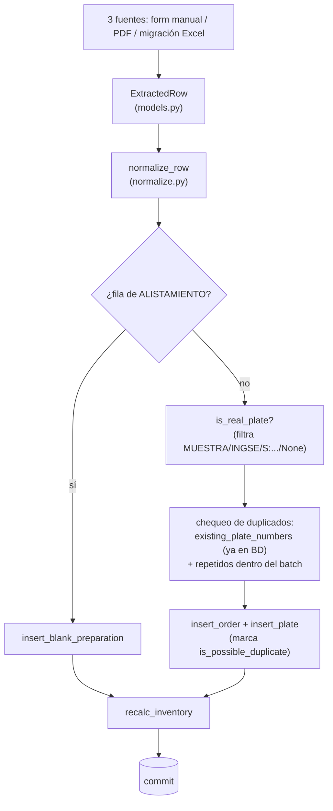

# Core (`app/core/`)

[← volver al índice](README.md)

Lógica de negocio independiente del framework web — compartida entre
`app/web` y la migración histórica de Excel (`app/migrate.py`). Ninguna
consulta SQL ni regla de negocio debería vivir fuera de esta carpeta.

## Pipeline de ingesta completo

Todo el pipeline corre en **una sola transacción** por llamada: el
llamador abre `with db.get_conn() as conn:` y se lo pasa explícito a
`ingestion.process_rows(conn, rows)` / `replace_order(conn, ...)` — un
fallo a mitad de camino revierte tanto los inserts como cualquier borrado
(en el caso de `replace_order`, ver más abajo). Antes de la Fase 1d cada
una de esas funciones abría su propia conexión por separado (un solo `POST
/ingest` corría en varias transacciones no atómicas entre sí); ver la nota
de "Contrato de transacción" más abajo.

## `models.py`

Esquema pydantic de una línea del libro/pedido, compartido tal cual por
cada puerta de ingesta para que `ingestion.py` solo tenga que manejar una
forma de dato.

- **`ExtractedRow`** — `order_number` (str, no int: hay valores como
  `"NT 895"`), `order_date`, `requested_by`, `plate_type`, `city`,
  `plate_number` (celda RANGO cruda), `plate_to`, `quantity` (default 1),
  `material`, `prepared_by`, y tres flags que por defecto son `False` y
  normalmente se infieren después en `normalize_row`. **Campos POS (Fase
  2)**, todos opcionales con default `None` (para que `app/migrate.py`,
  que nunca los llena, siga sin tocarse): a nivel de orden —
  `receipt_type`/`receipt_number`/`payment_method`/`tracking_number`/
  `client_order_number`/`delivery_date`/`payment_date`/`dispatched_by`/
  `received_by`/`notes`; a nivel de línea/placa — `reason`/
  `vehicle_brand`/`unit_price`. `delivery_date`/`payment_date` tienen un
  validador `mode="before"` que mapea `""` → `None` (un `<input
  type="date">` vacío postea `""`, que pydantic rechazaría tal cual) —
  sumados al `_blank_to_none` existente para el resto.
- **`Extraction`** — `{rows: list[ExtractedRow]}`. Es la forma que
  devolvería un paso de extracción por imagen (mencionado en el docstring
  como "Claude lee la imagen del pedido") — **hoy no está conectado a
  ninguna ruta real**, solo lo usan los tests. Un punto de integración
  documentado pero no implementado, no una feature activa.

Los validadores solo hacen coerción defensiva (floats como `598.0` →
`"598"`, strings vacíos → `None`) — la normalización de negocio real vive
en `normalize.py`.

## `normalize.py`

Normalización pura, sin acceso a base de datos — testeable en aislamiento.

| Función/constante | Qué hace |
|---|---|
| `normalize_requested_by(value)` | Limpia mayúsculas/espacios y mapea ~40 variantes de escritura curadas a mano a un nombre canónico; nunca fusiona entidades distintas de verdad. |
| `PLATE_TYPES` | Los 7 tipos de placa canónicos. |
| `INVENTORY_CATEGORIES` | Las 3 categorías de inventario: `CARRO PARTICULAR`, `MOTO PARTICULAR`, `PÚBLICO`. |
| `inventory_category(plate_type)` | Mapea un tipo de placa a su material de inventario (`ORNAMENTAL` → `None`, no consume material). |
| `normalize_plate_type(value)` | Canonicaliza etiquetas libres, incluyendo el mapeo histórico `MOTO PÚBLICO` → `MOTO CARRO PÚBLICO`. |
| `clean_plate(value)` | Mayúsculas + strip (`"arn 911"` → `"ARN911"`). |
| `validate_plate(value, plate_type)` | Valida contra el patrón regex del tipo; lanza `ValueError` en español. Solo se usa en carga manual, no en datos históricos de migración. |
| `normalize_city(value)` | Mayúsculas/un solo espacio; `None` para basura de puntuación. |
| `is_real_plate(plate_number)` | `TypeGuard[str]` — `False` para `None` y marcadores no-identificadores (`MUESTRA`, `INGSE`, `KWP`, notas `S/...`). Es el filtro que decide qué entra a la detección de duplicados. |
| `annulment_kind(*folded_texts)` | Clasifica texto de anulación encontrado en SOLICITADO/RANGO/CIUDAD en `"order"` (no consumida), `"plate"` (consumida pero perdida) o `"bare"`/`None`. |
| `normalize_row(row)` | Punto de entrada principal — normaliza texto e infiere los 3 flags a partir del token RANGO (`REPOSICION` → `is_batch_replacement=True` + `plate_number=None`) y del resultado de `annulment_kind`; nunca apaga un flag que ya venía en `True`. |
| `RECEIPT_TYPES`/`CUSTOMER_TYPES`/`DOCUMENT_TYPES`/`DOCUMENT_RELATIONS`/`PAYMENT_METHODS`/`REASONS` | Vocabularios fijos de la Fase 2 (POS) — nombres de constante en inglés, *valores* en español (`FACTURA`/`CLIENTE`/`CÉDULA`/`DUEÑO`/`EFECTIVO`/`DETERIORO`, etc.), cada uno un `<select>` en `/ingest`. `CUSTOMER_TYPES` = `TRÁNSITO`/`EMPRESA`/`GESTOR`/`CLIENTE` (`CLIENTE` es el antiguo `PERSONA NATURAL`; `OTROS` ya no existe) y `DOCUMENT_TYPES` = `NIT`/`CÉDULA`/`CÉDULA DE EXTRANJERÍA`/`OTROS`. |
| `normalize_choice(value, allowed)` | Helper genérico detrás de los 6 vocabularios de arriba: vacío → `None`; si matchea `allowed` (comparando plegado, sin acentos) devuelve la entrada canónica; si no matchea, `None` — **nunca inventa un valor**, mismo espíritu que `is_real_plate`/`pdf_extract`. Un valor no reconocido queda como aviso para que la persona lo elija del dropdown. |

**Lo más difícil de entender:**

- La anulación se registra de forma inconsistente en el libro crudo (la
  palabra puede aparecer en SOLICITADO, RANGO o CIUDAD) — por eso
  `annulment_kind` inspecciona los tres campos juntos como un solo blob, en
  vez de mirar una sola columna.
- `is_plate_annulled` vs. `is_voided` codifica una distinción de negocio
  real: anulación **de orden** = el blank nunca se gastó (no cuenta contra
  inventario); anulación **de placa** = el blank se gastó físicamente
  (sigue contando como consumido, pero se marca como desperdicio). Ver la
  tabla comparativa completa en [`DATABASE.md`](DATABASE.md#los-4-flags-booleanos-de-plates--fácil-confundirlos).
- El default de ciudad se evalúa al final y depende del orden: solo
  `CARRO PARTICULAR`/`CARRO PÚBLICO` son realmente específicos de ciudad;
  el resto recibe `"COLOMBIA"` si queda en blanco — este mismo paso también
  rellena la ciudad de filas cuya celda CIUDAD quedó anulada por la
  detección de "ANULAD" justo antes.
- El mapa de curación de `requested_by` es un registro vivo de decisiones
  humanas puntuales (hay comentarios con fechas de sesiones reales de
  limpieza de datos), no un algoritmo genérico — varios casi-duplicados se
  dejan sin fusionar a propósito, pendientes de confirmación.

## `pdf_extract.py`

Parsea el PDF de "pedido" con formato fijo de INGSE hacia la misma forma
`ExtractedRow` que produce el formulario manual, para que una persona pueda
subir un PDF en vez de tipear cada placa a mano, y revisar/corregir antes
de que llegue a `process_rows`.

| Función/clase | Qué hace |
|---|---|
| `PdfExtractError` | Excepción de mensaje en español ("esto no es un pedido legible") — nunca deja que un PDF malo tumbe la app con un 500. |
| `ParsedLine` | Una línea de la tabla de placas: `line_type` (`"placa"`/`"rango"`), `plate_type`, `plate_number`, `plate_to`, `quantity`, `city`. |
| `ParsedPedido` | Header (`order_number`, `order_date`, `requested_by`) + `lines`; `.to_rows()` convierte a `ExtractedRow`, avisando en español qué campo de header falta si está incompleto — las líneas de placa nunca quedan rehenes de un header malo. **Fase 4** agregó 10 campos más, todos texto crudo sin interpretación de negocio (`customer_document_number`, `tracking_number`, `client_order_number`, `delivery_date`, `payment_date`, `dispatched_by`, `customer_phone`, `received_by`, `payment_method`, `notes`) — mapear vocabularios (`normalize_choice`) y decidir qué es obligatorio es trabajo de `app/web/blueprints/ingest.py::_form_from_pedido`, no de este módulo. |
| `parse_order_date(value)` | Prueba ISO, luego numérico día-primero (convención colombiana), luego nombres de mes en español; devuelve `None` en vez de adivinar. |
| `parse_pedido_pdf(source)` | Parseo principal: extrae tablas de todas las páginas, ubica la fila de header `ITEM \| PLACA \| ...`, lee los campos de arriba (`_find_header_value`), y parsea las líneas de abajo hasta la fila `TOTAL PEDIDO`. |
| `extract_rows_from_pdf(source)` | Atajo: `parse_pedido_pdf(source).to_rows()` para llamadores no interactivos. El flujo web usa `parse_pedido_pdf` directo para poder tolerar un header parcial y dejar que la persona complete lo que falta. |

**Lo más difícil de entender:**

- **Por qué `extract_tables()` y nunca `extract_text()`**: decisión
  documentada y forzada por comentario en el código. `extract_text()`
  recorre el stream de caracteres crudo y se observó que mezclaba
  etiquetas estáticas carácter por carácter en un documento real;
  `extract_tables()` reconstruye celdas a partir de la geometría de líneas
  del PDF y es inmune a eso. **Nunca revertir esta decisión.**
- **Número de orden real vs. campo señuelo**: la orden de producción se
  etiqueta `ORDEN DE PRODUCCION` en las plantillas actuales o `NT` en las
  viejas; `PEDIDO #` es un número de reclamo de cara al cliente,
  **deliberadamente excluido** de esa lista. `_find_header_value` compara
  etiquetas exactas (no por substring) justamente para que `FECHA PEDIDO`
  no matchee por accidente con `PEDIDO #`.

  Esto no fue solo teórico: en producción apareció una orden literalmente
  numerada `"PEDIDO #"` porque una fila del PDF tenía esa etiqueta sin dos
  puntos, empaquetada en la misma fila que el valor real de la orden — el
  escaneo interno la confundió con el valor que buscaba. El fix agregó una
  constante `_LABEL_PEDIDO_HASH_BARE` para que el escaneo reconozca esa
  etiqueta "pelada" (sin `:`) y la trate como un límite, no como un valor.
- Las posiciones de columna se leen dinámicamente desde la propia fila de
  header del documento, no están hardcodeadas por índice — así que un
  cambio de plantilla que mueva/inserte columnas sigue funcionando.
- Una fila cuenta como línea de placa solo si trae un valor de placa o de
  inicio de rango (`_parse_lines`) — esta única regla maneja a la vez filas
  pre-impresas en blanco (se saltan, aunque tengan número de ITEM) y filas
  con placa pero sin ITEM (se conservan). El parser es explícitamente
  "fiel, no inteligente": nunca valida formatos de placa ni reglas de
  negocio, eso es trabajo de `normalize.py` y del humano que revisa.
- **El pie de página (Fase 4)**: seis etiquetas nuevas (`RESPONSABLE
  DESPACHO (INGSE SAS):`, `TELÉFONO:`, `NOMBRE QUIEN RECIBE EL PEDIDO:`,
  `FORMA DE PAGO:`, `OBSERVACIONES:`) están físicamente DEBAJO de la fila
  `TOTAL PEDIDO`, invisibles para `header_rows`. `parse_pedido_pdf` agrega
  un segundo slice, `footer_rows` (desde la fila `TOTAL PEDIDO` en
  adelante), y llama a `_find_header_value` contra ese slice también —
  la función en sí **no se tocó**, el guard `_LABEL_PEDIDO_HASH_BARE` sigue
  aplicando gratis. Las etiquetas siguen siendo texto exacto, nunca
  abreviado. `PEDIDO #:` (con dos puntos, en la tabla declarativa del
  header) usa a propósito el mismo texto plegado que
  `_LABEL_PEDIDO_HASH_BARE` (el guard del bare `PEDIDO #` sin dos puntos)
  — son casos distintos que `_split_label` distingue de forma segura
  porque uno tiene `:` y el otro no; mantenerlos como una sola constante
  evita que los dos conceptos se desincronicen.
- **NIT / CÉDULA puede volver `""` legítimamente** cuando la celda de valor
  cae en una fila distinta a la de la etiqueta (artefacto de celdas
  combinadas) — el escaneo "misma fila solamente" de `_find_header_value`
  ya lo maneja así; **nunca** agregar un heurístico de "mirar la fila
  siguiente", arriesga traer el valor de otro campo.
- **Los campos de dinero del PDF se ignoran a propósito**: `VALOR:` del
  header, `VALOR PLACA`/`VALOR TOTAL` de las líneas, y `TOTAL PEDIDO:` del
  pie (su fila sigue marcando el fin de la tabla de placas y ahora también
  el inicio del bloque de pie, pero su *valor* no se lee) — `unit_price`
  siempre sale de la tarifa vigente (`plate_type_prices`), nunca del PDF.

## `ingestion.py` (antes `process.py`, renombrado en la Fase 1d)

El único backend de ingesta al que convergen todas las puertas. Dado un
batch de `ExtractedRow`: normaliza, detecta duplicados, agrupa por orden,
inserta, recalcula inventario — todo en una transacción.

**Toma `conn` como primer parámetro explícito** en sus tres funciones
públicas (`process_rows(conn, rows)`, `replace_order(conn, order_number,
rows)`, `find_duplicate_plate_numbers(conn, rows)`) y nunca comitea ni
hace rollback — el mismo contrato que sigue todo `app/core/db/` (ver más
abajo). Antes de la Fase 1d cada una abría su propia `db.get_conn()`
internamente, así que un solo `POST /ingest` corría en 3-4 transacciones
separadas (el chequeo de duplicados y el insert que se supone protege no
eran atómicos entre sí); el llamador (la ruta Flask) ahora abre **una
sola** `with db.get_conn() as conn:` que envuelve el chequeo y el insert
juntos. Ver `tests/core/test_ingestion.py`'s test de atomicidad (una
excepción a mitad de `process_rows` revierte el batch entero) para el caso
concreto que esto cierra.

- **`Summary`** — conteos devueltos al llamador: `orders_inserted`,
  `plates_inserted`, `blank_preparations`, `possible_duplicates`,
  `voided`, `plate_annulled`, `batch_replacements`, `review_notes`, más
  `orders_replaced`/`plates_deleted` que solo pone `replace_order` (nunca
  `process_rows`, que jamás borra nada).
- **`find_duplicate_plate_numbers(conn, rows)`** — dry run de solo
  lectura: devuelve el conjunto de números de placa que *quedarían*
  marcados como posible duplicado si se insertaran ahora. Lo usa el
  formulario `/ingest` para avisar antes de guardar, en la misma
  transacción que el guardado real.
- **`process_rows(conn, rows, created_by=None) -> Summary`** — normaliza
  cada fila → separa ALISTAMIENTO de placas reales → cuenta repetidos
  dentro del batch → inserta cada fila de alistamiento (mapeando
  `plate_type` a material vía `normalize.inventory_category()` — antes
  de la Fase 2 pasaba `plate_type` directo como `category`, un bug real,
  código muerto en la práctica porque el flujo real de `/inventory/alistado`
  no pasaba por acá, corregido de una vez), calcula qué placas ya existen
  en vivo, saca un snapshot único de `db.current_prices(conn)` para todo
  el batch, agrupa las placas por `order_number` (resuelve/crea el
  cliente del grupo vía `db.resolve_or_create_customer` y hace un
  `insert_order` por grupo, usando la fila *cabeza* del grupo), inserta
  cada placa (aplicando el snapshot de precio como fallback solo si la
  fila no trae ya un `unit_price` propio) marcando `is_possible_duplicate`
  → `recalc_inventory`. No comitea: eso lo hace el `with db.get_conn()`
  del llamador al salir limpio. `created_by` (Fase 2, opcional) es el
  `users.id` de quien guardó, hacia `production_orders.created_by`.
  **Generaliza a `_ORDER_LEVEL_FIELDS`** (10 campos: `requested_by` +
  las 9 columnas POS de orden, excluyendo `reason`/`vehicle_brand`/
  `unit_price` que son genuinamente por línea) el chequeo de "¿todas las
  filas del grupo coinciden?" que antes solo existía para `requested_by` —
  cualquier desacuerdo dentro del mismo `order_number` genera un
  `review_notes` por campo.
- **`replace_order(conn, order_number, rows, created_by=None) -> Summary`**
  — acción explícita, opt-in (botón "Reemplazar" en `/ingest`): borra
  **todas** las órdenes existentes que coincidan con `order_number` (puede
  haber 2+, no hay `UNIQUE`) junto con sus placas, y luego inserta una
  sola orden nueva a partir de `rows`. Exige que todas las `rows`
  compartan el mismo `order_number` (si no, `ValueError`) y que haya al
  menos una fila. **Las placas nuevas toman la tarifa vigente AL MOMENTO
  DEL REEMPLAZO**, no la que regía en la fecha original de la orden —
  documentado, no un bug (el texto del `confirm()` de "Reemplazar" en
  `ingest.html` también lo advierte).
- **`is_alistado(row)`** (pública desde la Fase 1d, antes `_is_alistado`
  privada — `app/migrate.py` la importa cruzando el límite del módulo) —
  detecta una fila ALISTAMIENTO mirando tanto `requested_by` como
  `prepared_by`.
- El filtro `is_real_plate(...) and not is_voided` y el bloque de conteo
  por fila estaban duplicados 8-9 veces entre `process_rows`/
  `replace_order` (y una novena copia divergente, directo en
  `app/web/app.py`, que violaba la regla de este mismo archivo de no tener
  lógica de negocio fuera de `core/`) — factorizados en los helpers
  privados `_dedup_candidates(rows)` y `_count_row(summary, row, is_dup)`,
  usados por ambas funciones; la ruta web ahora pasa por acá también.

**Lo más difícil de entender:**

- `replace_order` existe para arreglar una clase de bug real: una fila de
  reposición no tiene identidad de placa contra la cual comparar, así que
  si sus números reales se recuperan después (ej. resubiendo el PDF
  original) y simplemente se vuelven a procesar con `process_rows`, se crea
  en silencio una **segunda** orden bajo el mismo `order_number` en vez de
  detectarse como duplicado. Esto ya pasó de verdad — caso real
  `WCY449`/pedido 1030, documentado en
  `data/duplicados_revision_2026-08-15.md` — y es exactamente el hueco que
  `replace_order` tapa.
- La detección de duplicados es **solo por número de placa**, calculada de
  forma independiente en `process_rows` y en `replace_order`: ya-presente-
  en-BD (`existing_plate_numbers`) O repetido-dentro-del-batch, y solo
  aplica a filas donde `is_real_plate(...)` es verdadero y `is_voided` es
  falso. Una reposición (sin `plate_number`) por diseño nunca puede
  marcarse como duplicado — de ahí la necesidad de `replace_order` como
  mecanismo separado basado en `order_number`, no en `plate_number`.
- `process_rows` puede insertar varias órdenes en una sola llamada (agrupa
  un batch multi-orden); `replace_order` está deliberadamente limitado a
  un solo `order_number` y no puede abarcar varias órdenes.

## `db/` (paquete — antes un solo `db.py` plano, dividido en la Fase 1d)

Todo el SQL crudo (psycopg 3, sin ORM) para `production_orders`, `plates`,
`blank_preparations` e `inventory_categories`, dividido por dominio en vez
de un único archivo de 556 líneas:

| Módulo | Qué contiene |
|---|---|
| `db/__init__.py` | `get_conn()` (ver pool más abajo) + re-export explícito de cada función pública de todos los submódulos — `db.insert_order(...)`, `db.recalc_inventory(...)`, `db.resolve_or_create_customer(...)`, etc. siguen llamándose exactamente igual desde fuera del paquete. |
| `db/orders.py` | CRUD de `production_orders` + `OrderSummary` (dataclass tipado, `class_row`) — la forma de fila compartida por `recent_orders`/`find_orders_by_number`/`search_orders_by_number`. |
| `db/plates.py` | CRUD de `plates`, incluida `distinct_cities` (agrupada acá por simetría con `distinct_requested_by` de `orders.py`, aunque ambas leen `plates`). |
| `db/inventory.py` | `blank_preparations`/`inventory_categories`: `insert_blank_preparation`, `recalc_inventory`, `inventory_view`, `ornamental_count`. |
| `db/customers.py` (Fase 2) | CRUD de `customers` — ver detalle abajo. |
| `db/ownership_cards.py` (Fase 2 declaraciones) | CRUD de `ownership_cards` (tarjeta de propiedad) y `find_card_conflicts` — ver detalle abajo. |
| `db/declarations.py` (Fase 3 declaraciones) | Lectura/escritura de `declarations` — ver detalle abajo. |
| `db/users.py` (Fase 2) | CRUD/lookup de `users` — backend real del login (`app/web/auth.py`), ver detalle abajo. |
| `db/pricing.py` (Fase 2) | CRUD de `plate_type_prices` — ver detalle abajo. |

Config de conexión desde variables de entorno (`DB_HOST` default `"db"` —
**nunca usar ese default en Docker Compose**, ver
[`ARCHITECTURE.md`](ARCHITECTURE.md)) más `DB_POOL_MIN_SIZE`/
`DB_POOL_MAX_SIZE` (default `1`/`5`, ver "Pool de conexiones" abajo).
Cada conexión se abre con `row_factory=dict_row` — toda fila que devuelve
una consulta es un dict por nombre de columna, nunca una tupla posicional.

**Contrato de transacción**: cada función de acá recibe una conexión ya
abierta (`conn`) y **nunca hace commit ni rollback** — quien llama es
siempre el dueño de la transacción (`with db.get_conn() as conn: ...`).
Esto es deliberado (Fase 1d): pasar `conn` explícito en vez de esconderlo
detrás de una interfaz deja visible en la firma quién controla el
commit, que es justamente el punto que un bug real (varias funciones de
`ingestion.py` abriendo cada una su propia conexión, ver más abajo) puso
en evidencia.

**Pool de conexiones (Fase 1d)**: `get_conn()` ya no abre un socket nuevo
en cada llamada — es un `@contextmanager` que envuelve un
`psycopg_pool.ConnectionPool`, construido de forma perezosa (recién en la
primera llamada real, nunca al importar el módulo, porque
`tests/conftest.py` importa este paquete incluso sin `POSTGRES_PASSWORD`
seteada). `with db.get_conn() as conn:` se comporta exactamente igual que
antes en los ~21 call sites existentes (commit en salida limpia, rollback
en excepción) — solo que ahora reusa una conexión del pool en vez de abrir
una nueva. Gunicorn corre sin `--preload`, así que cada worker arma su
propio pool en su primer request (si algún día se agrega `--preload`, ese
razonamiento se rompe y la construcción del pool debe moverse a un hook
`post_fork`).

**Escrituras — órdenes/placas**

| Función | Qué hace |
|---|---|
| `insert_order(conn, *, row, customer_id, created_by)` | Inserta `production_orders` a partir de la `ExtractedRow` completa (Fase 2 — igual que `insert_plate`, en vez de listar cada campo POS como kwarg suelto) + `customer_id`/`created_by`, ambos obligatorios (sin default) para que cada llamador elija explícito. `row.plate_type`/etc. se ignoran (irrelevantes para el header). |
| `update_order(conn, order_id, *, ..., customer_id=_UNSET, receipt_type=None, ...)` | Edita el header + los 10 campos POS. `customer_id` usa un sentinel privado `_UNSET` (no `None`) como default — pasarlo explícito (un int, o `None` para limpiarlo de verdad) lo cambia; omitirlo lo deja intacto. Es deliberado: si el default significara "poner `NULL`", cualquier guardado de Registro que todavía no resuelva cliente lo borraría sin querer. |
| `delete_order` | Borra placas primero (no hay `ON DELETE CASCADE` en el FK), luego la orden. |
| `insert_plate` | Inserta una placa con su flag `is_possible_duplicate` (+ `unit_price`/`reason`/`vehicle_brand`, Fase 2/3). |
| `update_plate(plate_id, ..., plate_type)` | Edición angosta usada por la cola de revisión de duplicados — siempre limpia `is_possible_duplicate` (editar = revisado). Aplica la regla de re-snapshot de `unit_price` (ver abajo), porque también permite cambiar `plate_type`. |
| `update_plate_full(plate_id, ..., plate_type, reason=None, vehicle_brand=None)` | Edición completa desde el detalle de Registro. **`is_batch_replacement` se debe pasar explícito** — así, corregir el `plate_number` de una reposición también puede apagar ese flag (bug ya corregido: antes se quedaba marcada como reposición para siempre). `unit_price` **no es un parámetro** — la regla de re-snapshot de abajo es el único camino que lo fija, nunca un caller directo. |
| `resolve_plate` | Solo limpia `is_possible_duplicate` ("no es duplicado", acción del revisor). |
| `delete_plate` | Borra la placa; si con eso queda exactamente **una** otra fila marcada con el mismo `plate_number`, también le limpia el flag (ya no hay nada más con qué compararla); si quedan 2+, las deja (sigue siendo ambiguo). |

**Regla de re-snapshot de `unit_price`** (Fase 2, `db/plates.py::_resnapshot_unit_price`, compartida por `update_plate`/`update_plate_full`): lee el `plate_type`/`unit_price` actuales de la placa en el mismo cursor, antes del `UPDATE` —
si el `plate_type` **no cambia**, el `unit_price` viejo se conserva tal cual (sin importar si cambia `quantity`); si el `plate_type` **sí cambia**, vuelve a tomar `db.current_prices(conn).get(nuevo_tipo)` (puede quedar `None` si ese tipo no tiene tarifa configurada — nunca un `0` silencioso). Placa nueva (`/ingest`, PDF, "+ agregar placa"): `ingestion.py::_snapshot_unit_price` aplica el mismo principio pero como fallback — solo si la fila no trae ya un `unit_price` propio (el form de `/ingest` siempre manda uno, pre-llenado por JS pero editable).

**Escrituras — inventario**

| Función | Qué hace |
|---|---|
| `insert_blank_preparation` | Registra un evento ALISTAMIENTO. |
| `recalc_inventory(conn)` | Recalcula `prepared` (suma de `blank_preparations` por categoría) y `consumed` (suma de placas no anuladas, mapeadas de `plate_type` a material vía `inventory_category`) — **itera explícitamente sobre la lista fija de categorías**, no solo sobre las que devuelve el `GROUP BY`, para que una categoría que se quedó sin placas en vivo también vea su `consumed` puesto en 0 en vez de conservar el último valor (bug real ya corregido). |

**Lecturas (selección — ver el archivo para la lista completa)**

| Función | Qué hace |
|---|---|
| `existing_plate_numbers` | Subconjunto de números candidatos ya en vivo (`is_voided=false`) — primitiva base de la detección de duplicados. |
| `find_orders_for_plate` | Órdenes en vivo que ya usaron un número de placa dado. |
| `inventory_view` | `prepared`, `consumed`, `available = prepared - consumed` (**no suma `initial_stock`**, ver [`DATABASE.md`](DATABASE.md#initial_stock-es-una-columna-muerta)) y `wasted` (recalculado en vivo desde `is_plate_annulled`). |
| `recent_orders(limit=50)` | Ordenado por `order_date DESC`, no por `created_at` — deliberado, para que una corrección de una orden vieja no tape la actividad real de hoy. |
| `find_orders_by_number(order_number)` | Match **exacto** (no `ILIKE`), sin límite — puede devolver 0/1/2+ filas. La consume directamente `replace_order`. |
| `search_plates_by_number` / `search_orders_by_number` | Búsqueda parcial (`ILIKE`) en toda la base, no solo en la ventana de `recent_orders`. |
| `order_detail(conn, order_id)` | `(orden, placas)` — la orden viene con un `LEFT JOIN customers` (columnas `customer_*`, `LEFT` porque `customer_id` es nullable) para traer los atributos del cliente resuelto en un solo viaje; las placas incluyen `unit_price`/`reason`/`vehicle_brand` (Fase 2/3). |
| `review_rows` | Cola de placas con `is_possible_duplicate = true`. |

### `db/customers.py` (Fase 2)

| Función | Qué hace |
|---|---|
| `resolve_or_create_customer(conn, name, *, type=None, document_type=None, ...)` | Busca por `name` canónico (`normalize_requested_by`); si existe, `ON CONFLICT (name) DO UPDATE SET name = EXCLUDED.name, type = COALESCE(customers.type, EXCLUDED.type), ...` para cada atributo — nunca sobrescribe un atributo que el cliente YA tiene, pero sí completa cualquiera que siga en NULL (así los clientes del backfill histórico, todos con atributos NULL, se van completando solos con el uso normal en vez de quedar en blanco para siempre). Los atributos de un cliente genuinamente nuevo se escriben en la rama INSERT como siempre. `ingestion.py` (`process_rows`/`replace_order`) y `record_save` llaman esta función solo con el nombre (todo `None`), así que para ellos `COALESCE(existente, NULL) = existente` — no-op, igual que antes; `app/web/blueprints/ingest.py` la llama con los atributos tipeados en el fieldset "cliente". Los atributos son `type`/`document_type`/`document_number`/`document_relation`/`phone`/`email` más los datos de persona `address`/`neighborhood`/`municipality` (también con `COALESCE`: nunca se sobrescriben). |
| `get_customer(conn, customer_id)` / `get_customer_by_name(conn, name)` | Lookups puntuales. |
| `list_customers(conn)` | Todos los clientes, alfabético — embebido entero como JSON en `ingest.html` (Fase 3) para que el JS auto-llene el fieldset de cliente al matchear un nombre tipeado, mismo patrón que `distinct_requested_by`/`distinct_cities` (esta app no tiene endpoints AJAX); también usado por la lista de `/customers` (Fase 6). |
| `update_customer(conn, customer_id, *, name, type, document_type, ...)` | Sobreescritura REAL, sin `COALESCE` — a diferencia de `resolve_or_create_customer`, esta sí reemplaza (o borra, si se pasa `None`) un atributo que el cliente ya tenía. Es la única función que puede hacerlo (incluidos `address`/`neighborhood`/`municipality`; `transit_license` ya no existe en `customers`); la usa exclusivamente `/customers` (Fase 6), la pantalla de admin para corregir a mano un dato mal tipeado o completar uno de los 191 clientes del backfill histórico. Sin pre-chequeo de unicidad de `name` — un rename que choca con otro cliente existente levanta `psycopg.errors.UniqueViolation`, que la ruta web atrapa para mostrar un error en español en vez de un 500. |

### `db/ownership_cards.py` (Fase 2 declaraciones)

Normaliza las entradas dentro de la capa: licencia con `strip` + mayúsculas,
placa con `normalize.clean_plate`, textos libres con `strip` (vacío →
`None`). No pre-chequea unicidad: `UniqueViolation`/`ForeignKeyViolation`
suben tal cual (la BD es la fuente de verdad). Ver
[`DATABASE.md`](DATABASE.md) para las columnas y los estados de conflicto.

| Función | Qué hace |
|---|---|
| `create_ownership_card(conn, customer_id, *, transit_license, plate_number, engine_number=None, chassis_number=None, vehicle_type=None, registered_in=None, vehicle_brand=None)` | Inserta una tarjeta y devuelve su `id`. |
| `get_ownership_card(conn, card_id)` | `OwnershipCardRecord` o `None`. |
| `get_ownership_card_by_transit_license(conn, transit_license)` / `get_ownership_card_by_plate_number(conn, plate_number)` | Lookup exacto por la forma normalizada; `OwnershipCardRecord` o `None`. |
| `list_ownership_cards_for_customer(conn, customer_id)` | Las tarjetas de un cliente, ordenadas por `id`. |
| `reassign_ownership_card(conn, card_id, new_customer_id)` | Cambia el dueño de la tarjeta (`UPDATE` simple; acción de admin del flujo de revisión). |
| `find_card_conflicts(conn, *, customer_id, transit_license, plate_number)` | Solo lectura. Devuelve `CardLookup(by_transit_license, by_plate_number, status)` con `status` en `new` / `same_card` / `other_owner` / `data_mismatch` (constantes `CARD_STATUS_*`). La decisión pura está en `classify_card_lookup`. |

### `db/declarations.py` (Fase 3 declaraciones)

Solo la capa de datos; las reglas de decisión están en `app/core/declarations.py`
(más abajo). Columnas, estados y alertas: [`DATABASE.md`](DATABASE.md). Constantes:
`STATUS_PENDING_REVIEW` / `STATUS_APPROVED` / `STATUS_REJECTED` y
`FLAG_PLATE_MADE_RECENTLY` / `FLAG_CARD_OTHER_OWNER` / `FLAG_CARD_DATA_MISMATCH` /
`FLAG_CUSTOMER_TYPE_MISMATCH`, `FLAG_CUSTOMER_DOCUMENT_MISMATCH`.

| Función | Qué hace |
|---|---|
| `insert_declaration(conn, *, reason, plate_quantity, acting_as, status, submitted_data, review_flags=None, customer_id=None, ownership_card_id=None, gestor_id=None, owner_signature_path=None, ..., accepted_terms_at=None)` | Inserta y devuelve el `id`. |
| `get_declaration(conn, declaration_id)` | `DeclarationRecord` o `None`. |
| `list_declarations(conn, *, status=None, query=None)` | `pending_review` primero, luego las más nuevas. `query` busca (sin mayúsculas) en nombre, documento, placa y licencia de `submitted_data` y de las filas enlazadas. |
| `count_recent_by_ip(conn, ip, *, since)` | Declaraciones de esa IP con `created_at >= since` (límite por IP del formulario). |
| `set_declaration_review(conn, declaration_id, *, status, reviewed_by, note=None, customer_id=None, ownership_card_id=None, gestor_id=None)` | Graba la decisión (`reviewed_at = now()`). No valida el estado previo. |

`db/plates.py` suma `last_fabrication_date(conn, plate_number)`: solo lectura,
la `order_date` más reciente de una placa con ese número exacto, **ignorando**
placas `is_voided` o `is_plate_annulled`; `None` si nunca se fabricó.

### `declarations.py` (Fase 3 declaraciones)

Lógica de negocio sin Flask; recibe `conn` y nunca hace commit/rollback.

| Función | Qué hace |
|---|---|
| `validate_declaration(inp)` | Lista de errores en español (vacía = válida): obligatorios, vocabulario con `normalize_choice`, placa con `validate_plate`, pérdida exige PDF notariado, gestor exige su bloque y su firma, firma del dueño y términos siempre, cantidad >= 1. |
| `submit_declaration(conn, inp, *, today=None)` | Aplica las reglas de abajo y devuelve `SubmitResult(declaration_id, status, flags)`. `today` por defecto es la fecha de Bogotá. |
| `approve_declaration(conn, id, reviewer_user_id, *, reassign_card=False, note=None)` | Solo desde `pending_review`. Crea/enlaza dueño, gestor y tarjeta desde `submitted_data`. Un cliente existente con tipo `NULL` pasa al tipo esperado; con otro tipo, `ValueError`. Tarjeta de otro dueño: `ValueError` salvo `reassign_card=True`; licencia/placa que no cuadran: siempre `ValueError`. |
| `reject_declaration(conn, id, reviewer_user_id, note)` | Marca `rejected` (nota obligatoria); no crea nada. |

Reglas de `submit_declaration`:

| Situación | Resultado |
|---|---|
| Cualquier alerta (`plate_made_recently`, `card_other_owner`, `card_data_mismatch`, `customer_type_mismatch`, `customer_document_mismatch`) | `pending_review`; **no se crea nada** (ni cliente, ni gestor, ni tarjeta); las tres FK quedan `NULL`. |
| Cliente nuevo + tarjeta nueva | `approved`; se crea el CLIENTE (y el GESTOR si hay) y la tarjeta. |
| Cliente existente (tipo `CLIENTE`) con otro carro | `approved`; se enlaza el cliente sin modificarlo y se crea la tarjeta nueva. |
| Mismo cliente, misma licencia y placa, pasados 6 meses | `approved`; se enlaza la tarjeta existente **sin modificarla** (los datos secundarios distintos solo quedan en `submitted_data`). |
| Cliente/gestor existentes | Solo se enlazan, nunca se modifican. |

**Privacidad:** `SubmitResult.flags` es solo para el personal y los logs. La capa
web **nunca** debe mostrarlas al anónimo que envía (ni nada del dueño anterior o
de la fecha de fabricación); solo "Recibimos tu declaración".

### `db/users.py` (Fase 2)

Backend real del login — reemplaza los env vars `AUTH_USERS`/`AUTH_ROLES`.

| Función | Qué hace |
|---|---|
| `get_user_by_username(conn, username)` | Usada por `app/web/auth.py::authenticate` en cada login. Devuelve la fila aunque `active=False` — es `authenticate` quien decide que un usuario inactivo no puede loguearse, no este lookup. |
| `get_user_by_id(conn, user_id)` | Para `session["user_id"]` → `production_orders.created_by`. |
| `create_user` / `list_users` | CRUD básico, para una futura pantalla de administración de usuarios (no consumidos por ninguna ruta activa hoy). |

### `db/pricing.py` (Fase 2)

Tarifas sugeridas por tipo de placa (`plate_type_prices`) — ver
[`DATABASE.md`](DATABASE.md) para la advertencia de namespace
(`plate_type`, 7 valores, nunca `inventory_categories.category`, 3
valores).

| Función | Qué hace |
|---|---|
| `current_prices(conn) -> dict[str, Decimal]` | `{plate_type: unit_price}` solo para los tipos que YA tienen fila — un tipo sin tarifa configurada simplemente no aparece (nunca un `0`). Consumida por `ingestion.py` (snapshot al insertar) y `db/plates.py` (re-snapshot al editar). |
| `price_list(conn) -> list[PriceRow]` | Una fila por cada `normalize.PLATE_TYPES`, en ese orden — un tipo sin tarifa aparece igual, con `unit_price=None` ("sin tarifa"). Consumida por `/precios`. |
| `set_price(conn, plate_type, unit_price, updated_by)` | Valida `plate_type` contra `normalize.PLATE_TYPES` en Python (mensaje en español antes de llegar a la FK real de la Fase 1b) y hace `INSERT ... ON CONFLICT (plate_type) DO UPDATE` — funciona igual si la fila existe o no, porque la tabla arranca vacía a propósito. |

### `cash_summary.py` (Fase 5b)

La única lógica de negocio de `app/core/` que **no** vive en `db/*.py` —
tiene reglas propias más allá de CRUD (agrupación, exclusiones, "nunca
convertir un precio faltante en 0"), suficiente para justificar su propio
módulo de orquestación, per el plan. Sigue el mismo contrato de conexión
que `db/*` (recibe `conn` abierto, nunca comitea).

| Función | Qué hace |
|---|---|
| `build_cash_summary(conn, *, desde, hasta) -> CashSummary` | Agrega `plates JOIN production_orders` en `[desde, hasta]` (ambos inclusive), agrupado siempre por `order_date` y luego por `payment_method` (`COALESCE(..., 'SIN FORMA DE PAGO')` — casi toda orden histórica tiene esto en `NULL`, sin el bucket explícito un `GROUP BY` las escondería). Excluye `is_voided`/`is_plate_annulled` de todo total. Una placa con `unit_price IS NULL` **nunca** se cuenta como `0` — Postgres `SUM()` ya la salta del total, y aparte se devuelve completa (orden + tipo de placa) en `CashSummary.missing_price`, para que se vea como aviso explícito, nunca como plata perdida en silencio. |
| `render_cash_summary_pdf(summary, *, desde, hasta) -> bytes` | Mismo `reportlab` (`SimpleDocTemplate`/`Table`/`TableStyle`, tamaño `letter`) que ya usa `tests/pdf_fixtures.py` para los PDFs sintéticos de test — una tabla de totales simple, sin logos ni gráficos, para que PTO.V la imprima y se la lleve al admin. |

Dinero (`Decimal`) de punta a punta, nunca mezclado con `float` — ver
[`DATABASE.md`](DATABASE.md) para las columnas `NUMERIC` involucradas.
