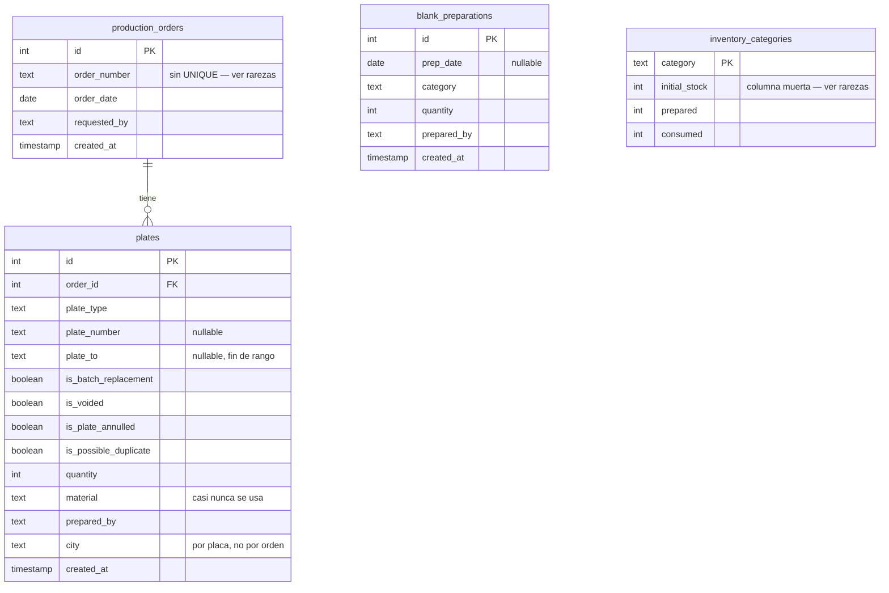

# Base de datos

[← volver al índice](README.md)

> Este esquema (`init.sql`, aplicado solo la primera vez que se inicializa
> el volumen de Postgres — editarlo no hace nada sobre una base ya
> existente) va a cambiar pronto con el próximo feature grande. Este
> documento es la **línea base de referencia** al momento de escribirlo,
> no una promesa de estabilidad. No hay tabla `users`: la autenticación es
> enteramente por variables de entorno (ver [`WEB.md`](WEB.md) y
> [`LOCAL_DEVELOPMENT.md`](LOCAL_DEVELOPMENT.md)).

## Diagrama

`blank_preparations` e `inventory_categories` **no tienen FK** hacia el
resto — se relacionan solo porque `recalc_inventory()` (en `app/core/db.py`)
recalcula `prepared`/`consumed` agregando sobre esas tablas por texto de
`category`/`plate_type`, no por llave foránea.

No existe ningún `VIEW`, índice adicional a la PK, ni `CHECK constraint` en
todo el esquema.

## Columnas por tabla

### `production_orders`

| Columna | Tipo | Constraint/Default | Nota |
|---|---|---|---|
| `id` | SERIAL | PK | |
| `order_number` | TEXT | NOT NULL | `TEXT`, no `INTEGER`, a propósito — hay números reales no numéricos (ej. `"NT 895"`). Sin `UNIQUE`. |
| `order_date` | DATE | NOT NULL | Fecha real del negocio, distinta de `created_at`. |
| `requested_by` | TEXT | NOT NULL | "Solicitado por" — normalizado en `app/core/normalize.py`. |
| `created_at` | TIMESTAMP | DEFAULT now() | Nunca se usa para ordenar por "reciente" (ver `recent_orders` en [`CORE.md`](CORE.md)). |

### `plates`

| Columna | Tipo | Constraint/Default | Nota |
|---|---|---|---|
| `id` | SERIAL | PK | |
| `order_id` | INTEGER | FK → `production_orders(id)` | Nullable en el esquema, sin `ON DELETE`; el borrado en cascada lo hace la app (`delete_order` borra placas antes que la orden). |
| `plate_type` | TEXT | NOT NULL | `CARRO PARTICULAR`, `MOTO PARTICULAR`, `CARRO PÚBLICO`, `MOTO CARRO PÚBLICO`, `REMOLQUE`, `ORNAMENTAL`, etc. |
| `plate_number` | TEXT | nullable | Placa única, o inicio de rango. `NULL` es válido (reposiciones sin placa asignada aún). |
| `plate_to` | TEXT | nullable | Fin de rango; `NULL` en placas únicas/reposiciones. |
| `quantity` | INTEGER | NOT NULL DEFAULT 1 | |
| `material` | TEXT | nullable | Rara vez se llena directo — el material real se deriva de `plate_type`. |
| `prepared_by` | TEXT | nullable | Rara vez se llena. |
| `city` | TEXT | nullable | **Por placa, no por orden** — una orden puede despachar a varias ciudades. |
| `created_at` | TIMESTAMP | DEFAULT now() | |

### `blank_preparations`

| Columna | Tipo | Constraint/Default | Nota |
|---|---|---|---|
| `id` | SERIAL | PK | |
| `prep_date` | DATE | nullable | Sin `NOT NULL` a pesar de representar "cuándo se preparó". |
| `category` | TEXT | NOT NULL | Texto libre, no forzado por FK a `inventory_categories.category` (solo coincide por convención). |
| `quantity` | INTEGER | NOT NULL DEFAULT 0 | |
| `prepared_by` | TEXT | nullable | |
| `created_at` | TIMESTAMP | DEFAULT now() | |

Representa eventos de "ALISTAMIENTO" — blanks cortados/preparados de
antemano, o ingreso de material nuevo. No son placas; solo alimentan
`inventory_categories.prepared`.

### `inventory_categories`

| Columna | Tipo | Constraint/Default | Nota |
|---|---|---|---|
| `category` | TEXT | PK | Una de las 3 categorías fijas: `CARRO PARTICULAR`, `MOTO PARTICULAR`, `PÚBLICO`. |
| `initial_stock` | INTEGER | DEFAULT 0 | **Columna muerta** — ver rarezas. |
| `prepared` | INTEGER | DEFAULT 0 | Recalculado por `recalc_inventory()` como suma de `blank_preparations.quantity`. |
| `consumed` | INTEGER | DEFAULT 0 | Recalculado por `recalc_inventory()` como suma de `plates.quantity` no anuladas, mapeadas a material. |

## Rarezas que hay que conocer

### `order_number` sin `UNIQUE`

Puede haber legítimamente **2 o más filas** de `production_orders` con el
mismo `order_number` — nada en el esquema ni en el código antiguo lo
impedía. `find_orders_by_number()` puede devolver 0, 1, o 2+ filas; la
función `replace_order()` (ver [`CORE.md`](CORE.md)) existe justamente para
**fusionar** todas las coincidencias en una sola orden cuando el usuario lo
pide explícitamente.

### `city` vive en `plates`, no en `production_orders`

Es deliberado: una orden puede tener placas para varias ciudades a la vez
(ej. un pedido mixto carro+moto). `production_orders` no tiene columna
`city` — cualquier "ciudades de esta orden" se recalcula agregando
`array_agg(DISTINCT p.city)` sobre sus placas. Solo los tipos
`CARRO PARTICULAR` y `CARRO PÚBLICO` son realmente específicos de ciudad;
el resto por defecto queda en `"COLOMBIA"` si se deja en blanco.

### Los 4 flags booleanos de `plates` — fácil confundirlos

| Flag | Significa | ¿Cuenta como "consumido" en inventario? | Se limpia... |
|---|---|---|---|
| `is_batch_replacement` | "Reposición": lote sin números de placa individuales identificados | Sí, consume material igual | Manualmente al recuperar la placa real (bug histórico ya corregido: `update_plate_full` ahora sí actualiza este flag) |
| `is_voided` | Orden/placa anulada — el blank nunca se consumió | **No** — excluida de `consumed` | Es un estado permanente de la fila, no se "limpia" |
| `is_plate_annulled` | Placa anulada pero el blank físico ya se gastó/perdió | **Sí** — cuenta además como "wasted" | No se limpia automáticamente |
| `is_possible_duplicate` | Candidata a duplicado, pendiente de revisión en `/review` | No afecta inventario | Con cualquier edición (`update_plate`, `update_plate_full`, `resolve_plate`), o en cascada por `delete_plate` cuando ya no queda otra fila ambigua con ese número |

### `initial_stock` es una columna muerta

El comentario original en `init.sql` sugiere que `available` debería ser
`initial_stock + prepared - consumed`, pero en el código real
(`app/core/db.py::inventory_view()`) es solo `prepared - consumed` — nunca
se lee ni se escribe `initial_stock` en ningún lugar de la app. La línea
base histórica se incorporó, en cambio, como filas reconciliadas dentro de
`blank_preparations` durante la migración de Excel
(`app/migrate.py::RECONCILED_ALISTAMIENTO`). No asumir que esta columna
está viva.

### Sin índices en columnas muy consultadas

No hay índice en `plates.order_id`, `plates.plate_number`, ni
`plates.city`, a pesar de que las tres se filtran/joinean constantemente
(`find_orders_for_plate`, las búsquedas `ILIKE` de Registros,
`distinct_cities`). No es un problema hoy por el volumen de datos, pero es
lo primero a revisar si una consulta de Registros empieza a sentirse lenta.
