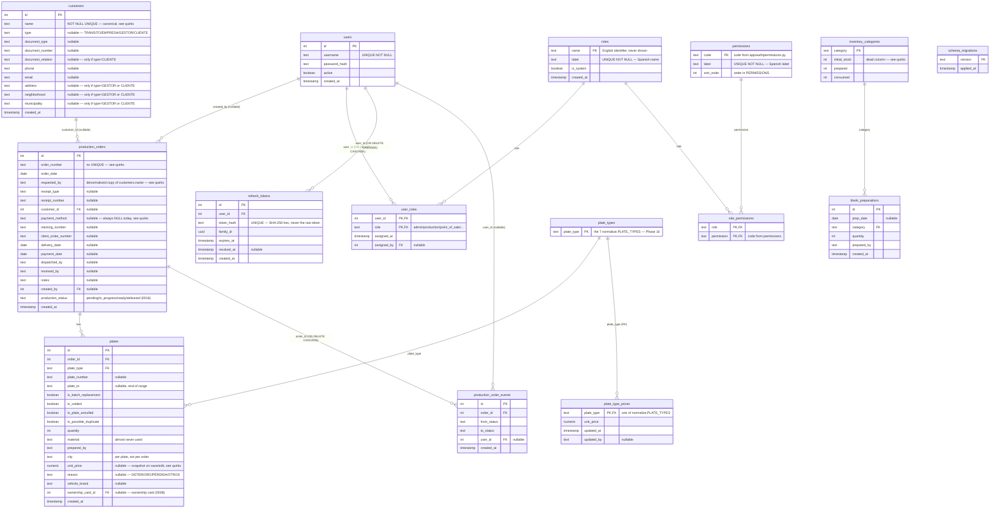

# Database

[← back to the index](README.md)

> This schema (`init.sql`, applied only the first time the Postgres volume is
> initialized — editing it does nothing to an existing database) received its
> big change in **Phase 1** of the POS feature (full sales-order capture +
> cash reconciliation): the tables
> `customers`/`users`/`plate_type_prices`/`schema_migrations` and the new
> columns of `production_orders`/`plates` below. **The complete feature is
> already in production** (Phases 1-5b, see
> `ARCHITECTURE_AND_POS_PLAN.md` at the repo root for the full history):
> `/ingest` captures all the POS fields, `/precios` manages
> `plate_type_prices`, `/cuadre` aggregates the totals, and `app/auth/login.py`
> queries `users` on every login. This document reflects that final state.
>
> **Historical note (Phase 1c)**: the original Phase 1 named `clientes`/
> `usuarios` (table + columns such as `nombre`/`tipo`/`rol`/`activo`) **and**
> all the new POS columns in `production_orders`/`plates`
> (`comprobante_tipo`, `cliente_id`, `forma_pago`, `creado_por`, `motivo`,
> `marca_vehiculo`, etc.) in Spanish, before the `CLAUDE.md` convention was
> set (identifiers in English, content/values in Spanish). **Phase 1c**
> (`app/migrations/0003_rename_to_english.sql`) renamed ALL of that to its
> final English names — the table and columns of `clientes`/`usuarios`, and
> every Spanish-named column of `production_orders`/`plates` (full mapping
> below, in the `production_orders`/`plates` section) — both in production and
> in `init.sql` for new installations. The stored *values* (customer names,
> `CLIENTE`/`CÉDULA`/`DUEÑO`, `EFECTIVO`, etc.) did not change — they are
> Spanish business data, not identifiers. **Later exception**: the role names
> (then in the `users.role` column, today in `user_roles.role`) did have their
> values translated to English afterwards
> (`app/migrations/0004_translate_role_values_to_english.sql`) — they are not
> Spanish business data, they are internal identifiers that are never shown to
> the user (see the note in the `user_roles` section below and `CLAUDE.md`).
>
> **Applying a schema change to an existing database** (with real data, not a
> fresh volume) is the job of the `app/schema_migrate.py` runner
> (`python -m app.schema_migrate`), NOT of editing `init.sql` — it applies
> `app/migrations/*.sql` in order (idempotent, safe to run twice).
> `deploy.yml` already invokes it automatically after every
> `docker compose up -d --build`.
>
> **`init.sql` records the migrations it already contains.** A new database
> created with `init.sql` already has the schema of all the migrations, so
> `init.sql` inserts into `schema_migrations` the name of each
> `app/migrations/*.sql` file and the runner does not run them again (`0004`
> and `0015` would fail: they read `users.role`, which no longer exists). Every
> new migration adds its row to that `INSERT`. The Python backfills
> (`0002_backfill_clientes`, `0003_backfill_usuarios`) are not registered
> there: they keep running on a new database.

## Diagram

`schema_migrations` is the only table in the schema with no FK to the rest —
it is pure bookkeeping for `app/schema_migrate.py`, unrelated to the rest of
the domain.

Since **Phase 1b**, the other three relationships that previously existed only
"by text convention" (same value, no real FK) are now real FKs:
- `plates.plate_type` and `plate_type_prices.plate_type` → `plate_types
  (plate_type)`. `plate_types` is a new table, seeded with the 7 values of
  `normalize.PLATE_TYPES` — the validation in Python against that same
  constant **is kept** (a clearer error message before reaching the DB); the
  FK is an additional safety net at the data level, not a replacement.
- `blank_preparations.category` → `inventory_categories(category)`.
  `inventory_categories` already existed (Phase 1) and now serves as the
  natural reference table for the 3 categories — no new table was needed for
  this one. **That is why `inventory_categories` is seeded with its 3 rows
  from `init.sql`/the migration**, instead of starting empty as before
  Phase 1b: if it did not already have the 3 rows, the very first
  ALISTAMIENTO (blank preparation) row on a freshly created volume would fail
  against this FK, because `recalc_inventory()` (in `app/inventory/repository.py`) only
  creates those rows *after* inserting into `blank_preparations`, not before.
- `recalc_inventory()` still aggregates `prepared`/`consumed` by the text of
  `category`/`plate_type` over `blank_preparations`/`plates` — that did not
  change; what is new is that those text values are now guaranteed by FK to be
  one of the valid ones, instead of only by convention.

`customer_id`/`created_by` in `production_orders` are real FKs (to
`customers(id)`/`users(id)`), both nullable and without `ON DELETE` — just
like the pre-existing FK `plates.order_id`.

There is no `VIEW` or `CHECK constraint` anywhere in the schema.
`customers.name UNIQUE` (Phase 1) is the first and only uniqueness constraint
in the schema apart from the PKs, and `plates_order_id_idx` (Phase 1) is the
first index outside a PK/UNIQUE — see quirks for both.

## Columns per table

### `production_orders`

| Column | Type | Constraint/Default | Note |
|---|---|---|---|
| `id` | SERIAL | PK | |
| `order_number` | TEXT | NOT NULL | `TEXT`, not `INTEGER`, on purpose — there are real non-numeric numbers (e.g. `"NT 895"`). No `UNIQUE`. |
| `order_date` | DATE | NOT NULL | Actual business date, distinct from `created_at`. |
| `requested_by` | TEXT | NOT NULL | "Solicitado por" (requested by) — normalized in `app/shared/normalize.py`. Since Phase 1, a denormalized copy of `customers.name` — see quirks. |
| `receipt_type` | TEXT | nullable | Expected value: `normalize.RECEIPT_TYPES` (`FACTURA`/`RECIBO`/`OTROS`); manual-entry field in `/ingest`, with no printed equivalent on the order PDF. Before Phase 1c, this column was called `comprobante_tipo`. |
| `receipt_number` | TEXT | nullable | Same — no vocabulary normalization, it is a free number/code. Before Phase 1c, `comprobante_numero`. |
| `customer_id` | INTEGER | FK → `customers(id)`, nullable | Nullable because not every historical `requested_by` value resolves to a clean customer — see the backfill in `app/schema_migrate.py` and quirks. Before Phase 1c, `cliente_id`. |
| `payment_method` | TEXT | nullable | Expected value: `normalize.PAYMENT_METHODS` (`EFECTIVO`/`TRANSFERENCIA`/`CRÉDITO`/`OTROS`). **Required in `/ingest`** since Phase 3 (it is the key that `/cuadre` groups by) — it stays `NULL` on every order from before that phase, hence the "SIN FORMA DE PAGO" (no payment method) bucket in the cash summary (see quirks). Before Phase 1c, `forma_pago`. |
| `tracking_number` | TEXT | nullable | Before Phase 1c, `guia_numero`. |
| `client_order_number` | TEXT | nullable | The printed `PEDIDO #:` number — it is **not** the same as `order_number` (`ORDEN DE PRODUCCIÓN`), do not confuse them. Before Phase 1c, `pedido_numero`. |
| `delivery_date` | DATE | nullable | Unlike `order_date`, a future date here is valid and expected. Before Phase 1c, `fecha_entrega`. |
| `payment_date` | DATE | nullable | Before Phase 1c, `fecha_transferencia_pago`. |
| `dispatched_by` | TEXT | nullable | Before Phase 1c, `responsable_despacho`. |
| `received_by` | TEXT | nullable | Who physically received the order — distinct from `customer_id`/`requested_by`. Before Phase 1c, `nombre_recibe`. |
| `notes` | TEXT | nullable | Before Phase 1c, `observaciones`. |
| `created_by` | INTEGER | FK → `users(id)`, nullable | The logged-in user who saved the order — distinct from `dispatched_by`/`received_by` (physical delivery data, not who entered it into the system). Before Phase 1c, `creado_por`. |
| `production_status` | TEXT | NOT NULL DEFAULT `'pending'` | *Added in migration `0016`.* Production status of the order: `pending` → `in_progress` → `ready` → `delivered` (to do, in progress, ready for delivery, delivered). The values are English identifiers, like `user_roles.role`; the Spanish labels are supplied by the web layer. Every new order is born `pending` through the default, without `insert_order` writing it. Orders that already existed when `0016` ran were left as `delivered` (see quirks). Indexed (`production_orders_production_status_idx`). Every change is recorded in `production_order_events`; the rules live in `app/production/service.py` (see [`DOMAINS.md`](DOMAINS.md)). No `CHECK`, like the rest of the schema. |
| `created_at` | TIMESTAMP | DEFAULT now() | Never used to sort by "recent" (see `recent_orders` in [`DOMAINS.md`](DOMAINS.md)). |

### `plates`

| Column | Type | Constraint/Default | Note |
|---|---|---|---|
| `id` | SERIAL | PK | |
| `order_id` | INTEGER | FK → `production_orders(id)` | Nullable in the schema, without `ON DELETE`; the cascading delete is done by the app (`delete_order` deletes plates before the order). Indexed (`plates_order_id_idx`, Phase 1) — see quirks. |
| `plate_type` | TEXT | NOT NULL, FK → `plate_types(plate_type)` (Phase 1b) | `CARRO PARTICULAR`, `MOTO PARTICULAR`, `CARRO PÚBLICO`, `MOTO CARRO PÚBLICO`, `REMOLQUE`, `ORNAMENTAL`, etc. |
| `plate_number` | TEXT | nullable | A single plate, or the start of a range. `NULL` is valid (replacements with no plate assigned yet). |
| `plate_to` | TEXT | nullable | End of range; `NULL` on single plates/replacements. |
| `quantity` | INTEGER | NOT NULL DEFAULT 1 | |
| `material` | TEXT | nullable | Rarely filled in directly — the actual material is derived from `plate_type`. |
| `prepared_by` | TEXT | nullable | Rarely filled in. |
| `city` | TEXT | nullable | **Per plate, not per order** — one order may ship to several cities. |
| `unit_price` | NUMERIC(12,2) | nullable | Snapshot of the price at the moment the plate is saved/edited, taken from `plate_type_prices` but editable — not a live reference to the rate (the exact re-snapshot rule, including the 3 editing cases, lives in `app/orders/repository/plates.py::_resnapshot_unit_price`, see [`DOMAINS.md`](DOMAINS.md)). `NULL` means "no rate captured" — `/cuadre` excludes it from the total and lists it as a warning, never treats it as `0`. |
| `reason` | TEXT | nullable | A vehicle/plate datum, not an order one. Expected value: `normalize.REASONS` (`DETERIORO`/`PÉRDIDA`/`OTROS`). Before Phase 1c, this column was called `motivo`. |
| `vehicle_brand` | TEXT | nullable | A vehicle datum, always entered manually (it is not printed on the order PDF). Before Phase 1c, `marca_vehiculo`. |
| `ownership_card_id` | INTEGER | FK → `ownership_cards(id)`, nullable | *Added in migration `0008`.* Formal link between the manufactured plate and its **ownership card** (tarjeta de propiedad). It is **automatic and silent**: the app computes it on every insert and edit (`app/orders/repository/plates.py`, rule in `app/customers/repository/ownership_cards.py::resolve_card_id_for_plate`) by comparing `plates.plate_number` with `ownership_cards.plate_number`. It stays `NULL` if there is no card with that plate, if the order belongs to an `EMPRESA` or `TRÁNSITO` customer (they have no ownership card; it is not even attempted), if the plate is a range (`plate_to`), a replacement, is voided (`is_voided` / `is_plate_annulled`) or has no real plate number (`normalize.is_real_plate`). If the customer type is `NULL` it is attempted (it only links if a card with that exact plate exists). A `GESTOR` links plates of its customers' cards: the card is looked up by plate regardless of whose name it is in. It is also recomputed when the customer of an order or the type of a customer changes. Migration `0008` does a one-time, idempotent *backfill* of the already manufactured plates with the same rules (in production there were no cards, so it links nothing). A card created later does **not** link already saved plates backwards; they are linked when edited. |
| `created_at` | TIMESTAMP | DEFAULT now() | |

### `customers`

*Added in Phase 1 (as `clientes`; renamed to `customers` in
**Phase 1c** — see the notice at the beginning of this document).* It is the
same concept that already existed as text in `requested_by` (PTO.V, MUVA,
etc.), now with attributes of its own.

| Column | Type | Constraint/Default | Note |
|---|---|---|---|
| `id` | SERIAL | PK | |
| `name` | TEXT | NOT NULL UNIQUE | **Canonical** form: `normalize.normalize_requested_by(value)`. See quirks — it is the first `UNIQUE` in the schema apart from the PKs. Before Phase 1c, this column was called `nombre`. |
| `type` | TEXT | nullable | Expected value: `normalize.CUSTOMER_TYPES` (`TRÁNSITO`/`EMPRESA`/`GESTOR`/`CLIENTE`). `CLIENTE` is the former `PERSONA NATURAL` (renamed by migration `0005`); `OTROS` no longer exists (those rows became `NULL`). Do not confuse with the *values* of `plates.reason` or with `document_type`. |
| `document_type` | TEXT | nullable | Expected value: `normalize.DOCUMENT_TYPES` (`NIT`/`CÉDULA`/`CÉDULA DE EXTRANJERÍA`/`OTROS`). |
| `document_number` | TEXT | nullable | Always `TEXT`, even if it is sometimes numeric — a NIT carries a check digit/hyphens. |
| `document_relation` | TEXT | nullable | Owner/Holder (`DUEÑO`/`POSEEDOR`/`OTROS`). Only meaningful if `type = 'CLIENTE'`; it must stay `NULL` in any other case (enforced on the server, not only in the HTML). |
| `phone` | TEXT | nullable | |
| `email` | TEXT | nullable | |
| `address` | TEXT | nullable | Address. Only meaningful if `type` is `GESTOR` or `CLIENTE`; `NULL` for `TRÁNSITO`/`EMPRESA`, same server-side enforcement (`customer_fields_from_form`). Added by migration `0005`. |
| `neighborhood` | TEXT | nullable | Neighborhood. Same rule as `address`. |
| `municipality` | TEXT | nullable | Municipality. Same rule as `address`. |
| `created_at` | TIMESTAMP | DEFAULT now() | |

**Migration `0005` (`app/migrations/0005_customer_types_and_person_fields.sql`)**:
adds `address`/`neighborhood`/`municipality`, renames `PERSONA NATURAL` →
`CLIENTE` (10 rows in production), turns `OTROS` into `NULL` and drops the
`transit_license` column (in production 0 of 205 customers had a value, so
nothing is lost: the license number now identifies the vehicle's ownership
card, not the customer). Idempotent (`ADD COLUMN IF NOT EXISTS`, `UPDATE ...
WHERE`, `DROP COLUMN IF EXISTS`).

**Which fields apply depending on `type`**: `TRÁNSITO` and `EMPRESA` store only
name, document (type/number), phone and email. `GESTOR` adds address,
neighborhood and municipality. `CLIENTE` additionally adds Owner/Holder
(`document_relation`). The HTML disables the fields that do not apply and the
server forces them back to `NULL` even if a raw POST carries them.

All customers backfilled from historical `production_orders` were left with all
these attributes as `NULL` except `name` — they are unknown for data prior to
this feature (see `app/schema_migrate.py::backfill_customers`, renamed from
`backfill_clientes` in Phase 1d; the version *string* recorded in
`schema_migrations` is still `"0002_backfill_clientes"`, untouched — see the
`schema_migrations` note below).

Since **Phase 3**, `/ingest` resolves/creates a `customers` row for each saved
order (`customers_repository.resolve_or_create_customer`, via
`normalize.normalize_requested_by`) — if the typed name matches an existing
one, the form's JS auto-fills the rest of its attributes from the full list of
customers embedded in `ingest.html`; if it does not match, a new customer is
created with the typed attributes. For a customer that ALREADY exists, each
attribute is filled with `COALESCE(existing, new)` — it never overwrites a
value the customer already has (this prevents an order with a mistyped datum
from corrupting a correct one), but it does fill in any attribute that is
still NULL the first time someone types it (see
`app/customers/repository/customers.py::resolve_or_create_customer`, updated 2026-09-21
precisely so that the 191 customers from the historical backfill —all with
NULL attributes, since the old spreadsheet never captured them— fill
themselves in through normal use, instead of staying blank forever). Editing
an already saved order (`record_save`) can re-point `customer_id` to another
customer if the name is changed, but it never sends attributes (that form does
not ask for them) — manually rewriting the data of an already complete
customer is left for a future customer administration screen.
### `users`

*Added in Phase 1 (as `usuarios`; renamed to `users` in **Phase 1c**),
populated by backfill from `AUTH_USERS`/`AUTH_ROLES`.* Since **Phase 2**,
`app/auth/login.py::authenticate` queries this table on every login (via
`app/auth/repository/users.py`) — the same hashes the backfill already brought over,
nobody had to reset a password. `load_users()`/`load_roles()` in `login.py`
are kept, but **only** as the historical code that did the original backfill;
the live login no longer calls them.

| Column | Type | Constraint/Default | Note |
|---|---|---|---|
| `id` | SERIAL | PK | It is the `sub` claim of the access token issued at login — it is what makes `production_orders.created_by` possible without querying again by username. |
| `username` | TEXT | UNIQUE NOT NULL | |
| `password_hash` | TEXT | NOT NULL | Same werkzeug (pbkdf2) format that `AUTH_USERS` carried — the backfill copied the hash as is, it never reset passwords. |
| `active` | BOOLEAN | DEFAULT true | Before Phase 1c, this column was called `activo`. |
| `created_at` | TIMESTAMP | DEFAULT now() | |

A user's roles no longer live in this table but in `user_roles` (the `role`
column was dropped in migration `0018`). Before Phase 1c, that column was
called `rol`.

### `user_roles`

*Added in migration `0018` (`app/migrations/0018_user_roles.sql`).* One row
for each role a user has: a user can have several roles, and their permissions
are the **union** of the permissions (`role_permissions`) of all of them. If
any of their roles is `admin`, they have all the permissions
(`app/auth/permissions.py::effective_permissions`). It is the only place where
role assignments live.

| Column | Type | Constraint/Default | Note |
|---|---|---|---|
| `user_id` | INTEGER | NOT NULL, PK, FK → `users(id)` `ON DELETE CASCADE` | Deleting a user deletes their assignments. |
| `role` | TEXT | NOT NULL, PK, FK → `roles(name)` `ON UPDATE CASCADE` (`user_roles_role_fkey`) | `admin`/`production`/`point_of_sale`/... — **values in English on purpose**: the role name is never shown to the user (it is only compared for permissions), so it does not count as Spanish business data — see `CLAUDE.md`. The Spanish name that staff would see lives in `roles.label`. Up to `app/migrations/0004_translate_role_values_to_english.sql` the actual values were `produccion`/`punto_venta`. **No `ON DELETE`**, the same rule the old `users_role_fkey` had: a role that any user still has cannot be deleted (`delete_role` receives a `ForeignKeyViolation`). Indexed (`user_roles_role_idx`) to look up who has a role. |
| `assigned_at` | TIMESTAMP | NOT NULL DEFAULT now() | When it was assigned. `set_user_roles` keeps the `assigned_at` of the roles the user already had. |
| `assigned_by` | INTEGER | FK → `users(id)` `ON DELETE SET NULL`, nullable | Who assigned it; `NULL` for the backfill rows and if that user is deleted. |

**Backfill from `users.role`**: migration `0018` creates one row per user with
the value it had in `users.role` (`assigned_by` as `NULL`) and then drops that
column (and with it `users_role_fkey`), so each user keeps exactly the access
they had. It only runs while `users.role` exists, so it is safe to run twice.

> **NIST core RBAC model.** The schema follows the NIST core RBAC model:
> users (`users`), roles (`roles`), permissions (`permissions`), user-role
> assignment (`user_roles`) and permission-role assignment
> (`role_permissions`). All of a user's roles are active in every session;
> there is no role hierarchy or separation of duties.

### `refresh_tokens`

*Added in migration `0019` (`app/migrations/0019_refresh_tokens.sql`).* One
row per opaque refresh token of the JWT authentication (see
`app/auth/refresh_tokens.py` in [`DOMAINS.md`](DOMAINS.md)). **Only the
SHA-256 hash of the token is stored**, never the raw value: the raw token is
returned to the client once, so a leaked table can't be replayed. No route
uses it yet.

| Column | Type | Constraint/Default | Note |
|---|---|---|---|
| `id` | SERIAL | PK | |
| `user_id` | INTEGER | NOT NULL, FK → `users(id)` `ON DELETE CASCADE` | Deleting a user deletes their tokens. Indexed (`refresh_tokens_user_id_idx`) to revoke all of a user's tokens. |
| `token_hash` | TEXT | NOT NULL UNIQUE | `sha256(raw).hexdigest()`; the only column ever compared. |
| `family_id` | UUID | NOT NULL | Shared by a token and every successor rotated from it; a new login (`issue`) starts a new family. Indexed (`refresh_tokens_family_id_idx`). |
| `expires_at` | TIMESTAMP | NOT NULL | Naive UTC; 30 days after the row was created (`REFRESH_TOKEN_LIFETIME`). |
| `revoked_at` | TIMESTAMP | nullable | Naive UTC; set when the token is rotated or revoked or its family is revoked. Never overwritten once set. |
| `created_at` | TIMESTAMP | NOT NULL DEFAULT now() | |

**Families and reuse.** Rotating a token revokes it and inserts its successor
in the same `family_id`. A revoked token presented again (stolen, or replayed)
is reuse: every token in that family is revoked, so whoever holds the newest
one is logged out too. An expired token is simply refused; its family is not
revoked. Expired and revoked rows are not purged yet.

### `roles`

*Added in migration `0015` (`app/migrations/0015_roles_and_permissions.sql`).*
The roles a user can belong to. Created in `init.sql` before `users` and
`user_roles`, so that `user_roles.role` references it directly.
`app/shared/auth.py` decides access on every request with the permissions of the
user's roles, carried in the access token (computed at login and refresh); this table is also the basis for a role management screen.

| Column | Type | Constraint/Default | Note |
|---|---|---|---|
| `name` | TEXT | PK | Internal English identifier (`admin`, `point_of_sale`, `production`, ...): it is what `user_roles.role` stores and it is never shown. |
| `label` | TEXT | NOT NULL UNIQUE | Spanish name that staff will see (`Administrador`, `Punto de venta`, `Producción`). |
| `is_system` | BOOLEAN | NOT NULL DEFAULT false | `true` for the 3 seeded roles. A future management screen will use it to protect those roles; the data layer does not prevent it. |
| `created_at` | TIMESTAMP | DEFAULT now() | |

Seeded from `init.sql`/migration `0015` with the 3 system roles
(`ON CONFLICT DO NOTHING`). **Backfill of unknown roles**: before adding
`users_role_fkey` (the FK of the old `users.role` column, which migration
`0018` replaced with `user_roles_role_fkey`), migration `0015` inserts each
`users.role` value that does not exist in `roles` as a non-system role with
`label = name` and no permissions, so that the FK never fails because of
unexpected production data.

### `permissions`

*Added in migration `0017` (`app/migrations/0017_permissions.sql`).*
The catalog of permissions that can be granted to a role: a database mirror of
`app/auth/permissions.py::PERMISSIONS`. Created in `init.sql` before
`role_permissions`, so that `role_permissions.permission` references it
directly. The routes still check the Python codes; this table is the basis for
the future role management screen (`db.list_permissions`).

| Column | Type | Constraint/Default | Note |
|---|---|---|---|
| `code` | TEXT | PK | Internal English identifier (`orders.capture`, `records.view`, ...): it is what `role_permissions.permission` stores. |
| `label` | TEXT | NOT NULL UNIQUE | Spanish text that staff will see (`Registrar y editar órdenes`, ...). |
| `sort_order` | INTEGER | NOT NULL | Position of the code in the `PERMISSIONS` tuple (1 to 13). |

Seeded from `init.sql`/migration `0017` with the 13 codes of `PERMISSIONS`,
with the same label and in the same order (`ON CONFLICT DO NOTHING`).
`sort_order` exists so that the future roles screen shows the permissions in a
stable order, the same as the tuple, without depending on the alphabetical
order of the codes. A test (`tests/test_schema_migrate.py::TestPermissions`)
requires the table and the tuple to be identical: adding a code requires a new
migration **and** an entry in `PERMISSIONS`.

### `role_permissions`

*Added in migration `0015`.* One row per permission granted to a role.

| Column | Type | Constraint/Default | Note |
|---|---|---|---|
| `role` | TEXT | NOT NULL, PK, FK → `roles(name)` `ON DELETE CASCADE ON UPDATE CASCADE` | Deleting a role deletes its permissions. |
| `permission` | TEXT | NOT NULL, PK, FK → `permissions(code)` `ON DELETE CASCADE ON UPDATE CASCADE` (`role_permissions_permission_fkey`, migration `0017`) | A code from the catalog `app/auth/permissions.py::PERMISSIONS` (`orders.capture`, `records.view`, ...). It is still validated in Python (`app/auth/repository/roles.py`) before writing, which gives a clear `ValueError`; since migration `0017` the FK additionally makes Postgres reject any unknown code. Before adding the FK, `0017` deletes the rows with codes that are not in the catalog (today they grant nothing: `effective_permissions` discards them, so nobody's access changes). |

The seed reproduces today's access, plus the production codes:
`admin` has all 13 codes (informational: `effective_permissions` always gives
it all of them); `point_of_sale` has `orders.capture`, `cash_summary.view`,
`declarations.review`, `records.view`, `production.view` and
`production.deliver`; `production` has `records.view`, `production.view`,
`production.manage` and `production.deliver`.

### `plate_types`

*Added in **Phase 1b**.* A pure reference table (no columns other than the PK)
for the 7 values of `normalize.PLATE_TYPES` — before Phase 1b this was only a
text convention shared between `plates.plate_type` and
`plate_type_prices.plate_type`, with nothing in the DB enforcing it. See
quirks for the detail on why `plates`/`plate_type_prices` now reference this
table with a real FK.

| Column | Type | Constraint/Default | Note |
|---|---|---|---|
| `plate_type` | TEXT | PK | Seeded once, from `init.sql`/`app/migrations/0002_reference_integrity.sql`, with the 7 exact values of `normalize.PLATE_TYPES`. It is not written anywhere else in the app. |

### `plate_type_prices`

*Added in Phase 1, starts **empty** — no seed data.* Managed from `/precios`
(Phase 5a, admin-only) — see [`WEB.md`](WEB.md).

| Column | Type | Constraint/Default | Note |
|---|---|---|---|
| `plate_type` | TEXT | PK, FK → `plate_types(plate_type)` (Phase 1b) | One of the 7 values of `normalize.PLATE_TYPES` — **never** one of the 3 `inventory_categories.category`. See quirks, it is easy to confuse these two namespaces. |
| `unit_price` | NUMERIC(12,2) | NOT NULL | **Suggested/default** rate, not locked — the actual price may vary by customer/negotiation and stays editable when capturing each plate (`plates.unit_price`). |
| `updated_at` | TIMESTAMP | DEFAULT now() | |
| `updated_by` | TEXT | nullable | |

A `plate_type` with no row here means "no rate configured", not `0` —
reads must never use `COALESCE(unit_price, 0)`.

### `production_order_events`

*Added in migration `0016`.* Production status history: one row for each
change of `production_orders.production_status` (advancing or undoing a step),
written by `app/production/repository.py::set_production_status` only when the
change actually happened.

| Column | Type | Constraint/Default | Note |
|---|---|---|---|
| `id` | SERIAL | PK | |
| `order_id` | INTEGER | NOT NULL, FK → `production_orders(id)` `ON DELETE CASCADE` | Deleting an order deletes its history, so `delete_order` did not change. Indexed (`production_order_events_order_id_idx`). |
| `from_status` | TEXT | NOT NULL | Previous status (one of the `production_status` values). |
| `to_status` | TEXT | NOT NULL | New status. |
| `user_id` | INTEGER | FK → `users(id)`, nullable | Who made the change; `NULL` if unknown. |
| `created_at` | TIMESTAMP | NOT NULL DEFAULT now() | When. The latest `created_at` of an order is its "changed status on...". |

`replace_order` deletes the old order (and with it its history, through the
cascade) and inserts a new one: the replaced order goes back to `pending` with
no history.

### `schema_migrations`

*Added in Phase 1.* Pure bookkeeping for `app/schema_migrate.py`
(`python -m app.schema_migrate`) — no other part of the app touches it.

| Column | Type | Constraint/Default | Note |
|---|---|---|---|
| `version` | TEXT | PK | Name of the applied file (e.g. `0001_pos_fields.sql`) or, for the Python backfill steps (they are not `.sql` files), a synthetic name (`0002_backfill_clientes`, `0003_backfill_usuarios`). **These two strings are fixed literals forever** — Phase 1d renamed the Python functions/constants that write them (`backfill_clientes`→`backfill_customers`, `BACKFILL_CLIENTES_VERSION`→`BACKFILL_CUSTOMERS_VERSION`, etc.), but never the *values* already recorded in production: changing them would make the runner believe the backfill never ran and repeat it against real data. |
| `applied_at` | TIMESTAMP | DEFAULT now() | |

### `ownership_cards`

*Added in Phase 2 of the declarations plan (migration
`app/migrations/0006_ownership_cards.sql`).* It is the Colombian **ownership
card** (tarjeta de propiedad); its identifier is the **transit license**
(licencia de tránsito). A customer can have several cards; each card belongs
to exactly one customer.

| Column | Type | Constraint/Default | Note |
|---|---|---|---|
| `id` | SERIAL | PK | |
| `customer_id` | INTEGER | NOT NULL, FK → `customers(id)` | The card's owner. No `ON DELETE`. Indexed (`ownership_cards_customer_id_idx`). |
| `transit_license` | TEXT | NOT NULL UNIQUE | Card identifier. The data layer stores it with `strip` + uppercase. |
| `plate_number` | TEXT | NOT NULL UNIQUE | Stored with `normalize.clean_plate` (uppercase, no spaces). |
| `engine_number` | TEXT | nullable | Engine number. |
| `chassis_number` | TEXT | nullable | Chassis number. |
| `vehicle_type` | TEXT | nullable | Expected value: `normalize.PLATE_TYPES`; validated by the caller, **without** a `CHECK` or FK in the DB. |
| `registered_in` | TEXT | nullable | "Matriculado en" (registered in). |
| `vehicle_brand` | TEXT | nullable | Vehicle brand. |
| `created_at` | TIMESTAMP | DEFAULT now() | |

There are **three independent constraints**, with no composite key: the FK to
`customers`, `UNIQUE(transit_license)` and `UNIQUE(plate_number)`. Violating
them raises `psycopg.errors.UniqueViolation` / `ForeignKeyViolation`; the data
layer does not pre-check (the DB constraint is the source of truth).

To know beforehand what collides with a declaration,
`customers_repository.find_card_conflicts(conn, customer_id=..., transit_license=..., plate_number=...)`
(read-only) classifies the triple (customer, license, plate) into one of these
states, with this precedence:

| State | When |
|---|---|
| `new` | No card exists with that license or with that plate. |
| `data_mismatch` | The license and the plate point to **different** cards, or only one of the two exists (the license exists with another plate, or the plate with another license). Wins over `other_owner`. |
| `other_owner` | License and plate are the **same** card, but its owner is not `customer_id` (or `customer_id` is `None`). |
| `same_card` | Same card and the owner is `customer_id`. |

`customers_repository.reassign_ownership_card(conn, card_id, new_customer_id)` is the deliberate
change of owner (an administration action of the declaration review flow): a
simple `UPDATE`.

### `declarations`

*Added in Phase 3 of the declarations plan (migration
`app/migrations/0007_declarations.sql`) and restructured by
`app/migrations/0009_declaration_cards.sql`.* One row per **sworn
declaration** (declaración juramentada) submitted through the public form. A
declaration has **a single declarant** (the person who signs it, once, for
everything declared) and **one or more ownership cards** (table
`declaration_cards`, below; maximum `MAX_CARDS` = 30). **All declarations are
saved as `pending_review`** (with or without alerts): the point of sale
reviews them and, on approving them (`approve_declaration`), the customer and
the ownership cards are created. While it is in `pending_review`, nothing is
created or modified in `customers` or `ownership_cards`: `submitted_data` is
the **only** place where the complete declaration (and the legal evidence)
lives.

| Column | Type | Constraint/Default | Note |
|---|---|---|---|
| `id` | SERIAL | PK | |
| `created_at` | TIMESTAMP | DEFAULT now() | |
| `acting_as` | TEXT | NOT NULL | `normalize.ACTING_AS`: `PROPIETARIO` / `POSEEDOR` / `GESTOR`. |
| `gestor_id` | INTEGER | FK → `customers(id)` | The declarant when `acting_as` is `GESTOR` (customer of type `GESTOR`). `NULL` in the other cases or while pending. |
| `status` | TEXT | NOT NULL | `pending_review` / `approved` / `rejected` (no `CHECK`; constants in `app/declarations/repository.py`). |
| `review_flags` | TEXT[] | NOT NULL DEFAULT `'{}'` | **Union** (without duplicates) of the alerts of all its cards. They are kept on approval. |
| `reviewed_by` | INTEGER | FK → `users(id)` | Who approved/rejected. |
| `reviewed_at` | TIMESTAMP | nullable | |
| `review_note` | TEXT | nullable | Required when rejecting. |
| `submitted_data` | JSONB | NOT NULL | Exact copy of what was declared, with the canonical shape `{"acting_as", "declarant": {...}, "cards": [{...}], "raw": {...}}` (see below). |
| `declarant_signature_path` | TEXT | nullable | The declarant's single signature; it covers all the cards. File name in the uploads volume. |
| `declarant_id_front_path` / `declarant_id_back_path` | TEXT | nullable | Photos of the declarant's ID card (front / back), names in the uploads volume. NULL in declarations prior to migration 0012. |
| `production_order_id` | INTEGER | FK `production_orders(id)` ON DELETE SET NULL, nullable | Order that handled the declaration ("Crear pedido" (create order) from an approved declaration, migration 0010). NULL = pending to be handled; when the order is deleted or replaced it goes back to pending to be handled. Index `declarations_production_order_id_idx`. |
| `notarized_pdf_path` | TEXT | nullable | **Unused in the public flow**: the form no longer receives any PDF (for a loss, the staff hands over the declaration as a PDF and the customer brings it notarized; see `notarized_received_*` of migration 0011). The column is kept (nullable, with no migration dropping it) for compatibility with existing rows; `submit_declaration` no longer writes it. |
| `submitter_ip` / `user_agent` | TEXT | nullable | For the per-IP limit and traceability. |
| `accepted_terms_at` | TIMESTAMP | nullable | |
| `accepted_data_policy_at` | TIMESTAMP | nullable | Migration 0013. When the declarant ticked the authorization for the processing of personal data (Ley 1581 de 2012) on the public form. NULL in declarations prior to migration 0013: those people never signed that authorization, and their PDF does not show it. |
| `accepts_marketing` | BOOLEAN | nullable | Migration 0013. YES / NO answer to «autorizo el envío de información comercial y ofertas» (I authorize the sending of commercial information and offers): `TRUE` = YES, `FALSE` = NO, NULL = no answer (declarations prior to migration 0013). |
| `notarized_received_at` | TIMESTAMP | nullable | Migration 0011. When the staff received back the document notarized at a notary's office (only declarations with some card for `PÉRDIDA`). NULL = not yet; in the meantime "Crear pedido" is blocked (also on the server, in `/ingest`). |
| `notarized_received_by` | INTEGER | FK `users(id)`, nullable | Who marked it as received. |

Indexes: `declarations_status_idx (status)` and
`declarations_submitter_ip_created_at_idx (submitter_ip, created_at)` (the
per-IP limit).

**Canonical shape of `submitted_data`**: `declarant` is the person
(`name`, `document_type`, `document_number`, `address`, `neighborhood`,
`municipality`, `phone`, `email`); each element of `cards` carries the card
fields (`plate_number`, `transit_license`, `engine_number`,
`chassis_number`, `vehicle_type`, `registered_in`, `vehicle_brand`), its
`reason`, its `plate_quantity`, its `owner` (the owner person; a copy of the
declarant when the declarant is the owner or holder) and `owner_relation`
(`DUEÑO` / `POSEEDOR`); `raw` is the raw form, if it was submitted.
Migration 0009 rewrites the declarations that existed with the previous shape
(a single card) into this one.

### `declaration_cards`

*Added by `app/migrations/0009_declaration_cards.sql`.* One row per
**declared ownership card**; the rows of a declaration are deleted along with
it (`ON DELETE CASCADE`). If the declarant acts as `PROPIETARIO` /
`POSEEDOR`, all the cards are theirs; if they act as `GESTOR`, each card
carries its own owner (`owner_data`). The alert rules are evaluated **per
card** and only serve to warn the reviewer: every declaration stays in
`pending_review` and nothing is created until the point of sale approves it.

| Column | Type | Constraint/Default | Note |
|---|---|---|---|
| `id` | SERIAL | PK | |
| `declaration_id` | INTEGER | NOT NULL, FK → `declarations(id)` ON DELETE CASCADE | |
| `position` | INTEGER | NOT NULL, `UNIQUE (declaration_id, position)` | Order within the declaration, starting at 0. |
| `reason` | TEXT | NOT NULL | `normalize.DECLARATION_REASONS`: `DETERIORO` / `PÉRDIDA`, per card. |
| `plate_quantity` | INTEGER | NOT NULL | Plates requested for that card: 1..`normalize.max_plates_per_card(vehicle_type)` (2 for cars, 1 for the rest; validated in code). The declaration's total quantity is the sum, never typed in. |
| `plate_number` / `transit_license` | TEXT | NOT NULL | Normalized (plate with `clean_plate`, license in uppercase without leading/trailing spaces). They are not repeated within a declaration. |
| `engine_number` / `chassis_number` / `registered_in` / `vehicle_brand` | TEXT | nullable | Same fields as `ownership_cards`. |
| `card_front_path` / `card_back_path` | TEXT | nullable | Photos of the ownership card (front / back), names in the uploads volume. NULL in declarations prior to migration 0012. |
| `used_plates_photo_path` | TEXT | nullable | Photo of the used plate(s) that the customer hands in, name in the uploads volume. Required on every card, whether the reason is `DETERIORO` or `PÉRDIDA`, unless the customer ticks «Perdí mis placas» (I lost my plates) on that card (it is stored as `plates_lost: true` in the card in `submitted_data`); NULL in that case and in declarations prior to migration 0014. |
| `vehicle_type` | TEXT | nullable | A value of `normalize.PLATE_TYPES`. |
| `owner_relation` | TEXT | nullable | `DUEÑO` / `POSEEDOR`: the declarant's (`PROPIETARIO` → `DUEÑO`, `POSEEDOR` → `POSEEDOR`) or, if it is a gestor, the one they indicated for that card. |
| `owner_data` | JSONB | NOT NULL | The person who owns that card (a copy of the declarant when it is not a gestor). |
| `customer_id` | INTEGER | FK → `customers(id)` | The owner (CLIENTE). `NULL` while pending (or rejected). The same owner repeated across several cards is **a single** customer (identified by canonical name). |
| `ownership_card_id` | INTEGER | FK → `ownership_cards(id)` | The card created or linked. `NULL` while pending (or rejected). |
| `review_flags` | TEXT[] | NOT NULL DEFAULT `'{}'` | Alerts for **that** card. Those that concern the gestor declarant (type/document of an already existing gestor) are noted on all of them. |

Indexes: the one from `UNIQUE (declaration_id, position)` (it covers lookups
by `declaration_id`), `declaration_cards_ownership_card_id_idx` and
`declaration_cards_customer_id_idx`.

**Alerts (`review_flags`)** — they tell the reviewer what to look at (the
declaration stays in `pending_review` with or without alerts; with no alerts,
`review_flags` stays empty). They are verified again on approval:

| Alert | When |
|---|---|
| `plate_made_recently` | The last manufacture of that plate (`orders_repository.last_fabrication_date`, ignores `is_voided` and `is_plate_annulled` plates) + 6 calendar months is later than today (Bogotá date). Exactly 6 months no longer alerts. |
| `card_other_owner` | The license and the plate are an existing card of **another** customer (or the owner does not exist yet). |
| `card_data_mismatch` | The license exists with another plate, or the plate with another license. |
| `customer_type_mismatch` | A customer/gestor that already exists with that name does not have the expected type (`CLIENTE` for the owner, `GESTOR` for the gestor); `NULL` counts as different. Also when, in the same declaration, the gestor's name appears as the owner of a card. |
| `customer_document_mismatch` | A customer/gestor that already exists with that name already has a document number and it is **different** from the declared one (a namesake, not the same person). Only letters and digits are compared (`1.234.567-8` = `12345678`); an empty document on either side does not count. Also when the same owner name appears in the same declaration with two different documents. |

### `blank_preparations`

| Column | Type | Constraint/Default | Note |
|---|---|---|---|
| `id` | SERIAL | PK | |
| `prep_date` | DATE | nullable | No `NOT NULL` despite representing "when it was prepared". |
| `category` | TEXT | NOT NULL, FK → `inventory_categories(category)` (Phase 1b) | One of the 3 values of `normalize.INVENTORY_CATEGORIES`. |
| `quantity` | INTEGER | NOT NULL DEFAULT 0 | |
| `prepared_by` | TEXT | nullable | |
| `created_at` | TIMESTAMP | DEFAULT now() | |

Represents "ALISTAMIENTO" (preparation) events — blanks cut/prepared in
advance, or the intake of new material. They are not plates; they only feed
`inventory_categories.prepared`.

### `inventory_categories`

| Column | Type | Constraint/Default | Note |
|---|---|---|---|
| `category` | TEXT | PK | One of the 3 fixed categories: `CARRO PARTICULAR`, `MOTO PARTICULAR`, `PÚBLICO`. Seeded with those 3 rows from `init.sql`/the migration since **Phase 1b** — see quirks (before that, this table started empty). |
| `initial_stock` | INTEGER | DEFAULT 0 | **Dead column** — see quirks. |
| `prepared` | INTEGER | DEFAULT 0 | Recomputed by `recalc_inventory()` as the sum of `blank_preparations.quantity`. |
| `consumed` | INTEGER | DEFAULT 0 | Recomputed by `recalc_inventory()` as the sum of non-voided `plates.quantity`, mapped to material. |

## Quirks to know about

### `requested_by` is still a denormalized copy of `customers.name`

Since Phase 1, `requested_by` (the "requester") and the `name` of
`customers` are **the same entity** — but `production_orders.requested_by`
**is kept**, it is still `NOT NULL`, and it is still always written. It was not
turned into a derived/computed column because 9 read queries and 2 templates
use it directly without going through `customers`
(`recent_orders`, `find_orders_by_number`, `search_orders_by_number`,
`search_plates_by_number`, `find_orders_for_plate`, `review_rows`,
`order_detail`, `distinct_requested_by`, `_orders_table.html`,
`record_detail.html`). A rule to respect in any new code:
**every write that sets `customer_id` must also set `requested_by =
customers.name` in the same operation** — leaving them out of sync is a
bug, not a valid variant.

### `customers.name UNIQUE` — the first real uniqueness constraint

Apart from the PKs, it is the only `UNIQUE` in the whole schema — deliberate,
because it is what gives "look up a customer by name and reuse its data" a
clear definition (and, incidentally, the lookup index for free). **Collision
policy, on purpose**: two distinct real customers who type the same canonical
name are treated as the SAME customer — this is already today's behavior in
`normalize._REQUESTED_BY_MAP_RAW` (variants such as `MUVA GRANADA`/`MUVA
SERGIO` are deliberately left unmerged); to separate them, a qualified name
is typed (`PTO.V FABIO M`), as always. `customers.name` does not force
anything different — it only canonicalizes (`normalize.normalize_requested_by`).

### Phase 1c covered EVERYTHING that Phase 1 added in Spanish, not just `clientes`/`usuarios`

An earlier version of this document (and of the plan) said that the POS
columns in `production_orders`/`plates` (`cliente_id`, `creado_por`,
`comprobante_tipo`, `motivo`, etc.) had been left out of the Phase 1c rename
because they "belonged to a Phase 2 that was never pushed" — that was a
mistake, detected when checking against real production with
`d production_orders`/`d plates`: those columns already existed, added by
Phase 1 (PR #14) just like `clientes`/`usuarios`, so the Phase 1c rename
covers them all — see the full mapping in the `production_orders`/`plates`
section above and in `app/migrations/0003_rename_to_english.sql`. The 2
existing FKs (`production_orders_cliente_id_fkey` →
`production_orders_customer_id_fkey`, `production_orders_creado_por_fkey` →
`production_orders_created_by_fkey`) were renamed too — not out of functional
necessity (Postgres names an FK after the column it is on, not after the
referenced table, and resolves it by internal OID, so it would have kept
working the same without renaming them) but so that the constraint name on an
already migrated database matches the one Postgres automatically gives it on
a new installation (same reasoning as the `customers`/`users` constraints,
see above). When Phase 2 picks this feature back up, it builds directly on
these English names (`receipt_type`, `payment_method`, `reason`, etc.), with
nothing pending to rename.

### `plates_order_id_idx` — the first index in this schema outside a PK/UNIQUE

Added in Phase 1, in anticipation of the cash reconciliation report
(`/cuadre`, Phase 5b — `app/cash_summary/service.py`), which did introduce the
first real aggregate `JOIN` over the whole `plates` table
(`plates JOIN production_orders`, filtered by `order_date`). Before this, the
schema had no index beyond the ones Postgres creates automatically for the
PKs.

### `plate_type` (7 values) vs. `inventory_categories.category` (3 materials)

Two "namespaces" that look alike and must not be confused — they already
existed before Phase 1, but `plate_type_prices` makes it more important to
keep them clear: `plates.plate_type` has 7 granular values
(`normalize.PLATE_TYPES`), while `inventory_categories.category` has only 3
materials (`normalize.INVENTORY_CATEGORIES`, several `plate_type` values map
to the same material). `plate_type_prices` is keyed by `plate_type` (7
values) — the rate is billed by type of plate sold, not by inventory
material. Confusing them would leave `ORNAMENTAL` unable to have its own price
and would give `REMOLQUE` the rate of `CARRO PÚBLICO`. Price (money, by type)
and inventory (quantities, by material) are separate loops in `app/pricing/` and `app/inventory/`
and must stay separate. Since Phase 1b each namespace has its own real
reference table (`plate_types` for the 7 types, `inventory_categories` for the
3 materials) — two *distinct* tables, not a shared FK; keep not confusing
them.

### Orders from before `0016` appear as `delivered`

Migration `0016_production_status.sql` added `production_status` with
`DEFAULT 'delivered'` and only afterwards changed the default to `'pending'`:
every order that already existed when it ran was left as `delivered` (they
were history, already delivered), with no event in `production_order_events`.
That is why a `delivered` order with no history does not mean someone marked
it as delivered: it predates the production board.

### `order_number` without `UNIQUE`

There can legitimately be **2 or more rows** of `production_orders` with the
same `order_number` — nothing in the schema or in the old code prevented it.
`find_orders_by_number()` can return 0, 1, or 2+ rows; the function
`replace_order()` (see [`DOMAINS.md`](DOMAINS.md)) exists precisely to **merge** all
the matches into a single order when the user explicitly asks for it.

### `city` lives in `plates`, not in `production_orders`

This is deliberate: an order can have plates for several cities at once
(e.g. a mixed car+motorcycle order). `production_orders` has no `city`
column — any "cities of this order" is recomputed by aggregating
`array_agg(DISTINCT p.city)` over its plates. Only the types
`CARRO PARTICULAR` and `CARRO PÚBLICO` are really city-specific; the rest
default to `"COLOMBIA"` if left blank.

### The 4 boolean flags of `plates` — easy to confuse

| Flag | Meaning | Does it count as "consumed" in inventory? | Cleared... |
|---|---|---|---|
| `is_batch_replacement` | "Reposición" (replacement): a batch without individual plate numbers identified | Yes, it consumes material all the same | Manually when the real plate is recovered (historical bug already fixed: `update_plate_full` now does update this flag) |
| `is_voided` | Voided order/plate — the blank was never consumed | **No** — excluded from `consumed` | It is a permanent state of the row, it is not "cleared" |
| `is_plate_annulled` | Annulled plate but the physical blank was already spent/lost | **Yes** — additionally counts as "wasted" | Not cleared automatically |
| `is_possible_duplicate` | Duplicate candidate, pending review in `/review` | Does not affect inventory | With any edit (`update_plate`, `update_plate_full`, `resolve_plate`), or in cascade by `delete_plate` when no other ambiguous row with that number remains |

### `initial_stock` is a dead column

The original comment in `init.sql` suggests that `available` should be
`initial_stock + prepared - consumed`, but in the real code
(`app/inventory/repository.py::inventory_view()`) it is just `prepared - consumed` —
`initial_stock` is never read or written anywhere in the app. The historical
baseline was instead incorporated as reconciled rows inside
`blank_preparations` during the Excel migration
(`app/migrate.py::RECONCILED_ALISTAMIENTO`). Do not assume this column is
alive.

### No indexes on heavily queried columns (partially resolved)

`plates.order_id` now has an index (`plates_order_id_idx`, Phase 1 — see
quirks above). But there is **still no index** on `plates.plate_number` or
`plates.city`, even though both are constantly filtered/joined
(`find_orders_for_plate`, the `ILIKE` searches of Registros (Records),
`distinct_cities`). It is not a problem today given the data volume, but it is
the first thing to check if a Records query starts to feel slow.
