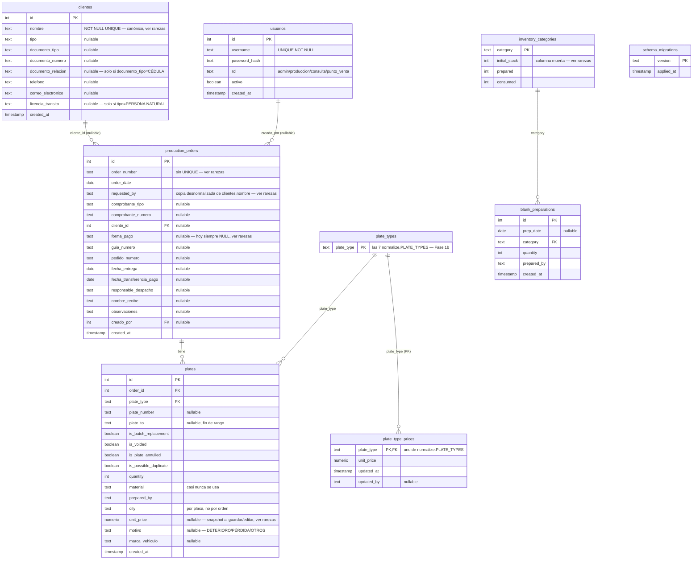

# Base de datos

[← volver al índice](README.md)

> Este esquema (`init.sql`, aplicado solo la primera vez que se inicializa
> el volumen de Postgres — editarlo no hace nada sobre una base ya
> existente) recibió su cambio grande en la **Fase 1** de la feature POS
> (captura de orden de venta completa + cuadre de caja): las tablas
> `clientes`/`usuarios`/`plate_type_prices`/`schema_migrations` y las
> columnas nuevas de `production_orders`/`plates` de más abajo. Las fases
> siguientes de esa feature (`app/core`, `/ingest`, `/precios`, `/cuadre`)
> construyen lógica de negocio **sobre** este esquema — no vuelven a
> tocarlo. Este documento ya refleja ese esquema final.
>
> **Aplicar el cambio a una base ya existente** (con datos reales, no un
> volumen nuevo) es trabajo del runner nuevo `app/schema_migrate.py`
> (`python -m app.schema_migrate`), NO de editar `init.sql` — aplica
> `app/migrations/*.sql` en orden (idempotente, seguro de correr dos veces) y
> corre el backfill de `clientes`/`usuarios` descrito en las tablas de abajo.
> `deploy.yml` ya lo invoca automáticamente después de cada
> `docker compose up -d --build`.
>
> **Estado de transición, a propósito**: la tabla `usuarios` ya existe y ya
> está poblada (backfill desde `AUTH_USERS`/`AUTH_ROLES`), pero
> `app/web/auth.py` **todavía lee de esas variables de entorno**, no de la
> tabla — conectar el login a `usuarios` es trabajo de una fase posterior de
> la misma feature, fuera de este documento. No asumir que `usuarios` ya
> está "viva" solo porque existe.

## Diagrama

`schema_migrations` es la única tabla del esquema sin ninguna FK hacia el
resto — es puro bookkeeping de `app/schema_migrate.py`, sin relación con el
resto del dominio.

Desde la **Fase 1b**, las otras tres relaciones que antes existían solo "por
convención de texto" (mismo valor, sin FK real) ya son FK reales:
- `plates.plate_type` y `plate_type_prices.plate_type` → `plate_types
  (plate_type)`. `plate_types` es una tabla nueva, sembrada con los 7
  valores de `normalize.PLATE_TYPES` — la validación en Python contra esa
  misma constante **se mantiene** (mensaje de error más claro antes de
  llegar a la BD); la FK es una red de seguridad adicional a nivel de datos,
  no un reemplazo.
- `blank_preparations.category` → `inventory_categories(category)`.
  `inventory_categories` ya existía (Fase 1) y ahora hace de tabla de
  referencia natural para las 3 categorías — no hizo falta una tabla nueva
  para esta. **Por eso `inventory_categories` está sembrada con sus 3 filas
  desde `init.sql`/la migración**, en vez de nacer vacía como antes de la
  Fase 1b: si no tuviera ya las 3 filas, la primerísima fila de
  ALISTAMIENTO en un volumen recién creado fallaría contra esta FK, porque
  `recalc_inventory()` (en `app/core/db.py`) solo crea esas filas *después*
  de insertar en `blank_preparations`, no antes.
- `recalc_inventory()` sigue agregando `prepared`/`consumed` por texto de
  `category`/`plate_type` sobre `blank_preparations`/`plates` — eso no
  cambió; lo nuevo es que esos valores de texto ahora están garantizados
  por FK a ser uno de los válidos, en vez de solo por convención.

`cliente_id`/`creado_por` en `production_orders` sí son FK reales (a
`clientes(id)`/`usuarios(id)`), ambas nullable y sin `ON DELETE` — igual que
la FK preexistente `plates.order_id`.

No existe ningún `VIEW` ni `CHECK constraint` en todo el esquema.
`clientes.nombre UNIQUE` (Fase 1) es la primera y única restricción de
unicidad del esquema aparte de las PK, y `plates_order_id_idx` (Fase 1) es
el primer índice fuera de una PK/UNIQUE — ver rarezas para ambos.

## Columnas por tabla

### `production_orders`

| Columna | Tipo | Constraint/Default | Nota |
|---|---|---|---|
| `id` | SERIAL | PK | |
| `order_number` | TEXT | NOT NULL | `TEXT`, no `INTEGER`, a propósito — hay números reales no numéricos (ej. `"NT 895"`). Sin `UNIQUE`. |
| `order_date` | DATE | NOT NULL | Fecha real del negocio, distinta de `created_at`. |
| `requested_by` | TEXT | NOT NULL | "Solicitado por" — normalizado en `app/core/normalize.py`. Desde la Fase 1, copia desnormalizada de `clientes.nombre` — ver rarezas. |
| `comprobante_tipo` | TEXT | nullable | *Fase 1: columna agregada al esquema; el flujo de `/ingest` todavía no la llena (fase posterior de la misma feature).* Valor esperado: `normalize.COMPROBANTE_TIPOS` (`FACTURA`/`RECIBO`/`OTROS`). |
| `comprobante_numero` | TEXT | nullable | Ídem — sin normalización de vocabulario, es un número/código libre. |
| `cliente_id` | INTEGER | FK → `clientes(id)`, nullable | Nullable porque no todo valor histórico de `requested_by` resuelve a un cliente limpio — ver el backfill en `app/schema_migrate.py` y rarezas. |
| `forma_pago` | TEXT | nullable | Valor esperado: `normalize.FORMAS_PAGO` (`EFECTIVO`/`TRANSFERENCIA`/`CRÉDITO`/`OTROS`). Hoy **todas** las órdenes existentes tienen esto en `NULL` — ver rarezas. |
| `guia_numero` | TEXT | nullable | |
| `pedido_numero` | TEXT | nullable | El número de `PEDIDO #:` impreso — **no** es lo mismo que `order_number` (`ORDEN DE PRODUCCIÓN`), no confundirlos. |
| `fecha_entrega` | DATE | nullable | A diferencia de `order_date`, una fecha futura acá es válida y esperada. |
| `fecha_transferencia_pago` | DATE | nullable | |
| `responsable_despacho` | TEXT | nullable | |
| `nombre_recibe` | TEXT | nullable | Quien recibió físicamente el pedido — distinto de `cliente_id`/`requested_by`. |
| `observaciones` | TEXT | nullable | |
| `creado_por` | INTEGER | FK → `usuarios(id)`, nullable | El usuario logueado que guardó la orden — distinto de `responsable_despacho`/`nombre_recibe` (datos de la entrega física, no de quién la cargó al sistema). |
| `created_at` | TIMESTAMP | DEFAULT now() | Nunca se usa para ordenar por "reciente" (ver `recent_orders` en [`CORE.md`](CORE.md)). |

### `plates`

| Columna | Tipo | Constraint/Default | Nota |
|---|---|---|---|
| `id` | SERIAL | PK | |
| `order_id` | INTEGER | FK → `production_orders(id)` | Nullable en el esquema, sin `ON DELETE`; el borrado en cascada lo hace la app (`delete_order` borra placas antes que la orden). Indexado (`plates_order_id_idx`, Fase 1) — ver rarezas. |
| `plate_type` | TEXT | NOT NULL, FK → `plate_types(plate_type)` (Fase 1b) | `CARRO PARTICULAR`, `MOTO PARTICULAR`, `CARRO PÚBLICO`, `MOTO CARRO PÚBLICO`, `REMOLQUE`, `ORNAMENTAL`, etc. |
| `plate_number` | TEXT | nullable | Placa única, o inicio de rango. `NULL` es válido (reposiciones sin placa asignada aún). |
| `plate_to` | TEXT | nullable | Fin de rango; `NULL` en placas únicas/reposiciones. |
| `quantity` | INTEGER | NOT NULL DEFAULT 1 | |
| `material` | TEXT | nullable | Rara vez se llena directo — el material real se deriva de `plate_type`. |
| `prepared_by` | TEXT | nullable | Rara vez se llena. |
| `city` | TEXT | nullable | **Por placa, no por orden** — una orden puede despachar a varias ciudades. |
| `unit_price` | NUMERIC(12,2) | nullable | *Fase 1: columna agregada al esquema; nada la escribe todavía (fase posterior de la misma feature).* Cuando se use: snapshot del precio al momento de guardar/editar la placa, tomado de `plate_type_prices` pero editable — no una referencia viva a la tarifa. `NULL` significa "sin tarifa capturada", nunca se trata como `0`. |
| `motivo` | TEXT | nullable | Dato del vehículo/placa, no de la orden. Valor esperado: `normalize.MOTIVOS` (`DETERIORO`/`PÉRDIDA`/`OTROS`). |
| `marca_vehiculo` | TEXT | nullable | Dato del vehículo, siempre de captura manual (no viene impreso en el PDF de pedido). |
| `created_at` | TIMESTAMP | DEFAULT now() | |

### `clientes`

*Agregada en la Fase 1.* Es el mismo concepto que ya existía como texto en
`requested_by` (PTO.V, MUVA, etc.), ahora con atributos propios.

| Columna | Tipo | Constraint/Default | Nota |
|---|---|---|---|
| `id` | SERIAL | PK | |
| `nombre` | TEXT | NOT NULL UNIQUE | Forma **canónica**: `normalize.normalize_requested_by(valor)`. Ver rarezas — es la primera `UNIQUE` del esquema aparte de las PK. |
| `tipo` | TEXT | nullable | Valor esperado: `normalize.CLIENTE_TIPOS` (`PERSONA NATURAL`/`TRÁNSITO`/`EMPRESA`/`OTROS`). No confundir con los *valores* de `plates.motivo` ni con `documento_tipo`. |
| `documento_tipo` | TEXT | nullable | Valor esperado: `normalize.DOCUMENTO_TIPOS` (`NIT`/`CÉDULA`/`OTROS`). |
| `documento_numero` | TEXT | nullable | `TEXT` siempre, aunque a veces sea numérico — un NIT trae dígito de verificación/guiones. |
| `documento_relacion` | TEXT | nullable | Solo tiene sentido si `documento_tipo = 'CÉDULA'`; debe quedar `NULL` en cualquier otro caso (se refuerza en servidor, no solo en el HTML). |
| `telefono` | TEXT | nullable | |
| `correo_electronico` | TEXT | nullable | |
| `licencia_transito` | TEXT | nullable | Solo tiene sentido si `tipo = 'PERSONA NATURAL'`; debe quedar `NULL` en cualquier otro caso, mismo refuerzo en servidor. |
| `created_at` | TIMESTAMP | DEFAULT now() | |

Todos los clientes backfillados desde `production_orders` histórico quedan
con todos estos atributos en `NULL` salvo `nombre` — son desconocidos para
datos anteriores a este feature (ver `app/schema_migrate.py::backfill_clientes`).

### `usuarios`

*Agregada en la Fase 1, ya poblada por backfill — pero `app/web/auth.py`
todavía NO la consulta* (sigue leyendo `AUTH_USERS`/`AUTH_ROLES`; ver el
aviso al principio de este documento).

| Columna | Tipo | Constraint/Default | Nota |
|---|---|---|---|
| `id` | SERIAL | PK | |
| `username` | TEXT | UNIQUE NOT NULL | |
| `password_hash` | TEXT | NOT NULL | Mismo formato werkzeug (pbkdf2) que `AUTH_USERS` hoy — el backfill copia el hash tal cual, nunca resetea contraseñas. |
| `rol` | TEXT | NOT NULL | `admin`/`produccion`/`consulta`/`punto_venta`, texto libre validado en Python contra una tupla en `auth.py`, sin FK ni `CHECK` en la BD — a diferencia de `plate_type_prices.plate_type`/`plates.plate_type`/`blank_preparations.category`, que desde la Fase 1b sí tienen FK real (ver rarezas). |
| `activo` | BOOLEAN | DEFAULT true | |
| `created_at` | TIMESTAMP | DEFAULT now() | |

### `plate_types`

*Agregada en la **Fase 1b**.* Tabla de referencia pura (sin más columnas que
la PK) para los 7 valores de `normalize.PLATE_TYPES` — antes de la Fase 1b
esto era solo una convención de texto compartida entre `plates.plate_type` y
`plate_type_prices.plate_type`, sin nada en la BD que la hiciera cumplir. Ver
rarezas para el detalle de por qué `plates`/`plate_type_prices` ahora
referencian esta tabla con FK real.

| Columna | Tipo | Constraint/Default | Nota |
|---|---|---|---|
| `plate_type` | TEXT | PK | Sembrada una vez, desde `init.sql`/`app/migrations/0002_reference_integrity.sql`, con los 7 valores exactos de `normalize.PLATE_TYPES`. No se escribe en ningún otro lugar de la app. |

### `plate_type_prices`

*Agregada en la Fase 1, arranca **vacía** — sin seed data.*

| Columna | Tipo | Constraint/Default | Nota |
|---|---|---|---|
| `plate_type` | TEXT | PK, FK → `plate_types(plate_type)` (Fase 1b) | Uno de los 7 valores de `normalize.PLATE_TYPES` — **nunca** uno de los 3 `inventory_categories.category`. Ver rarezas, es fácil confundir estos dos espacios de nombres. |
| `unit_price` | NUMERIC(12,2) | NOT NULL | Tarifa **sugerida/default**, no bloqueada — el precio real puede variar por cliente/negociación y queda editable al capturar cada placa (`plates.unit_price`). |
| `updated_at` | TIMESTAMP | DEFAULT now() | |
| `updated_by` | TEXT | nullable | |

Un `plate_type` sin fila acá significa "sin tarifa configurada", no `0` —
las lecturas nunca deben usar `COALESCE(unit_price, 0)`.

### `schema_migrations`

*Agregada en la Fase 1.* Bookkeeping puro para `app/schema_migrate.py`
(`python -m app.schema_migrate`) — no la toca ninguna otra parte de la app.

| Columna | Tipo | Constraint/Default | Nota |
|---|---|---|---|
| `version` | TEXT | PK | Nombre del archivo aplicado (ej. `0001_pos_fields.sql`) o, para los pasos de backfill en Python (no son archivos `.sql`), un nombre sintético (`0002_backfill_clientes`, `0003_backfill_usuarios`). |
| `applied_at` | TIMESTAMP | DEFAULT now() | |

### `blank_preparations`

| Columna | Tipo | Constraint/Default | Nota |
|---|---|---|---|
| `id` | SERIAL | PK | |
| `prep_date` | DATE | nullable | Sin `NOT NULL` a pesar de representar "cuándo se preparó". |
| `category` | TEXT | NOT NULL, FK → `inventory_categories(category)` (Fase 1b) | Uno de los 3 valores de `normalize.INVENTORY_CATEGORIES`. |
| `quantity` | INTEGER | NOT NULL DEFAULT 0 | |
| `prepared_by` | TEXT | nullable | |
| `created_at` | TIMESTAMP | DEFAULT now() | |

Representa eventos de "ALISTAMIENTO" — blanks cortados/preparados de
antemano, o ingreso de material nuevo. No son placas; solo alimentan
`inventory_categories.prepared`.

### `inventory_categories`

| Columna | Tipo | Constraint/Default | Nota |
|---|---|---|---|
| `category` | TEXT | PK | Una de las 3 categorías fijas: `CARRO PARTICULAR`, `MOTO PARTICULAR`, `PÚBLICO`. Sembrada con esas 3 filas desde `init.sql`/la migración desde la **Fase 1b** — ver rarezas (antes de eso, esta tabla nacía vacía). |
| `initial_stock` | INTEGER | DEFAULT 0 | **Columna muerta** — ver rarezas. |
| `prepared` | INTEGER | DEFAULT 0 | Recalculado por `recalc_inventory()` como suma de `blank_preparations.quantity`. |
| `consumed` | INTEGER | DEFAULT 0 | Recalculado por `recalc_inventory()` como suma de `plates.quantity` no anuladas, mapeadas a material. |

## Rarezas que hay que conocer

### `requested_by` sigue siendo una copia desnormalizada de `clientes.nombre`

Desde la Fase 1, `requested_by` (el "solicitante") y el `nombre` de
`clientes` son **la misma entidad** — pero `production_orders.requested_by`
**se mantiene**, sigue siendo `NOT NULL`, y se sigue escribiendo siempre. No
se convirtió en una columna derivada/calculada porque 9 queries de lectura y
2 templates lo usan directo sin pasar por `clientes`
(`recent_orders`, `find_orders_by_number`, `search_orders_by_number`,
`search_plates_by_number`, `find_orders_for_plate`, `review_rows`,
`order_detail`, `distinct_requested_by`, `_orders_table.html`,
`record_detail.html`). Regla que hay que respetar en cualquier código nuevo:
**toda escritura que fija `cliente_id` debe fijar también `requested_by =
clientes.nombre` en la misma operación** — dejarlos desincronizados es un
bug, no una variante válida.

### `clientes.nombre UNIQUE` — la primera restricción de unicidad real

Aparte de las PK, es la única `UNIQUE` de todo el esquema — deliberada,
porque es lo que le da a "buscar cliente por nombre y reusar sus datos" una
definición clara (y de paso, el índice de búsqueda gratis). **Política de
colisión, a propósito**: dos clientes reales distintos que tipean el mismo
nombre canónico se tratan como el MISMO cliente — ya es el comportamiento de
hoy en `normalize._REQUESTED_BY_MAP_RAW` (variantes como `MUVA GRANADA`/`MUVA
SERGIO` quedan sin fusionar a propósito); para separarlos se tipea un nombre
calificado (`PTO.V FABIO M`), igual que siempre. `clientes.nombre` no fuerza
nada distinto — solo canonicaliza (`normalize.normalize_requested_by`).

### `plates_order_id_idx` — primer índice de este esquema fuera de PK/UNIQUE

Agregado en la Fase 1 porque el reporte de cuadre de caja (fase posterior de
esta misma feature) introduce el primer `JOIN` agregado real sobre toda la
tabla `plates`. Antes de esto, el esquema no tenía ningún índice más allá de
los que Postgres crea automáticamente para las PK.

### `plate_type` (7 valores) vs. `inventory_categories.category` (3 materiales)

Dos "espacios de nombres" que se parecen y no hay que confundir — ya existían
antes de la Fase 1, pero `plate_type_prices` los vuelve más importantes de
tener claros: `plates.plate_type` tiene 7 valores granulares
(`normalize.PLATE_TYPES`), mientras que `inventory_categories.category`
tiene solo 3 materiales (`normalize.INVENTORY_CATEGORIES`, varios
`plate_type` mapean al mismo material). `plate_type_prices` está indexada
por `plate_type` (7 valores) — la tarifa se factura por tipo de placa
vendido, no por material de inventario. Confundirlos dejaría `ORNAMENTAL`
sin poder tener precio propio y le daría a `REMOLQUE` la tarifa de
`CARRO PÚBLICO`. Precio (dinero, por tipo) e inventario (cantidades, por
material) son loops separados en `app/core/db.py` y deben seguir separados.
Desde la Fase 1b cada espacio de nombres tiene su propia tabla de referencia
real (`plate_types` para los 7 tipos, `inventory_categories` para los 3
materiales) — dos tablas *distintas*, no una FK compartida; seguir sin
confundirlas.

### `order_number` sin `UNIQUE`

Puede haber legítimamente **2 o más filas** de `production_orders` con el
mismo `order_number` — nada en el esquema ni en el código antiguo lo
impedía. `find_orders_by_number()` puede devolver 0, 1, o 2+ filas; la
función `replace_order()` (ver [`CORE.md`](CORE.md)) existe justamente para
**fusionar** todas las coincidencias en una sola orden cuando el usuario lo
pide explícitamente.

### `city` vive en `plates`, no en `production_orders`

Es deliberado: una orden puede tener placas para varias ciudades a la vez
(ej. un pedido mixto carro+moto). `production_orders` no tiene columna
`city` — cualquier "ciudades de esta orden" se recalcula agregando
`array_agg(DISTINCT p.city)` sobre sus placas. Solo los tipos
`CARRO PARTICULAR` y `CARRO PÚBLICO` son realmente específicos de ciudad;
el resto por defecto queda en `"COLOMBIA"` si se deja en blanco.

### Los 4 flags booleanos de `plates` — fácil confundirlos

| Flag | Significa | ¿Cuenta como "consumido" en inventario? | Se limpia... |
|---|---|---|---|
| `is_batch_replacement` | "Reposición": lote sin números de placa individuales identificados | Sí, consume material igual | Manualmente al recuperar la placa real (bug histórico ya corregido: `update_plate_full` ahora sí actualiza este flag) |
| `is_voided` | Orden/placa anulada — el blank nunca se consumió | **No** — excluida de `consumed` | Es un estado permanente de la fila, no se "limpia" |
| `is_plate_annulled` | Placa anulada pero el blank físico ya se gastó/perdió | **Sí** — cuenta además como "wasted" | No se limpia automáticamente |
| `is_possible_duplicate` | Candidata a duplicado, pendiente de revisión en `/review` | No afecta inventario | Con cualquier edición (`update_plate`, `update_plate_full`, `resolve_plate`), o en cascada por `delete_plate` cuando ya no queda otra fila ambigua con ese número |

### `initial_stock` es una columna muerta

El comentario original en `init.sql` sugiere que `available` debería ser
`initial_stock + prepared - consumed`, pero en el código real
(`app/core/db.py::inventory_view()`) es solo `prepared - consumed` — nunca
se lee ni se escribe `initial_stock` en ningún lugar de la app. La línea
base histórica se incorporó, en cambio, como filas reconciliadas dentro de
`blank_preparations` durante la migración de Excel
(`app/migrate.py::RECONCILED_ALISTAMIENTO`). No asumir que esta columna
está viva.

### Sin índices en columnas muy consultadas (parcialmente resuelto)

`plates.order_id` ya tiene índice (`plates_order_id_idx`, Fase 1 — ver
rarezas arriba). Pero **sigue sin haber índice** en `plates.plate_number` ni
`plates.city`, a pesar de que ambas se filtran/joinean constantemente
(`find_orders_for_plate`, las búsquedas `ILIKE` de Registros,
`distinct_cities`). No es un problema hoy por el volumen de datos, pero es
lo primero a revisar si una consulta de Registros empieza a sentirse lenta.
