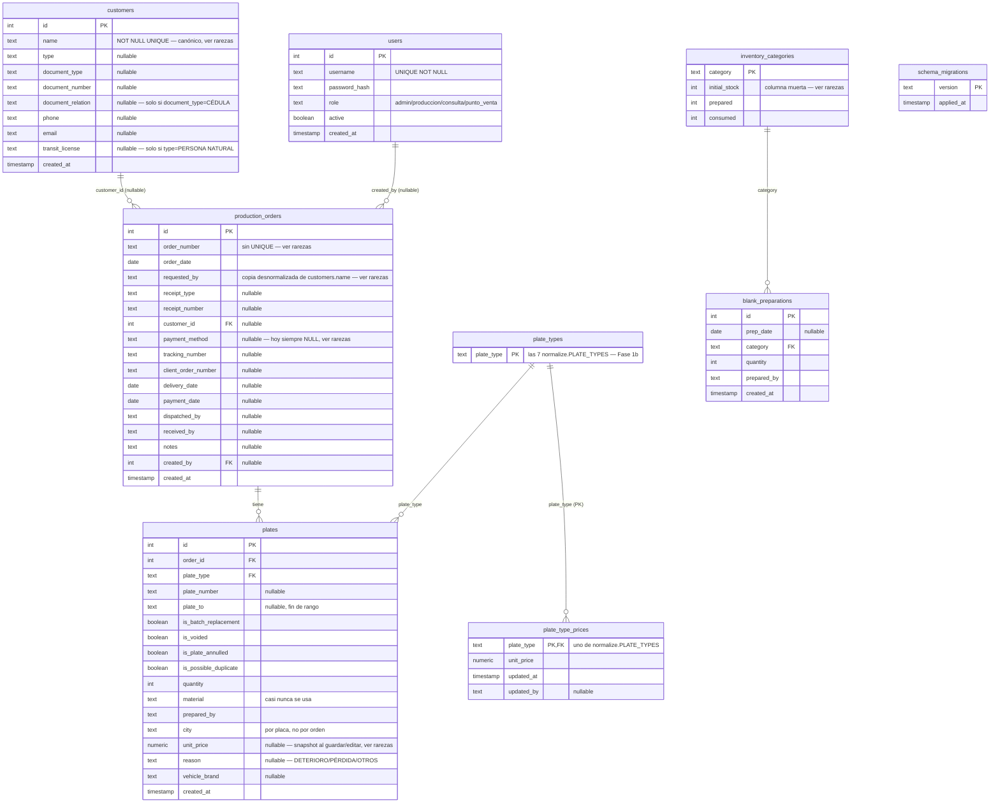

# Base de datos

[← volver al índice](README.md)

> Este esquema (`init.sql`, aplicado solo la primera vez que se inicializa
> el volumen de Postgres — editarlo no hace nada sobre una base ya
> existente) recibió su cambio grande en la **Fase 1** de la feature POS
> (captura de orden de venta completa + cuadre de caja): las tablas
> `customers`/`users`/`plate_type_prices`/`schema_migrations` y las
> columnas nuevas de `production_orders`/`plates` de más abajo. **La
> feature completa ya está en producción** (Fases 1-5b, ver
> `PLAN_ARQUITECTURA_Y_POS.md` en la raíz del repo para el historial
> completo): `/ingest` captura todos los campos POS, `/precios` administra
> `plate_type_prices`, `/cuadre` agrega los totales, y `app/web/auth.py`
> consulta `users` en cada login. Este documento refleja ese estado final.
>
> **Nota histórica (Fase 1c)**: la Fase 1 original nombró `clientes`/
> `usuarios` (tabla + columnas como `nombre`/`tipo`/`rol`/`activo`) **y**
> todas las columnas nuevas de POS en `production_orders`/`plates`
> (`comprobante_tipo`, `cliente_id`, `forma_pago`, `creado_por`, `motivo`,
> `marca_vehiculo`, etc.) en español, antes de fijar la convención de
> `CLAUDE.md` (identificadores en inglés, contenido/valores en español). La
> **Fase 1c** (`app/migrations/0003_rename_to_english.sql`) renombró TODO
> eso a sus nombres en inglés finales — tabla y columnas de `clientes`/
> `usuarios`, y cada columna Spanish-named de `production_orders`/`plates`
> (mapeo completo más abajo, sección de `production_orders`/`plates`) —
> tanto en producción como en `init.sql` para instalaciones nuevas. Los
> *valores* guardados (nombres de clientes, `PERSONA NATURAL`/`CÉDULA`/
> `DUEÑO`, `admin`/`producción`/`consulta`/`punto_venta`, `EFECTIVO`, etc.)
> no cambiaron — son datos de negocio en español, no identificadores.
>
> **Aplicar un cambio de esquema a una base ya existente** (con datos
> reales, no un volumen nuevo) es trabajo del runner `app/schema_migrate.py`
> (`python -m app.schema_migrate`), NO de editar `init.sql` — aplica
> `app/migrations/*.sql` en orden (idempotente, seguro de correr dos veces).
> `deploy.yml` ya lo invoca automáticamente después de cada
> `docker compose up -d --build`.

## Diagrama

`schema_migrations` es la única tabla del esquema sin ninguna FK hacia el
resto — es puro bookkeeping de `app/schema_migrate.py`, sin relación con el
resto del dominio.

Desde la **Fase 1b**, las otras tres relaciones que antes existían solo "por
convención de texto" (mismo valor, sin FK real) ya son FK reales:
- `plates.plate_type` y `plate_type_prices.plate_type` → `plate_types
  (plate_type)`. `plate_types` es una tabla nueva, sembrada con los 7
  valores de `normalize.PLATE_TYPES` — la validación en Python contra esa
  misma constante **se mantiene** (mensaje de error más claro antes de
  llegar a la BD); la FK es una red de seguridad adicional a nivel de datos,
  no un reemplazo.
- `blank_preparations.category` → `inventory_categories(category)`.
  `inventory_categories` ya existía (Fase 1) y ahora hace de tabla de
  referencia natural para las 3 categorías — no hizo falta una tabla nueva
  para esta. **Por eso `inventory_categories` está sembrada con sus 3 filas
  desde `init.sql`/la migración**, en vez de nacer vacía como antes de la
  Fase 1b: si no tuviera ya las 3 filas, la primerísima fila de
  ALISTAMIENTO en un volumen recién creado fallaría contra esta FK, porque
  `recalc_inventory()` (en `app/core/db/`) solo crea esas filas *después*
  de insertar en `blank_preparations`, no antes.
- `recalc_inventory()` sigue agregando `prepared`/`consumed` por texto de
  `category`/`plate_type` sobre `blank_preparations`/`plates` — eso no
  cambió; lo nuevo es que esos valores de texto ahora están garantizados
  por FK a ser uno de los válidos, en vez de solo por convención.

`customer_id`/`created_by` en `production_orders` sí son FK reales (a
`customers(id)`/`users(id)`), ambas nullable y sin `ON DELETE` — igual que
la FK preexistente `plates.order_id`.

No existe ningún `VIEW` ni `CHECK constraint` en todo el esquema.
`customers.name UNIQUE` (Fase 1) es la primera y única restricción de
unicidad del esquema aparte de las PK, y `plates_order_id_idx` (Fase 1) es
el primer índice fuera de una PK/UNIQUE — ver rarezas para ambos.

## Columnas por tabla

### `production_orders`

| Columna | Tipo | Constraint/Default | Nota |
|---|---|---|---|
| `id` | SERIAL | PK | |
| `order_number` | TEXT | NOT NULL | `TEXT`, no `INTEGER`, a propósito — hay números reales no numéricos (ej. `"NT 895"`). Sin `UNIQUE`. |
| `order_date` | DATE | NOT NULL | Fecha real del negocio, distinta de `created_at`. |
| `requested_by` | TEXT | NOT NULL | "Solicitado por" — normalizado en `app/core/normalize.py`. Desde la Fase 1, copia desnormalizada de `customers.name` — ver rarezas. |
| `receipt_type` | TEXT | nullable | Valor esperado: `normalize.RECEIPT_TYPES` (`FACTURA`/`RECIBO`/`OTROS`); campo de captura manual en `/ingest`, sin equivalente impreso en el PDF de pedido. Antes de la Fase 1c, esta columna se llamaba `comprobante_tipo`. |
| `receipt_number` | TEXT | nullable | Ídem — sin normalización de vocabulario, es un número/código libre. Antes de la Fase 1c, `comprobante_numero`. |
| `customer_id` | INTEGER | FK → `customers(id)`, nullable | Nullable porque no todo valor histórico de `requested_by` resuelve a un cliente limpio — ver el backfill en `app/schema_migrate.py` y rarezas. Antes de la Fase 1c, `cliente_id`. |
| `payment_method` | TEXT | nullable | Valor esperado: `normalize.PAYMENT_METHODS` (`EFECTIVO`/`TRANSFERENCIA`/`CRÉDITO`/`OTROS`). **Obligatorio en `/ingest`** desde la Fase 3 (es la clave que agrupa `/cuadre`) — sigue `NULL` en toda orden anterior a esa fase, de ahí el bucket "SIN FORMA DE PAGO" del cuadre (ver rarezas). Antes de la Fase 1c, `forma_pago`. |
| `tracking_number` | TEXT | nullable | Antes de la Fase 1c, `guia_numero`. |
| `client_order_number` | TEXT | nullable | El número de `PEDIDO #:` impreso — **no** es lo mismo que `order_number` (`ORDEN DE PRODUCCIÓN`), no confundirlos. Antes de la Fase 1c, `pedido_numero`. |
| `delivery_date` | DATE | nullable | A diferencia de `order_date`, una fecha futura acá es válida y esperada. Antes de la Fase 1c, `fecha_entrega`. |
| `payment_date` | DATE | nullable | Antes de la Fase 1c, `fecha_transferencia_pago`. |
| `dispatched_by` | TEXT | nullable | Antes de la Fase 1c, `responsable_despacho`. |
| `received_by` | TEXT | nullable | Quien recibió físicamente el pedido — distinto de `customer_id`/`requested_by`. Antes de la Fase 1c, `nombre_recibe`. |
| `notes` | TEXT | nullable | Antes de la Fase 1c, `observaciones`. |
| `created_by` | INTEGER | FK → `users(id)`, nullable | El usuario logueado que guardó la orden — distinto de `dispatched_by`/`received_by` (datos de la entrega física, no de quién la cargó al sistema). Antes de la Fase 1c, `creado_por`. |
| `created_at` | TIMESTAMP | DEFAULT now() | Nunca se usa para ordenar por "reciente" (ver `recent_orders` en [`CORE.md`](CORE.md)). |

### `plates`

| Columna | Tipo | Constraint/Default | Nota |
|---|---|---|---|
| `id` | SERIAL | PK | |
| `order_id` | INTEGER | FK → `production_orders(id)` | Nullable en el esquema, sin `ON DELETE`; el borrado en cascada lo hace la app (`delete_order` borra placas antes que la orden). Indexado (`plates_order_id_idx`, Fase 1) — ver rarezas. |
| `plate_type` | TEXT | NOT NULL, FK → `plate_types(plate_type)` (Fase 1b) | `CARRO PARTICULAR`, `MOTO PARTICULAR`, `CARRO PÚBLICO`, `MOTO CARRO PÚBLICO`, `REMOLQUE`, `ORNAMENTAL`, etc. |
| `plate_number` | TEXT | nullable | Placa única, o inicio de rango. `NULL` es válido (reposiciones sin placa asignada aún). |
| `plate_to` | TEXT | nullable | Fin de rango; `NULL` en placas únicas/reposiciones. |
| `quantity` | INTEGER | NOT NULL DEFAULT 1 | |
| `material` | TEXT | nullable | Rara vez se llena directo — el material real se deriva de `plate_type`. |
| `prepared_by` | TEXT | nullable | Rara vez se llena. |
| `city` | TEXT | nullable | **Por placa, no por orden** — una orden puede despachar a varias ciudades. |
| `unit_price` | NUMERIC(12,2) | nullable | Snapshot del precio al momento de guardar/editar la placa, tomado de `plate_type_prices` pero editable — no una referencia viva a la tarifa (la regla exacta de re-snapshot, incluidos los 3 casos de edición, vive en `app/core/db/plates.py::_resnapshot_unit_price`, ver [`CORE.md`](CORE.md)). `NULL` significa "sin tarifa capturada" — `/cuadre` lo excluye del total y lo lista como aviso, nunca lo trata como `0`. |
| `reason` | TEXT | nullable | Dato del vehículo/placa, no de la orden. Valor esperado: `normalize.REASONS` (`DETERIORO`/`PÉRDIDA`/`OTROS`). Antes de la Fase 1c, esta columna se llamaba `motivo`. |
| `vehicle_brand` | TEXT | nullable | Dato del vehículo, siempre de captura manual (no viene impreso en el PDF de pedido). Antes de la Fase 1c, `marca_vehiculo`. |
| `created_at` | TIMESTAMP | DEFAULT now() | |

### `customers`

*Agregada en la Fase 1 (como `clientes`; renombrada a `customers` en la
**Fase 1c** — ver el aviso al principio de este documento).* Es el mismo
concepto que ya existía como texto en `requested_by` (PTO.V, MUVA, etc.),
ahora con atributos propios.

| Columna | Tipo | Constraint/Default | Nota |
|---|---|---|---|
| `id` | SERIAL | PK | |
| `name` | TEXT | NOT NULL UNIQUE | Forma **canónica**: `normalize.normalize_requested_by(valor)`. Ver rarezas — es la primera `UNIQUE` del esquema aparte de las PK. Antes de la Fase 1c, esta columna se llamaba `nombre`. |
| `type` | TEXT | nullable | Valor esperado: `normalize.CUSTOMER_TYPES` (`PERSONA NATURAL`/`TRÁNSITO`/`EMPRESA`/`OTROS`). No confundir con los *valores* de `plates.reason` ni con `document_type`. |
| `document_type` | TEXT | nullable | Valor esperado: `normalize.DOCUMENT_TYPES` (`NIT`/`CÉDULA`/`OTROS`). |
| `document_number` | TEXT | nullable | `TEXT` siempre, aunque a veces sea numérico — un NIT trae dígito de verificación/guiones. |
| `document_relation` | TEXT | nullable | Solo tiene sentido si `document_type = 'CÉDULA'`; debe quedar `NULL` en cualquier otro caso (se refuerza en servidor, no solo en el HTML). |
| `phone` | TEXT | nullable | |
| `email` | TEXT | nullable | |
| `transit_license` | TEXT | nullable | Solo tiene sentido si `type = 'PERSONA NATURAL'`; debe quedar `NULL` en cualquier otro caso, mismo refuerzo en servidor. |
| `created_at` | TIMESTAMP | DEFAULT now() | |

Todos los clientes backfillados desde `production_orders` histórico
quedaron con todos estos atributos en `NULL` salvo `name` — son
desconocidos para datos anteriores a este feature (ver
`app/schema_migrate.py::backfill_customers`, renombrada de
`backfill_clientes` en la Fase 1d; el *string* de versión que quedó
grabado en `schema_migrations` sigue siendo `"0002_backfill_clientes"`, sin
tocar — ver la nota de `schema_migrations` más abajo).

Desde la **Fase 3**, `/ingest` resuelve/crea un `customers` por cada orden
guardada (`db.resolve_or_create_customer`, vía
`normalize.normalize_requested_by`) — si el nombre tipeado matchea uno
existente, el JS del form auto-llena el resto de sus atributos desde la
lista completa de clientes embebida en `ingest.html`; si no matchea, se
crea un cliente nuevo con los atributos tipeados. **Regla B5, deliberada**:
`resolve_or_create_customer` solo escribe atributos en la rama INSERT (un
cliente genuinamente nuevo) — editar una orden ya guardada (`record_save`)
puede volver a apuntar `customer_id` hacia otro cliente si se cambia el
nombre, pero nunca reescribe los atributos de un cliente ya existente; eso
queda para una futura pantalla de administración de clientes.

### `users`

*Agregada en la Fase 1 (como `usuarios`; renombrada a `users` en la
**Fase 1c**), poblada por backfill desde `AUTH_USERS`/`AUTH_ROLES`.* Desde
la **Fase 2**, `app/web/auth.py::authenticate` consulta esta tabla en cada
login (vía `app/core/db/users.py`) — los mismos hashes que ya traía el
backfill, nadie tuvo que resetear contraseña. `load_users()`/`load_roles()`
en `auth.py` se mantienen, pero **solo** como el código histórico que hizo
el backfill original; el login en vivo no los llama más.

| Columna | Tipo | Constraint/Default | Nota |
|---|---|---|---|
| `id` | SERIAL | PK | Desde la Fase 2, se guarda en `session["user_id"]` al loguearse — es lo que permite `production_orders.created_by` sin volver a consultar por username. |
| `username` | TEXT | UNIQUE NOT NULL | |
| `password_hash` | TEXT | NOT NULL | Mismo formato werkzeug (pbkdf2) que `AUTH_USERS` traía — el backfill copió el hash tal cual, nunca reseteó contraseñas. |
| `role` | TEXT | NOT NULL | `admin`/`produccion`/`consulta`/`punto_venta` — **`produccion` va sin tilde, es el valor real guardado y comparado**, aunque la prosa de este documento diga "producción" por ser español corriente; cambiarlo rompería el login de usuarios existentes. Texto libre validado en Python contra la tupla `auth.ROLES`, sin FK ni `CHECK` en la BD — a diferencia de `plate_type_prices.plate_type`/`plates.plate_type`/`blank_preparations.category`, que desde la Fase 1b sí tienen FK real (ver rarezas). Antes de la Fase 1c, esta columna se llamaba `rol`. `punto_venta` (Fase 2) es el rol nuevo de PTO.V — nivel de acceso intermedio, `POS_ROLES = {admin, punto_venta}`, decorador `@pos_allowed` (ver [`WEB.md`](WEB.md)). |
| `active` | BOOLEAN | DEFAULT true | Antes de la Fase 1c, esta columna se llamaba `activo`. |
| `created_at` | TIMESTAMP | DEFAULT now() | |

### `plate_types`

*Agregada en la **Fase 1b**.* Tabla de referencia pura (sin más columnas que
la PK) para los 7 valores de `normalize.PLATE_TYPES` — antes de la Fase 1b
esto era solo una convención de texto compartida entre `plates.plate_type` y
`plate_type_prices.plate_type`, sin nada en la BD que la hiciera cumplir. Ver
rarezas para el detalle de por qué `plates`/`plate_type_prices` ahora
referencian esta tabla con FK real.

| Columna | Tipo | Constraint/Default | Nota |
|---|---|---|---|
| `plate_type` | TEXT | PK | Sembrada una vez, desde `init.sql`/`app/migrations/0002_reference_integrity.sql`, con los 7 valores exactos de `normalize.PLATE_TYPES`. No se escribe en ningún otro lugar de la app. |

### `plate_type_prices`

*Agregada en la Fase 1, arranca **vacía** — sin seed data.* Administrada
desde `/precios` (Fase 5a, admin-only) — ver [`WEB.md`](WEB.md).

| Columna | Tipo | Constraint/Default | Nota |
|---|---|---|---|
| `plate_type` | TEXT | PK, FK → `plate_types(plate_type)` (Fase 1b) | Uno de los 7 valores de `normalize.PLATE_TYPES` — **nunca** uno de los 3 `inventory_categories.category`. Ver rarezas, es fácil confundir estos dos espacios de nombres. |
| `unit_price` | NUMERIC(12,2) | NOT NULL | Tarifa **sugerida/default**, no bloqueada — el precio real puede variar por cliente/negociación y queda editable al capturar cada placa (`plates.unit_price`). |
| `updated_at` | TIMESTAMP | DEFAULT now() | |
| `updated_by` | TEXT | nullable | |

Un `plate_type` sin fila acá significa "sin tarifa configurada", no `0` —
las lecturas nunca deben usar `COALESCE(unit_price, 0)`.

### `schema_migrations`

*Agregada en la Fase 1.* Bookkeeping puro para `app/schema_migrate.py`
(`python -m app.schema_migrate`) — no la toca ninguna otra parte de la app.

| Columna | Tipo | Constraint/Default | Nota |
|---|---|---|---|
| `version` | TEXT | PK | Nombre del archivo aplicado (ej. `0001_pos_fields.sql`) o, para los pasos de backfill en Python (no son archivos `.sql`), un nombre sintético (`0002_backfill_clientes`, `0003_backfill_usuarios`). **Estos dos strings son literales fijos para siempre** — la Fase 1d renombró las funciones/constantes de Python que los escriben (`backfill_clientes`→`backfill_customers`, `BACKFILL_CLIENTES_VERSION`→`BACKFILL_CUSTOMERS_VERSION`, etc.), pero nunca los *valores* ya grabados en producción: cambiarlos haría que el runner crea que el backfill nunca corrió y lo repita contra datos reales. |
| `applied_at` | TIMESTAMP | DEFAULT now() | |

### `blank_preparations`

| Columna | Tipo | Constraint/Default | Nota |
|---|---|---|---|
| `id` | SERIAL | PK | |
| `prep_date` | DATE | nullable | Sin `NOT NULL` a pesar de representar "cuándo se preparó". |
| `category` | TEXT | NOT NULL, FK → `inventory_categories(category)` (Fase 1b) | Uno de los 3 valores de `normalize.INVENTORY_CATEGORIES`. |
| `quantity` | INTEGER | NOT NULL DEFAULT 0 | |
| `prepared_by` | TEXT | nullable | |
| `created_at` | TIMESTAMP | DEFAULT now() | |

Representa eventos de "ALISTAMIENTO" — blanks cortados/preparados de
antemano, o ingreso de material nuevo. No son placas; solo alimentan
`inventory_categories.prepared`.

### `inventory_categories`

| Columna | Tipo | Constraint/Default | Nota |
|---|---|---|---|
| `category` | TEXT | PK | Una de las 3 categorías fijas: `CARRO PARTICULAR`, `MOTO PARTICULAR`, `PÚBLICO`. Sembrada con esas 3 filas desde `init.sql`/la migración desde la **Fase 1b** — ver rarezas (antes de eso, esta tabla nacía vacía). |
| `initial_stock` | INTEGER | DEFAULT 0 | **Columna muerta** — ver rarezas. |
| `prepared` | INTEGER | DEFAULT 0 | Recalculado por `recalc_inventory()` como suma de `blank_preparations.quantity`. |
| `consumed` | INTEGER | DEFAULT 0 | Recalculado por `recalc_inventory()` como suma de `plates.quantity` no anuladas, mapeadas a material. |

## Rarezas que hay que conocer

### `requested_by` sigue siendo una copia desnormalizada de `customers.name`

Desde la Fase 1, `requested_by` (el "solicitante") y el `name` de
`customers` son **la misma entidad** — pero `production_orders.requested_by`
**se mantiene**, sigue siendo `NOT NULL`, y se sigue escribiendo siempre. No
se convirtió en una columna derivada/calculada porque 9 queries de lectura y
2 templates lo usan directo sin pasar por `customers`
(`recent_orders`, `find_orders_by_number`, `search_orders_by_number`,
`search_plates_by_number`, `find_orders_for_plate`, `review_rows`,
`order_detail`, `distinct_requested_by`, `_orders_table.html`,
`record_detail.html`). Regla que hay que respetar en cualquier código nuevo:
**toda escritura que fija `customer_id` debe fijar también `requested_by =
customers.name` en la misma operación** — dejarlos desincronizados es un
bug, no una variante válida.

### `customers.name UNIQUE` — la primera restricción de unicidad real

Aparte de las PK, es la única `UNIQUE` de todo el esquema — deliberada,
porque es lo que le da a "buscar cliente por nombre y reusar sus datos" una
definición clara (y de paso, el índice de búsqueda gratis). **Política de
colisión, a propósito**: dos clientes reales distintos que tipean el mismo
nombre canónico se tratan como el MISMO cliente — ya es el comportamiento de
hoy en `normalize._REQUESTED_BY_MAP_RAW` (variantes como `MUVA GRANADA`/`MUVA
SERGIO` quedan sin fusionar a propósito); para separarlos se tipea un nombre
calificado (`PTO.V FABIO M`), igual que siempre. `customers.name` no fuerza
nada distinto — solo canonicaliza (`normalize.normalize_requested_by`).

### Fase 1c cubrió TODO lo que Fase 1 agregó en español, no solo `clientes`/`usuarios`

Una versión anterior de este documento (y del plan) decía que las columnas
de POS en `production_orders`/`plates` (`cliente_id`, `creado_por`,
`comprobante_tipo`, `motivo`, etc.) habían quedado fuera del rename de la
Fase 1c porque "pertenecían a una Fase 2 que nunca llegó a pushear" — eso
era un error, detectado al verificar contra producción real con
`\d production_orders`/`\d plates`: esas columnas ya existían, agregadas
por la Fase 1 (PR #14) igual que `clientes`/`usuarios`, así que el rename
de la Fase 1c las cubre a todas — ver el mapeo completo en la sección de
`production_orders`/`plates` más arriba y en
`app/migrations/0003_rename_to_english.sql`. Las 2 FK existentes
(`production_orders_cliente_id_fkey` → `production_orders_customer_id_fkey`,
`production_orders_creado_por_fkey` → `production_orders_created_by_fkey`)
se renombraron también — no por necesidad funcional (Postgres nombra una FK
por la columna que referencia, no por la tabla referenciada, y la resuelve
por OID internamente, así que habría seguido funcionando igual sin
renombrarlas) sino para que el nombre de la constraint en una base ya
migrada coincida con el que Postgres le pone automáticamente en una
instalación nueva (mismo razonamiento que las constraints de
`customers`/`users`, ver arriba). Cuando la Fase 2 retome esta feature,
sigue construyendo directamente sobre estos nombres en inglés
(`receipt_type`, `payment_method`, `reason`, etc.), sin nada pendiente de
renombrar.

### `plates_order_id_idx` — primer índice de este esquema fuera de PK/UNIQUE

Agregado en la Fase 1, en anticipación al reporte de cuadre de caja
(`/cuadre`, Fase 5b — `app/core/cash_summary.py`), que efectivamente
introdujo el primer `JOIN` agregado real sobre toda la tabla `plates`
(`plates JOIN production_orders`, filtrado por `order_date`). Antes de
esto, el esquema no tenía ningún índice más allá de los que Postgres crea
automáticamente para las PK.

### `plate_type` (7 valores) vs. `inventory_categories.category` (3 materiales)

Dos "espacios de nombres" que se parecen y no hay que confundir — ya existían
antes de la Fase 1, pero `plate_type_prices` los vuelve más importantes de
tener claros: `plates.plate_type` tiene 7 valores granulares
(`normalize.PLATE_TYPES`), mientras que `inventory_categories.category`
tiene solo 3 materiales (`normalize.INVENTORY_CATEGORIES`, varios
`plate_type` mapean al mismo material). `plate_type_prices` está indexada
por `plate_type` (7 valores) — la tarifa se factura por tipo de placa
vendido, no por material de inventario. Confundirlos dejaría `ORNAMENTAL`
sin poder tener precio propio y le daría a `REMOLQUE` la tarifa de
`CARRO PÚBLICO`. Precio (dinero, por tipo) e inventario (cantidades, por
material) son loops separados en `app/core/db/` y deben seguir separados.
Desde la Fase 1b cada espacio de nombres tiene su propia tabla de referencia
real (`plate_types` para los 7 tipos, `inventory_categories` para los 3
materiales) — dos tablas *distintas*, no una FK compartida; seguir sin
confundirlas.

### `order_number` sin `UNIQUE`

Puede haber legítimamente **2 o más filas** de `production_orders` con el
mismo `order_number` — nada en el esquema ni en el código antiguo lo
impedía. `find_orders_by_number()` puede devolver 0, 1, o 2+ filas; la
función `replace_order()` (ver [`CORE.md`](CORE.md)) existe justamente para
**fusionar** todas las coincidencias en una sola orden cuando el usuario lo
pide explícitamente.

### `city` vive en `plates`, no en `production_orders`

Es deliberado: una orden puede tener placas para varias ciudades a la vez
(ej. un pedido mixto carro+moto). `production_orders` no tiene columna
`city` — cualquier "ciudades de esta orden" se recalcula agregando
`array_agg(DISTINCT p.city)` sobre sus placas. Solo los tipos
`CARRO PARTICULAR` y `CARRO PÚBLICO` son realmente específicos de ciudad;
el resto por defecto queda en `"COLOMBIA"` si se deja en blanco.

### Los 4 flags booleanos de `plates` — fácil confundirlos

| Flag | Significa | ¿Cuenta como "consumido" en inventario? | Se limpia... |
|---|---|---|---|
| `is_batch_replacement` | "Reposición": lote sin números de placa individuales identificados | Sí, consume material igual | Manualmente al recuperar la placa real (bug histórico ya corregido: `update_plate_full` ahora sí actualiza este flag) |
| `is_voided` | Orden/placa anulada — el blank nunca se consumió | **No** — excluida de `consumed` | Es un estado permanente de la fila, no se "limpia" |
| `is_plate_annulled` | Placa anulada pero el blank físico ya se gastó/perdió | **Sí** — cuenta además como "wasted" | No se limpia automáticamente |
| `is_possible_duplicate` | Candidata a duplicado, pendiente de revisión en `/review` | No afecta inventario | Con cualquier edición (`update_plate`, `update_plate_full`, `resolve_plate`), o en cascada por `delete_plate` cuando ya no queda otra fila ambigua con ese número |

### `initial_stock` es una columna muerta

El comentario original en `init.sql` sugiere que `available` debería ser
`initial_stock + prepared - consumed`, pero en el código real
(`app/core/db/inventory.py::inventory_view()`) es solo `prepared - consumed` — nunca
se lee ni se escribe `initial_stock` en ningún lugar de la app. La línea
base histórica se incorporó, en cambio, como filas reconciliadas dentro de
`blank_preparations` durante la migración de Excel
(`app/migrate.py::RECONCILED_ALISTAMIENTO`). No asumir que esta columna
está viva.

### Sin índices en columnas muy consultadas (parcialmente resuelto)

`plates.order_id` ya tiene índice (`plates_order_id_idx`, Fase 1 — ver
rarezas arriba). Pero **sigue sin haber índice** en `plates.plate_number` ni
`plates.city`, a pesar de que ambas se filtran/joinean constantemente
(`find_orders_for_plate`, las búsquedas `ILIKE` de Registros,
`distinct_cities`). No es un problema hoy por el volumen de datos, pero es
lo primero a revisar si una consulta de Registros empieza a sentirse lenta.
