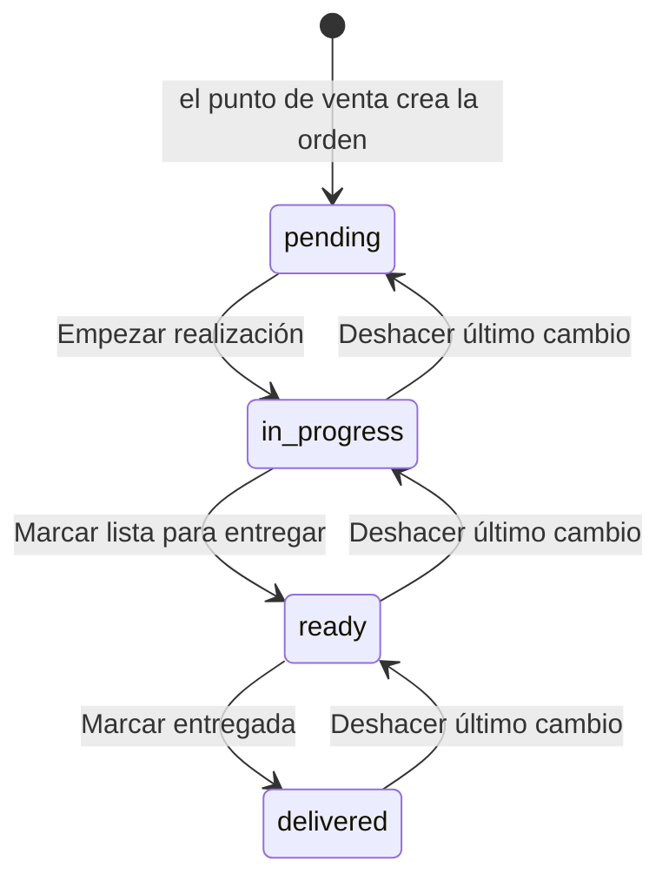

# Producción

La pantalla **Producción** (`/produccion`) es donde el equipo de producción ve
todas las órdenes que creó el punto de venta y las lleva hasta la entrega.
Las reglas de negocio están en `app/core/production.py` (sin Flask) y la capa
de datos en `app/core/db/production.py`; la pantalla está en
`app/web/blueprints/production.py` con las plantillas `production.html` y
`production_detail.html`.

## El flujo completo

1. **Declaración.** El cliente llena el formulario público `/declaracion`
   (declarante, tarjetas de propiedad, fotos y firma). Queda *Por revisar*.
2. **Revisión del punto de venta.** En `/declaraciones` el punto de venta
   revisa la declaración y la aprueba o la rechaza. Si tiene tarjetas por
   pérdida, además debe llegar autenticada de la notaría.
3. **Orden.** Con la declaración aprobada, el punto de venta crea el pedido en
   `/ingest` («Crear pedido»). La orden nace en el estado *Por realizar* y la
   declaración queda *Atendida*.
4. **Producción.** Producción abre la orden en `/produccion/<order_id>`, ve los
   datos de la orden, las placas y las declaraciones enlazadas (con las fotos
   de la cédula y de las tarjetas) y la avanza: *En realización* y luego
   *Lista para entregar*.
5. **Entrega.** Cuando el cliente recoge las placas, producción o el punto de
   venta la marca *Entregada*.

La pantalla de producción **no muestra** precios, forma de pago, fecha de
pago, comprobante, la firma del declarante ni el PDF notariado.

## Estados

| Valor guardado | Etiqueta en pantalla |
|---|---|
| `pending` | Por realizar |
| `in_progress` | En realización |
| `ready` | Lista para entregar |
| `delivered` | Entregada |

Cada cambio guarda una fila en `production_order_events` (de, a, usuario y
hora), que la orden muestra en su **Historial**. Las órdenes anuladas por
completo no aparecen en el tablero.

El estado también se ve, como insignia, en la lista y el detalle de
`/declaraciones` (declaraciones atendidas) y en el detalle de la orden en
`/records/<order_id>`, que además enlaza a Producción («Ver en Producción»).

## Quién puede hacer cada paso

| Permiso | Roles | Qué permite |
|---|---|---|
| `production.view` | admin, production, point_of_sale | Ver el tablero, el detalle y las fotos |
| `production.manage` | admin, production | Hacer cualquier paso, adelante o atrás |
| `production.deliver` | admin, production, point_of_sale | Marcar entregada una orden lista y deshacer esa entrega |

El punto de venta solo tiene `production.deliver`: en una orden *Lista para
entregar* ve «Marcar entregada», y en una *Entregada* ve «Deshacer último
cambio» (vuelve a *Lista para entregar*). Cualquier otro paso le responde 403 y
no cambia nada.

## Estado desactualizado

Cada botón envía el estado que la persona estaba viendo (`expected_status`).
El cambio solo se hace si la orden sigue en ese estado; si alguien la movió
mientras tanto, la página se vuelve a mostrar con el mensaje «El estado de la
orden cambió mientras tanto. Revisa el estado actual e inténtalo de nuevo.»
(400) y no se guarda nada. Así dos personas que hacen clic a la vez nunca
mueven la orden dos pasos.

## Rutas

| Método | Ruta | Permiso | Qué hace |
|---|---|---|---|
| GET | `/produccion` | `production.view` | Tablero: pestañas por estado (`?status=`), búsqueda por número de orden o placa (`?q=`) |
| GET | `/produccion/<order_id>` | `production.view` | Detalle de la orden: datos, placas, declaraciones enlazadas, historial y acciones |
| GET | `/produccion/<order_id>/declarations/<declaration_id>/file/<kind>` | `production.view` | Foto de la cédula (`id_front`, `id_back`) de una declaración enlazada a la orden |
| GET | `/produccion/<order_id>/declarations/<declaration_id>/cards/<card_id>/photo/<side>` | `production.view` | Foto de una tarjeta (`front`, `back`, `used_plates`) de una declaración enlazada a la orden |
| POST | `/produccion/<order_id>/advance` | `production.manage` o `production.deliver` | Avanza la orden un paso (con `expected_status`) |
| POST | `/produccion/<order_id>/undo` | `production.manage` o `production.deliver` | Deshace el último paso (con `expected_status`) |
