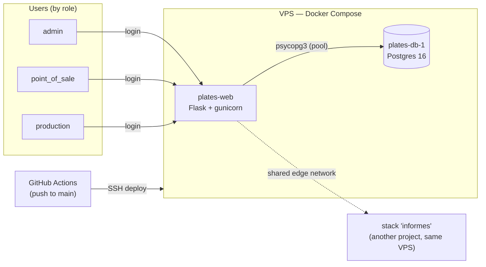

# Reference documentation — plates

Plates is INGSE's (Colombia) production and point-of-sale app for vehicle
license plates, replacing a workflow that used to be based on Excel.
Permissions are assigned by role and roles are managed at `/usuarios`:
`admin` always has all permissions and every other role has only the ones
assigned to it. The production flow goes from the customer's sworn
declaration to the order created by the point of sale, and from there
*Por realizar* → *En realización* → *Lista para entregar* → *Entregada*
(to do → in progress → ready for delivery → delivered).

This folder holds **technical reference** documentation — to understand how
the system works internally. How to deploy it, configure auth or bring up
the local environment is covered in the root [`README.md`](../README.md);
it is not repeated here.

## Document map

| Document | What it covers |
|---|---|
| [`ARCHITECTURE.md`](ARCHITECTURE.md) | Components, deployment (Docker/networks), CI/CD pipeline |
| [`DATABASE.md`](DATABASE.md) | Full schema, ER diagram, columns, data quirks |
| [`DOMAINS.md`](DOMAINS.md) | `app/shared/`, the rules and SQL of `app/auth/` and the SQL of `app/customers/`, `app/pricing/`, `app/inventory/`, the ingestion pipeline, parsers and SQL of `app/orders/`, and the service, PDF and SQL of `app/declarations/`: connection pool, normalization, PDF extraction, ingestion pipeline, permissions, users and roles |
| [`WEB.md`](WEB.md) | `app/web/` and the routes of `app/auth/`, `app/customers/`, `app/pricing/`, `app/inventory/`, `app/orders/`: routes, login, roles/permissions, templates, complete flows |
| [`PRODUCTION.md`](PRODUCTION.md) | Production screen: an order's flow through to delivery, states, permissions and routes |
| [`LOCAL_DEVELOPMENT.md`](LOCAL_DEVELOPMENT.md) | Local infra gotchas, testing, environment variables |
| [`MIGRATION_PLAN.md`](MIGRATION_PLAN.md) | Proposal: JWT auth, JSON API + Next.js front end, back end organized by domain |
| [`FRONTEND.md`](FRONTEND.md) | Proposal: front-end architecture, UX patterns per screen, visual identity; clickable prototypes in `prototypes/` |
| [`CUSTOMER_PORTAL.md`](CUSTOMER_PORTAL.md) | Plan: customer portal where recurring customers build and send their orders (phase 7) |
| [`SIIGO_INTEGRATION.md`](SIIGO_INTEGRATION.md) | Plan: inventory transfers and billing in Siigo from plates (phase 8, built last) |

## System overview

See [`ARCHITECTURE.md`](ARCHITECTURE.md) for the details of the components
and deployment, including a real production incident that motivated part
of the current design.
