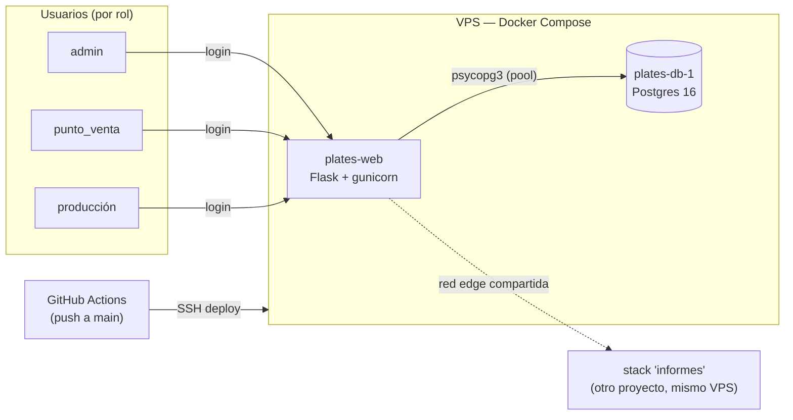

# Documentación de referencia — plates

Plates es la app de producción y venta de placas vehiculares de INGSE
(Colombia): reemplaza un flujo antes basado en Excel, y desde la feature
POS (Fases 1-5b, ver `PLAN_ARQUITECTURA_Y_POS.md` en la raíz del repo)
también captura la orden de venta completa (cliente, forma de pago,
precio) y genera el cuadre de caja diario. Tres roles: `admin` (acceso
completo), `punto_venta` (captura ventas en `/ingest` y consulta
`/cuadre`), y `producción` (solo lectura) sobre un registro
único de órdenes de producción y las placas que contienen.

Esta carpeta es documentación **técnica de referencia** — para entender
cómo funciona el sistema por dentro. Cómo desplegarlo, configurar auth o
levantar el entorno local está en el [`README.md`](../README.md) raíz; acá
no se repite.

## Mapa de documentos

| Documento | Qué cubre |
|---|---|
| [`ARCHITECTURE.md`](ARCHITECTURE.md) | Componentes, despliegue (Docker/redes), pipeline CI/CD |
| [`DATABASE.md`](DATABASE.md) | Esquema completo, diagrama ER, columnas, rarezas de datos |
| [`CORE.md`](CORE.md) | `app/core/`: normalización, extracción de PDF, pipeline de ingesta |
| [`WEB.md`](WEB.md) | `app/web/`: rutas, roles/permisos, templates, flujos completos |
| [`LOCAL_DEVELOPMENT.md`](LOCAL_DEVELOPMENT.md) | Gotchas de infra local, testing, variables de entorno |

## Vista general del sistema

Ver [`ARCHITECTURE.md`](ARCHITECTURE.md) para el detalle de componentes y
de despliegue, incluido un incidente real de producción que motivó parte
del diseño actual.
