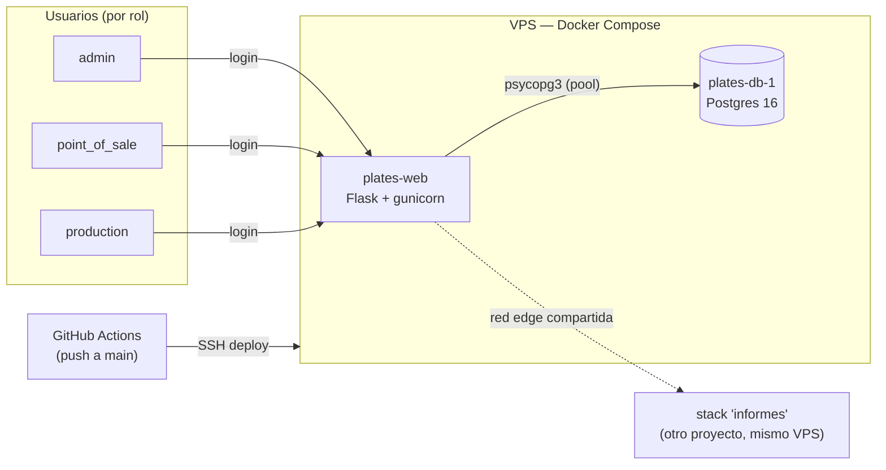

# Documentación de referencia — plates

Plates es la app de producción y punto de venta de placas vehiculares de
INGSE (Colombia), que reemplaza un flujo antes basado en Excel. Los permisos
se asignan por rol y los roles se administran en `/usuarios`: `admin` tiene
siempre todos los permisos y cada otro rol tiene solo los que se le asignan.
El flujo de producción va de la declaración juramentada del cliente al
pedido que crea el punto de venta, y de ahí *Por realizar* → *En
realización* → *Lista para entregar* → *Entregada*.

Esta carpeta es documentación **técnica de referencia** — para entender
cómo funciona el sistema por dentro. Cómo desplegarlo, configurar auth o
levantar el entorno local está en el [`README.md`](../README.md) raíz; acá
no se repite.

## Mapa de documentos

| Documento | Qué cubre |
|---|---|
| [`ARCHITECTURE.md`](ARCHITECTURE.md) | Componentes, despliegue (Docker/redes), pipeline CI/CD |
| [`DATABASE.md`](DATABASE.md) | Esquema completo, diagrama ER, columnas, rarezas de datos |
| [`CORE.md`](CORE.md) | `app/core/`: normalización, extracción de PDF, pipeline de ingesta |
| [`WEB.md`](WEB.md) | `app/web/`: rutas, roles/permisos, templates, flujos completos |
| [`PRODUCTION.md`](PRODUCTION.md) | Pantalla de Producción: flujo de una orden hasta la entrega, estados, permisos y rutas |
| [`LOCAL_DEVELOPMENT.md`](LOCAL_DEVELOPMENT.md) | Gotchas de infra local, testing, variables de entorno |

## Vista general del sistema

Ver [`ARCHITECTURE.md`](ARCHITECTURE.md) para el detalle de componentes y
de despliegue, incluido un incidente real de producción que motivó parte
del diseño actual.
