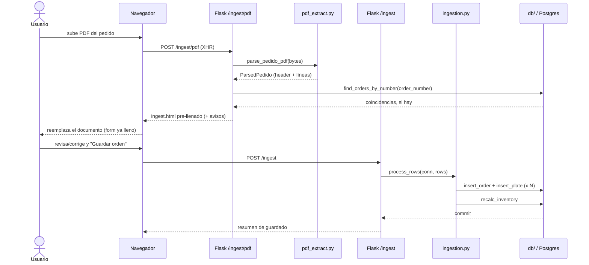
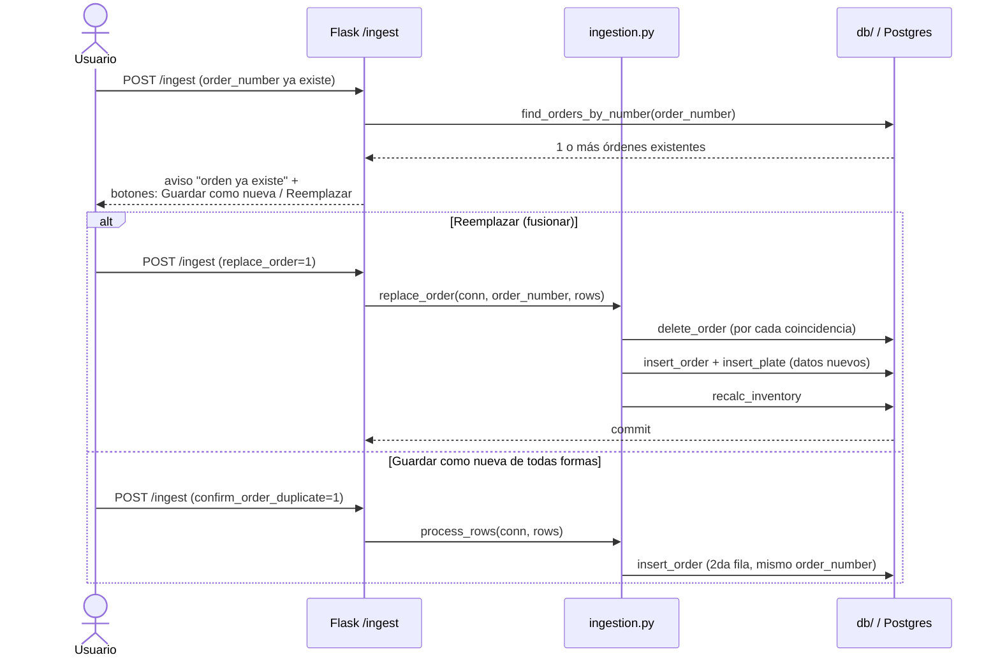

# Web (`app/web/`)

[← volver al índice](README.md)

Desde la Fase 1d, `app.py` solo crea el objeto `app`, inicializa Sentry
(si `SENTRY_DSN` está seteada), registra un blueprint por dominio y
retiene las 2 rutas demasiado chicas para tener el suyo propio (`/` y
`/healthz`) — 83 líneas en total. Las rutas reales viven en
`app/web/blueprints/`, un módulo por dominio; helpers compartidos por 2+
blueprints (`today_iso`, `_options`, `_padded`, `_validate_order_header`,
etc.) viven en `app/web/helpers.py`.

## Rutas

| Método | Path | Blueprint | Qué hace | Llama de `core` | Template | Auth |
|---|---|---|---|---|---|---|
| GET | `/` | `app.py` | Redirige a Registrar (roles full-access) o Registros (resto) | — | (redirect) | `@consulta_allowed` |
| GET | `/healthz` | `app.py` | Liveness probe | — | — | abierta |
| GET/POST | `/login` | `auth_routes.py` | Login | `auth.verify_credentials`, `auth.role_for` | `login.html` | abierta |
| GET/POST | `/logout` | `auth_routes.py` | Cierra sesión | — | (redirect) | abierta |
| GET | `/ingest` | `ingest.py` | Form "Registrar" (carga manual) | `db.distinct_requested_by/cities` | `ingest.html` | `@login_required` |
| POST | `/ingest` | `ingest.py` | Guarda orden+placas; gestiona los avisos de orden/placa duplicada y el "Reemplazar" opt-in | `ingestion.process_rows`, `ingestion.replace_order`, `ingestion.find_duplicate_plate_numbers`, `db.find_orders_by_number` | `ingest.html` | `@login_required` |
| GET | `/ingest/pdf` | `ingest.py` | Form de upload de PDF | — | `ingest_pdf.html` | `@login_required` |
| POST | `/ingest/pdf` | `ingest.py` | Parsea el PDF y re-renderiza `ingest.html` pre-llenado (**no guarda nada**) | `pdf_extract.parse_pedido_pdf`, `db.find_orders_by_number` | `ingest.html` | `@login_required` |
| GET | `/review` | `review.py` | Cola de placas con `is_possible_duplicate` | `db.review_rows` | `review.html` | `@login_required` |
| POST | `/review/update` \| `/resolve` \| `/delete` | `review.py` | Edita/marca revisada/borra una fila flagged | `db.update_plate`, `resolve_plate`, `delete_plate`, `recalc_inventory` | (redirect) | `@login_required` |
| GET | `/inventory` | `inventory.py` | Cards de inventario por categoría | `db.inventory_view`, `ornamental_count` | `inventory.html` | `@login_required` |
| POST | `/inventory/alistado` | `inventory.py` | Registra un alistamiento | `db.insert_blank_preparation`, `recalc_inventory` | (redirect) | `@login_required` |
| GET | `/records` | `records.py` | Registros: recientes, o búsqueda por placa/orden | `db.recent_orders`, `search_plates_by_number`, `search_orders_by_number` | `records.html` | `@consulta_allowed` |
| GET | `/records/<id>` | `records.py` | Detalle de orden (ver o editar según rol); preserva `?q=` para el link de volver | `db.order_detail` | `record_detail.html` | `@consulta_allowed` |
| POST | `/records/<id>/save` | `records.py` | Guarda edición de header + placas (insert/update/delete) en una transacción | `db.update_order`, `delete_plate`, `normalize.normalize_row`, `update_plate_full`, `insert_plate`, `recalc_inventory` | `record_detail.html` / redirect | `@login_required` |
| POST | `/records/search-pdf` | `records.py` | Sube un PDF y chequea sus placas contra la BD (**solo lectura**) | `pdf_extract.parse_pedido_pdf`, `normalize.is_real_plate`, `db.find_orders_for_plate` | `records.html` | `@consulta_allowed` |
| POST | `/records/delete` | `records.py` | Borra una orden completa y sus placas | `db.delete_order`, `recalc_inventory` | (redirect) | `@login_required` |

`/ingest/pdf` (POST) y `/records/search-pdf` **nunca escriben en la BD** —
documentado explícitamente como solo-lectura/preview en sus docstrings.

## Roles y permisos (`auth.py`)

- **Roles**: `admin`, `producción`, `consulta`.
- **`FULL_ACCESS_ROLES = {admin}`** — solo `admin` puede escribir.
  `producción` originalmente tenía acceso completo, se degradó a solo
  lectura (igual que `consulta`); se mantiene como rol separado por si
  necesita volver a divergir.
- **Usuarios y roles viven en variables de entorno**, no en una tabla:
  `AUTH_USERS` (`usuario:hash`, separados por coma) y `AUTH_ROLES`
  (`usuario:rol`) — separados justamente para no ambigüar el split por
  `:` (el hash también contiene `:`). Un usuario ausente de `AUTH_ROLES`
  es `admin` por defecto.
- **Decoradores**: `@login_required` (default para cualquier ruta que
  escribe — 403 si el rol no es full-access) vs. `@consulta_allowed`
  (deja pasar cualquier rol autenticado — **nunca aplicar a algo que
  escribe**).
- Sesión firmada con `SECRET_KEY` (obligatoria, sin default), cookie
  `HTTPONLY` + `SAMESITE=Lax` + `SECURE` condicionada a `COOKIE_SECURE`,
  12 horas de duración.
- Guard anti open-redirect en `?next=` del login: solo rutas relativas del
  mismo origen.

## Templates

No hay `base.html` compartido — cada página es un documento HTML
independiente que incluye `_nav.html` y duplica su propio `<style>`.

| Template | Qué renderiza |
|---|---|
| `_nav.html` | Nav compartido; tabs de escritura (Registrar/Revisión/Inventario) solo si el rol es full-access. |
| `_orders_table.html` | Tabla de órdenes reusada por la vista "recientes" y por los resultados de búsqueda por orden. |
| `login.html` | Card de login (sin nav). |
| `ingest.html` | Form de carga manual + los 3 posibles avisos pre-guardado (`notices` del PDF, `order_duplicates`, `duplicates` de placa) + panel de resumen post-guardado. Mantiene los datos tipeados al ida-y-vuelta de un aviso. |
| `ingest_pdf.html` | Upload de PDF vía XHR con barra de progreso; reemplaza el documento con la respuesta (`ingest.html` pre-llenado). |
| `records.html` | Búsqueda por texto (placa u orden) + búsqueda por PDF (nunca guarda). |
| `record_detail.html` | Detalle de orden — form editable para roles full-access, resumen de solo lectura para el resto. Ambos branches preservan `back_query` para el link "Volver a Registros". |
| `review.html` | Cola de placas flagged, cada fila con Guardar/Revisada/Eliminar. |
| `inventory.html` | Cards de Disponible/Consumido por categoría + form de alistamiento. |

## Flujo 1 — Subir un PDF y guardarlo como orden nueva

## Flujo 2 — Re-subir el PDF de una orden vieja: detectar y fusionar/reemplazar

Este segundo flujo existe por el caso real documentado en
[`CORE.md`](CORE.md#ingestionpy-antes-processpy-renombrado-en-la-fase-1d) (WCY449/pedido 1030): una reposición vieja
sin número de placa no puede detectarse por el chequeo normal de
duplicados, así que el chequeo de **orden** corre primero y de forma
independiente.
