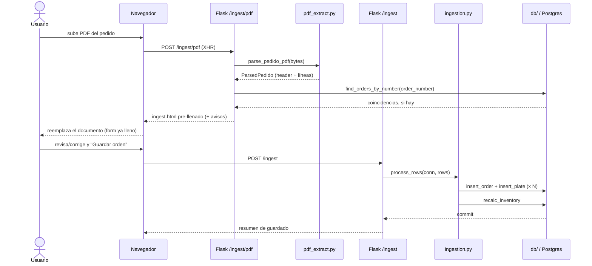
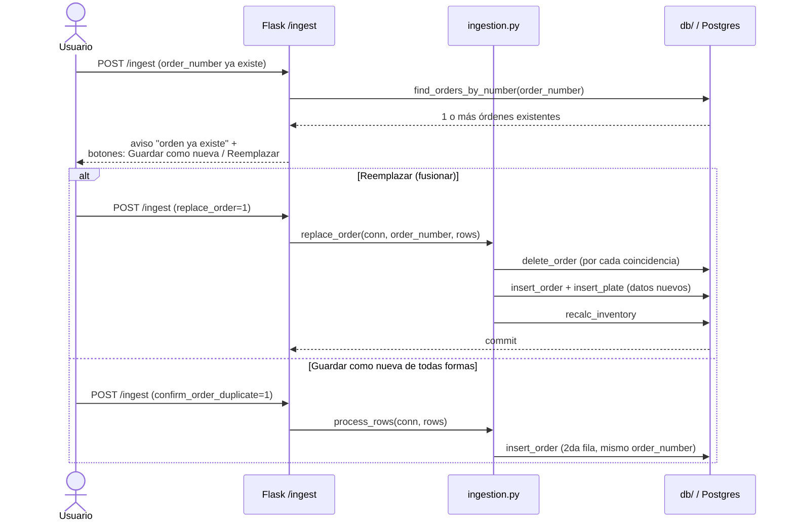

# Web (`app/web/`)

[← volver al índice](README.md)

Desde la Fase 1d, `app.py` solo crea el objeto `app`, inicializa Sentry
(si `SENTRY_DSN` está seteada), registra un blueprint por dominio y
retiene las 2 rutas demasiado chicas para tener el suyo propio (`/` y
`/healthz`) — 83 líneas en total. Las rutas reales viven en
`app/web/blueprints/`, un módulo por dominio; helpers compartidos por 2+
blueprints (`today_iso`, `_options`, `_padded`, `_validate_order_header`,
`customer_fields_from_form`, etc.) viven en `app/web/helpers.py`.

## Rutas

| Método | Path | Blueprint | Qué hace | Llama de `core` | Template | Auth |
|---|---|---|---|---|---|---|
| GET | `/` | `app.py` | Redirige a Registrar (`point_of_sale`/`admin`) o Registros (resto) | — | (redirect) | `@consulta_allowed` |
| GET | `/healthz` | `app.py` | Liveness probe | — | — | abierta |
| GET/POST | `/login` | `auth_routes.py` | Login (consulta `users`, Fase 2) | `auth.authenticate` | `login.html` | abierta |
| GET/POST | `/logout` | `auth_routes.py` | Cierra sesión | — | (redirect) | abierta |
| GET/POST | `/declaracion` | `public_declaration.py` | Formulario público de declaración juramentada (QR en el mostrador), solo para personas que declaran por sí mismas (PROPIETARIO / POSEEDOR; un `GESTOR` enviado a mano se rechaza con 400; el endpoint para gestores está planeado). POST: honeypot, token firmado, Turnstile, límite por IP (20/hora; los clientes comparten la IP del wifi del local), lee de 1 a 30 tarjetas de propiedad (`card_<i>_*`) con un solo declarante y una sola firma, guarda la firma en `UPLOADS_DIR` (el formulario no sube ningún archivo), valida y guarda. Responde **503** (`declaration_unavailable.html`) mientras no estén `TURNSTILE_SITE_KEY` y `TURNSTILE_SECRET_KEY` (o `TURNSTILE_BYPASS`). La página de éxito es idéntica para declaraciones aprobadas y retenidas: nunca revela estado, alertas ni al dueño anterior | `declarations.validate_declaration`, `submit_declaration`, `db.count_recent_by_ip` | `declaration.html`, `declaration_received.html`, `declaration_unavailable.html` | **sin login** (única ruta pública que escribe) |
| GET | `/ingest` | `ingest.py` | Form "Registrar" — captura completa de orden POS (Fase 3). Con `?declaration_id=N` (el botón de `/declaraciones`) llega **pre-llenado desde una declaración aprobada y todavía no atendida** (`production_order_id` NULL), igual que el PDF: **no guarda nada**. Encabezado: fecha de hoy, N° de orden y forma de pago vacíos (los decide el personal), cliente = el declarante (el gestor si actuó un gestor; si no, el cliente enlazado a las tarjetas) con todos sus datos. Una línea `placa` por tarjeta de propiedad, en orden: tipo de placa de la tarjeta (vacío si no se reconoce), placa, cantidad, motivo, marca y valor = tarifa vigente del tipo (vacío si no hay); la ciudad queda vacía y un aviso la pide para las líneas `CARRO PARTICULAR`/`CARRO PÚBLICO`. Id inexistente o mal formado → 404; pendiente, rechazada, ya atendida o **aprobada con alguna tarjeta por `PÉRDIDA` cuya autenticación notarial todavía no se marcó como recibida** → el formulario normal con un error en español (si ya fue atendida, dice con qué orden y enlaza a su detalle; las declaraciones solo `DETERIORO` nunca se bloquean así) | `db.distinct_requested_by/cities`, `db.current_prices`, `db.list_customers`, `db.get_declaration`, `db.list_declaration_cards`, `db.get_customer` | `ingest.html` | `@pos_allowed` |
| POST | `/ingest` | `ingest.py` | Guarda orden+placas (resuelve/crea cliente, snapshotea precios); gestiona los avisos de orden/placa duplicada y el "Reemplazar" opt-in. Si trae el campo oculto `declaration_id`, el servidor **vuelve a validar** la declaración (existe, aprobada, sin atender y, si tiene una tarjeta `PÉRDIDA`, con la autenticación notarial recibida; si no, no guarda y devuelve el formulario tal cual con el error); las placas de sus tarjetas **no se bloquean** como "ya existe" (el caso es reponer una placa perdida o deteriorada; escribir dos veces la misma placa en el envío sí sigue bloqueando) y, en la **misma transacción** del guardado (camino normal y "Reemplazar"), la declaración queda atendida por la orden creada (`db.set_declaration_production_order`). El campo oculto viaja en todos los re-renders (avisos de orden/placa duplicada, errores). Sin `declaration_id` el comportamiento no cambia | `ingestion.process_rows`, `ingestion.replace_order`, `ingestion.find_duplicate_plate_numbers`, `db.resolve_or_create_customer`, `db.find_orders_by_number`, `db.set_declaration_production_order` | `ingest.html` | `@pos_allowed` |
| GET | `/ingest/pdf` | `ingest.py` | Form de upload de PDF | — | `ingest_pdf.html` | `@pos_allowed` |
| POST | `/ingest/pdf` | `ingest.py` | Parsea el PDF (incl. campos de pie de página, Fase 4) y re-renderiza `ingest.html` pre-llenado (**no guarda nada**) | `pdf_extract.parse_pedido_pdf`, `db.find_orders_by_number` | `ingest.html` | `@pos_allowed` |
| GET | `/review` | `review.py` | Cola de placas con `is_possible_duplicate` | `db.review_rows` | `review.html` | `@login_required` |
| POST | `/review/update` \| `/resolve` \| `/delete` | `review.py` | Edita/marca revisada/borra una fila flagged | `db.update_plate`, `resolve_plate`, `delete_plate`, `recalc_inventory` | (redirect) | `@login_required` |
| GET | `/inventory` | `inventory.py` | Cards de inventario por categoría | `db.inventory_view`, `ornamental_count` | `inventory.html` | `@login_required` |
| POST | `/inventory/alistado` | `inventory.py` | Registra un alistamiento | `db.insert_blank_preparation`, `recalc_inventory` | (redirect) | `@login_required` |
| GET | `/precios` | `pricing.py` | Tabla de tarifas por tipo de placa, editable (Fase 5a) | `db.price_list` | `pricing.html` | `@login_required` (admin-only, nunca `@pos_allowed`) |
| POST | `/precios/<plate_type>` | `pricing.py` | Fija/actualiza la tarifa de un tipo | `db.set_price` | (redirect) | `@login_required` |
| GET | `/customers` | `customers.py` | Lista de clientes, con filtro `?q=` por nombre (Fase 6) | `db.list_customers` | `customers.html` | `@login_required` (admin-only, mismo nivel que `/precios`) |
| GET | `/customers/<id>` | `customers.py` | Form de edición de un cliente | `db.get_customer` | `customer_detail.html` | `@login_required` |
| POST | `/customers/<id>` | `customers.py` | Sobreescribe los atributos del cliente (nombre incluido, y dirección/barrio/municipio según el tipo) — a diferencia de `db.resolve_or_create_customer`, esto SÍ reemplaza un valor ya guardado | `db.update_customer` | (redirect) | `@login_required` |
| GET | `/declaraciones` | `declarations.py` | Lista de declaraciones juramentadas del formulario público: **una fila por declaración** con el declarante (nombre y `acting_as`), la cantidad de tarjetas de propiedad, el **total de placas** (suma de `plate_quantity`), un resumen compacto (`ABC123 · DEF45G +3`, y los motivos contados por tarjeta, `PÉRDIDA` primero: `1 deterioro` o `2 pérdida · 1 deterioro`, en rojo si hay alguna pérdida), estado, alertas (unión) con el número de la tarjeta que las causó, y fecha. Pestañas `?status=` (Pendientes por defecto, Aprobadas, Rechazadas, Todas), filtro `?attended=` (`all` por defecto, `no` = Por atender, `yes` = Atendidas; se conserva al cambiar de pestaña y de búsqueda; `no` mira solo `production_order_id IS NULL`, así que se combina con la pestaña Aprobadas para ver lo que falta por atender), junto al estado una insignia "Atendida" (ya se creó un pedido con la declaración) o "Por atender" (aprobada sin pedido) y, para las aprobadas con alguna tarjeta `PÉRDIDA`, "Falta autenticación" o "Autenticada" (según `notarized_received_at`), filtro `?reason=` (`all` = Todos por defecto, `loss` = Pérdida, `deterioration` = Deterioro; basta **una** tarjeta con ese motivo; también acepta las palabras guardadas `PÉRDIDA`/`DETERIORO`; se combina con estado, atención y búsqueda y se conserva en las pestañas), búsqueda `?q=` (declarante o placa/licencia/dueño de **cualquier** tarjeta), pendientes primero y contador de pendientes. Las tarjetas se cargan con una sola consulta (`db.list_cards_for_declarations`). En pantallas angostas cada fila se muestra como tarjeta | `db.list_declarations(status, query, attended, reason)`, `requires_notarization`, `db.list_cards_for_declarations` | `declarations.html` | `@pos_allowed` (el rol `production` recibe 403: maneja datos de identidad) |
| GET | `/declaraciones/<id>` | `declarations.py` | Detalle: bloque del declarante, su única firma y el PDF notariado, y **una sección por tarjeta de propiedad** ("Tarjeta de propiedad N de M") con sus datos, motivo, cantidad de placas, su dueño (y relación DUEÑO/POSEEDOR) y, una vez aprobada, el cliente y la tarjeta creados o enlazados (enlace a `/customers/<id>` solo para admin, porque esa pantalla es solo admin). El motivo de cada tarjeta es una insignia (`PÉRDIDA` en rojo, `DETERIORO` en azul). Si está pendiente, un resumen "Retenida por X de M tarjetas" con enlaces a las tarjetas que la retienen y, dentro de **cada** tarjeta, la explicación de **sus** alertas con el contexto real (fecha de la última fabricación y desde cuándo se puede repetir, tarjetas existentes y sus dueños, tipo/documento del cliente existente, mismo nombre repetido en la declaración). Las alertas del gestor (tipo/documento) se copian a todas las tarjetas y se rotulan "Gestor ...". Solo personal autenticado; las alertas nunca se muestran en páginas públicas. Si la declaración está **aprobada y sin atender**, arriba aparece el botón destacado **"Crear pedido"** (enlace a `/ingest?declaration_id=<id>`), visible para admin y `point_of_sale` (el punto de venta es quien revisa: aprobar, rechazar y reasignar también son de ambos roles); si está pendiente se muestra el aviso "el pedido se podrá crear cuando el punto de venta apruebe", y si está rechazada no aparece nada. Si está aprobada y tiene **al menos una tarjeta `PÉRDIDA`**, aparece el bloque **"Autenticación notarial"**: mientras `notarized_received_at` es NULL dice "Pendiente" (descargar el PDF, entregarlo al cliente y marcar cuando regrese autenticado), con el botón "Descargar PDF para autenticación" y el botón "Marcar autenticación recibida" (`POST .../notarized`), y **en lugar de "Crear pedido"** se muestra la nota "Falta la autenticación notarial…"; una vez recibida muestra fecha y quién la registró, con "Deshacer" (`POST .../notarized/undo`, oculto si ya hay pedido) y el botón "Crear pedido" vuelve. Las declaraciones solo `DETERIORO` nunca se bloquean. Si ya tiene `production_order_id` se muestra la insignia **"Atendida"** con el enlace al pedido (`/records/<id>`, con su número de pedido) en lugar del botón. Id desconocido redirige a la lista | `db.get_declaration`, `db.order_detail`, `db.list_declaration_cards`, `db.last_fabrication_date`, `db.find_orders_for_plate`, `db.get_ownership_card*`, `db.get_customer*` | `declaration_detail.html` | `@pos_allowed` |
| GET | `/declaraciones/<id>/file/<kind>` | `declarations.py` | Descarga autenticada (`kind` = `signature` (la firma única del declarante, que cubre todas las tarjetas) o `notarized_pdf`) vía `resolve_upload_path`; `inline`, `nosniff`, `no-store`; 404 si el tipo, la ruta o el archivo no existen. Nunca se acepta un nombre de archivo en la URL | `db.get_declaration` | (archivo) | `@pos_allowed` |
| POST | `/declaraciones/<id>/approve` | `declarations.py` | Aprueba **toda** la declaración (todo o nada). Campos: `note` (opcional) y una casilla `reassign_<id de la tarjeta de la declaración>` por cada tarjeta con la alerta `card_other_owner` (la casilla solo aparece en esas tarjetas y se envía con el atributo `form="approve-form"`), que se pasan como `reassign_card_ids`. Un `ValueError` (que nombra la tarjeta: "tarjeta 2 (placa DEF456)") re-renderiza el detalle con el mensaje (400), conserva las casillas marcadas y no cambia nada | `declarations.approve_declaration` | (redirect) | `@pos_allowed` (admin y `point_of_sale`; `reviewed_by` = el usuario de la sesión; `production` recibe 403) |
| POST | `/declaraciones/<id>/reject` | `declarations.py` | Rechaza toda la declaración sin crear nada; la nota (`note`) es obligatoria | `declarations.reject_declaration` | (redirect) | `@pos_allowed` |
| GET | `/declaraciones/<id>/pdf` | `declarations.py` | PDF de la declaración para que el cliente lo autentique en una notaría (se imprime y se le entrega). Solo si está **aprobada** y tiene **al menos una tarjeta `PÉRDIDA`** (`requires_notarization`); si no, 404 con un mensaje en español. Lee la firma del declarante con `resolve_upload_path` (sin firma o archivo faltante → `signature_png=None`) y llama `declaration_pdf.build_declaration_pdf(declaration, cards, signature_png, issued_at)`. Respuesta `attachment` `declaracion-<id>.pdf`, `application/pdf`, `nosniff`, `no-store` | `declaration_pdf.build_declaration_pdf`, `db.list_declaration_cards` | (archivo) | `@pos_allowed` |
| POST | `/declaraciones/<id>/notarized` | `declarations.py` | Marca que el cliente devolvió la declaración autenticada (`db.set_declaration_notarized_received` con el `user_id` de la sesión). Idempotente (marcar dos veces conserva la primera marca). Id desconocido → lista; declaración no aprobada o sin tarjeta `PÉRDIDA` → detalle con error (400), sin cambios | `db.set_declaration_notarized_received` | (redirect) | `@pos_allowed` |
| POST | `/declaraciones/<id>/notarized/undo` | `declarations.py` | Deshace la marca anterior (vuelve a NULL). Se rechaza (400) si la declaración ya fue atendida por un pedido | `db.set_declaration_notarized_received` | (redirect) | `@pos_allowed` |
| GET | `/cuadre` | `cash_summary.py` | Cuadre de caja: totales por fecha/forma de pago en `[desde, hasta]` (default hoy, Fase 5b) | `cash_summary.build_cash_summary` | `cash_summary.html` | `@pos_allowed` |
| GET | `/cuadre/pdf` | `cash_summary.py` | Mismo reporte, exportado a PDF | `cash_summary.build_cash_summary`, `render_cash_summary_pdf` | (descarga PDF) | `@pos_allowed` |
| GET | `/records` | `records.py` | Registros: recientes, o búsqueda por placa/orden | `db.recent_orders`, `search_plates_by_number`, `search_orders_by_number` | `records.html` | `@consulta_allowed` |
| GET | `/records/<id>` | `records.py` | Detalle de orden (ver o editar según rol); preserva `?q=` para el link de volver | `db.order_detail` | `record_detail.html` | `@consulta_allowed` |
| POST | `/records/<id>/save` | `records.py` | Guarda edición de header + placas (insert/update/delete) en una transacción; re-resuelve `customer_id` desde `requested_by` (nunca reescribe atributos de un cliente existente, B5) | `db.update_order`, `delete_plate`, `normalize.normalize_row`, `db.resolve_or_create_customer`, `update_plate_full`, `insert_plate`, `recalc_inventory` | `record_detail.html` / redirect | `@pos_allowed` |
| POST | `/records/search-pdf` | `records.py` | Sube un PDF y chequea sus placas contra la BD (**solo lectura**) | `pdf_extract.parse_pedido_pdf`, `normalize.is_real_plate`, `db.find_orders_for_plate` | `records.html` | `@consulta_allowed` |
| POST | `/records/delete` | `records.py` | Borra una orden completa y sus placas | `db.delete_order`, `recalc_inventory` | (redirect) | `@login_required` |

`/ingest/pdf` (POST), `GET /ingest?declaration_id=N` y `/records/search-pdf`
**nunca escriben en la BD** — documentado explícitamente como solo-lectura/preview
en sus docstrings.

Una placa repuesta desde una declaración sí queda con `is_possible_duplicate`
(la exención solo levanta el bloqueo previo al guardado; `process_rows` marca
igual toda placa que ya existía), así que aparece en `/review` y en el resumen
("Posibles duplicados") para que el personal la confirme.

## Roles y permisos (`auth.py`)

- **Roles**: `admin`, `point_of_sale` (PTO.V), `production` — valores en
  inglés a propósito: `users.role` nunca se muestra al usuario, solo se
  compara para permisos, así que no es dato de negocio en español (ver
  `CLAUDE.md`). Hasta `app/migrations/0004_translate_role_values_to_english.sql`
  los valores reales eran `produccion`/`punto_venta`.
- **`FULL_ACCESS_ROLES = {admin}`** — solo `admin` puede escribir fuera de
  `/ingest`/`/cuadre`. `production` originalmente tenía acceso completo, se
  degradó a solo lectura (hoy el único rol de solo lectura); se mantiene
  como rol separado por si necesita volver a divergir.
- **`POS_ROLES = {admin, point_of_sale}`** (Fase 2) — el nivel intermedio de
  `point_of_sale`: puede capturar ventas (`/ingest`, `/ingest/pdf`,
  `/records/<id>/save`) y consultar el cuadre de caja (`/cuadre`,
  `/cuadre/pdf`), pero nada más de escritura (`/review/*`,
  `/inventory/alistado`, `/records/delete`, `/precios` siguen siendo
  `@login_required`, admin-only).
- **Login vía tabla `users` (Fase 2)** — `app/web/auth.py::authenticate`
  consulta `users` (vía `app/core/db/users.py`) en cada login, ya no lee
  `AUTH_USERS`/`AUTH_ROLES`. Esas dos variables de entorno y las funciones
  `load_users()`/`load_roles()` que las parsean **se mantienen**, pero
  solo como el código que hizo el backfill histórico (`app.schema_migrate`)
  — no los toca el login en vivo. La sesión guarda `user`/`role` y, desde
  la Fase 2, `user_id` (`users.id`) → `production_orders.created_by`; una
  sesión de antes de este cambio (sin `user_id`) se trata como stale y
  fuerza un login nuevo, no un error.
- **Decoradores**: `@login_required` (default para cualquier ruta que
  escribe fuera del alcance de POS — 403 si el rol no es full-access) vs.
  `@consulta_allowed` (deja pasar cualquier rol autenticado — **nunca
  aplicar a algo que escribe**) vs. `@pos_allowed` (Fase 2/3, deja pasar
  `POS_ROLES` — 403 para `producción`, el único rol de solo lectura).
- Sesión firmada con `SECRET_KEY` (obligatoria, sin default), cookie
  `HTTPONLY` + `SAMESITE=Lax` + `SECURE` condicionada a `COOKIE_SECURE`,
  12 horas de duración.
- Guard anti open-redirect en `?next=` del login: solo rutas relativas del
  mismo origen.
- `landing_url()` (a dónde cae un login sin `?next=`): `POS_ROLES` cae en
  Registrar (`/ingest`, su punto de entrada diario); el resto cae en
  Registros (`producción` no puede llegar a `/ingest` de ningún modo, así
  que mandarla ahí solo rebotaría en un 403).

## Rutas públicas

Solo estas rutas responden sin sesión: `/login`, `/logout`, `/healthz` y
`/declaracion` (más `/static`). `tests/web/test_public_routes.py` recorre
`app.url_map` y falla si cualquier otra ruta contesta 200 a una petición
anónima; agregar una ruta pública exige editar su lista a propósito.

`/declaracion` se apaga sola: sin llaves de Turnstile (ni `TURNSTILE_BYPASS`)
responde 503, así que producción no expone nada hasta que el dueño configure
Cloudflare. `app.py` fija `MAX_CONTENT_LENGTH` en 12 MB para toda la app (lo
necesitan los PDFs de `/ingest/pdf`; el formulario público ya no sube PDF, solo
la firma PNG en base64, unos 270 KB); un cuerpo más grande recibe un 413
amigable en esa ruta.

### Formulario público de declaración

Este formulario es **solo para personas que declaran por sí mismas** (trámite
"1 a 1"): no es para gestores. Para los gestores se planea un endpoint público
aparte; el núcleo (`declarations.py`), la base de datos y la pantalla de
revisión `/declaraciones` ya soportan `acting_as = GESTOR`, pero este
formulario no lo ofrece.

Una declaración tiene **un solo declarante** (la persona que llena el
formulario, propietaria o poseedora) y **de 1 a `MAX_CARDS` (30) tarjetas de
propiedad**, todas del declarante. Solo el declarante firma, una vez: la firma
cubre todas las tarjetas. Secciones: 1 Calidad en la que actúa (PROPIETARIO /
POSEEDOR), 2 Datos del declarante, 3 Tarjetas de propiedad, texto legal
(4 a 6) y 7 Firma.

Cada bloque "Tarjeta de propiedad N" lleva los datos de la tarjeta (placa,
licencia de tránsito, motor, chasis, tipo de vehículo, matriculado en, marca),
el **motivo** (DETERIORO / PÉRDIDA) por tarjeta y la **cantidad de placas**
(1 o 2). El tipo de placa limita la cantidad con
`normalize.max_plates_per_card`: los carros (particular y público) permiten 1
o 2 (por defecto 2) y los demás tipos solo 1. El mapa tipo a máximo viaja a la
página como JSON en `data-max-by-type`. El **total de placas** se muestra
sumado y de solo lectura; nunca se digita ni se envía.

Las tarjetas no llevan datos de otro dueño: el declarante es el dueño o
poseedor de todas. Si alguien envía `acting_as = GESTOR` a mano, el servidor
lo rechaza como un error de validación normal (400, antes de guardar
archivos): vuelve a dibujar el formulario con "Este formulario es solo para
personas que declaran por sí mismas…" y nunca llama a `submit_declaration`. Los
campos `card_<i>_owner_*` que lleguen se ignoran. **El formulario no tiene
ningún campo de archivo**: junto al motivo de cada tarjeta hay una nota ("Si
declaras pérdida, INGSE te entregará este documento en el mostrador para que lo
autentiques en una notaría.") que es visible sin JavaScript y que el script
oculta mientras el motivo de esa tarjeta no sea PÉRDIDA. La página de éxito
repite el aviso en forma genérica, sin revelar estado.

Límite por IP: `MAX_SUBMISSIONS_PER_IP_PER_HOUR` = 20 (constante única en
`public_declaration.py`).

Campos del POST (`application/x-www-form-urlencoded`): `form_token`, `website` (honeypot),
`cf-turnstile-response`, `acting_as`, `declarant_<campo>`, `signature` (data
URL PNG), `accept_terms` y, por cada tarjeta con índice `i`:
`card_<i>_plate_number`, `_transit_license`, `_engine_number`,
`_chassis_number`, `_vehicle_type`, `_registered_in`, `_vehicle_brand`,
`_reason` y `_plate_quantity`. Los campos de persona son `name`, `document_type`,
`document_number`, `address`, `neighborhood`, `municipality`, `phone`, `email`.

Los índices los pone el navegador y pueden quedar **dispersos** (0, 2, 5) al
quitar tarjetas; el servidor lee los que lleguen, en orden numérico. Se
rechaza (400, antes de construir nada ni guardar archivos) un envío con más de
`MAX_CARDS` índices distintos, y también uno sin ninguna tarjeta. Una cantidad
no numérica se convierte en 0 para que la validación la rechace. Tras un error
de validación se vuelven a dibujar todos los bloques con lo que la persona
digitó (la firma no se devuelve: hay que volver a firmar). Sin
JavaScript la página sigue mostrando la primera tarjeta, pero agregar o quitar
tarjetas y los límites por tipo requieren JavaScript.

## Templates

No hay `base.html` compartido — cada página es un documento HTML
independiente que incluye `_nav.html` y duplica su propio `<style>`.

| Template | Qué renderiza |
|---|---|
| `_nav.html` | Nav compartido; "Registrar"/"Cuadre"/"Declaraciones" solo si el rol está en `pos_roles`, "Revisión"/"Inventario"/"Precios" solo si está en `full_access_roles`. |
| `declarations.html` | Lista de declaraciones: pestañas de estado con contador de pendientes, búsqueda, una fila por declaración (declarante, tarjetas, total de placas, resumen), filtros de atención y de motivo (Todos / Pérdida / Deterioro), insignias de estado, de atención (`Atendida` / `Por atender`), de autenticación notarial (`Falta autenticación` / `Autenticada`) y de alertas (`Placa reciente`, `Tarjeta de otro dueño`, `Datos no cuadran`, `Tipo de cliente`, `Documento distinto`); en pantallas angostas la tabla se apila en tarjetas. |
| `declaration_detail.html` | Detalle de una declaración: resumen de la retención, declarante, archivos, una sección por tarjeta de propiedad con sus alertas, el bloque "Crear pedido" / "Atendida" (según el estado y `production_order_id`; reemplazado por la nota "Falta la autenticación notarial" mientras haya tarjetas `PÉRDIDA` sin autenticación recibida), el bloque "Autenticación notarial" (PDF, marcar/deshacer), insignias de motivo por tarjeta, y los formularios de aprobar (con las casillas de reasignación) y rechazar. |
| `customer_detail.html` | Edición de un cliente (`/customers/<id>`); para clientes `CLIENTE` añade la tabla de solo lectura "Tarjetas de propiedad" (licencia, placa, tipo de vehículo, matriculado en, marca; con texto si no tiene ninguna) desde `db.list_ownership_cards_for_customer`. |
| `_orders_table.html` | Tabla de órdenes reusada por la vista "recientes" y por los resultados de búsqueda por orden. |
| `login.html` | Card de login (sin nav). |
| `declaration.html` | Formulario público de declaración, solo para personas que declaran por sí mismas (sin nav, sin login): un declarante, de 1 a 30 tarjetas de propiedad repetibles (bloque clonado desde un `<template>`) y una sola firma. Los nombres de los campos son el contrato con `public_declaration.py` (ver "Formulario público de declaración"). |
| `declaration_received.html` | Confirmación genérica "Recibimos tu declaración" (igual para aprobada y retenida). |
| `declaration_unavailable.html` | Página 503 cuando el formulario público está apagado (faltan las llaves de Turnstile). |
| `ingest.html` | Form de captura POS completa (Fase 3): fieldset de orden (comprobante/cliente/forma de pago obligatoria/guía#/pedido#/fechas/responsable/observaciones) + tabla de líneas con `reason`/`vehicle_brand`/`unit_price` por placa. `unit_price` se pre-llena por JS desde una tarifa embebida como JSON (`prices`); el fieldset de cliente se auto-completa por JS al matchear un nombre contra la lista de clientes embebida (`customers`). Por tipo de cliente (`toggleCustomerFields`): Propietario/Poseedor solo para `CLIENTE`; Dirección/Barrio/Municipio solo para `GESTOR` o `CLIENTE`; `TRÁNSITO` y `EMPRESA` conservan solo nombre, documento, teléfono y correo (el servidor lo vuelve a forzar en `customer_fields_from_form`). Un dato que el cliente ya tiene guardado queda bloqueado (los selects con un input oculto espejo); el bloqueo solo se agrega, nunca habilita un campo que la regla del tipo deshabilitó. Los 3 posibles avisos pre-guardado (`notices` del PDF o de la declaración —con título propio `notices_title`—, `order_duplicates`, `duplicates` de placa) + panel de resumen post-guardado (que, si la orden atendió una declaración, dice "La declaración #N quedó marcada como atendida"). Cuando viene de una declaración lleva el input oculto `declaration_id` y una nota con enlace a la declaración. Mantiene TODOS los campos tipeados (orden + cliente + por línea) al ida-y-vuelta de un aviso, vía el único dict "sticky" (`_sticky_header_from_form`/`_sticky_lines_from_form` en `ingest.py`). |
| `ingest_pdf.html` | Upload de PDF vía XHR con barra de progreso; reemplaza el documento con la respuesta (`ingest.html` pre-llenado, incluidos los campos de pie de página desde la Fase 4). |
| `records.html` | Búsqueda por texto (placa u orden) + búsqueda por PDF (nunca guarda). |
| `record_detail.html` | Detalle de orden — form editable para `pos_roles` (Fase 3: incluye los mismos campos POS que `ingest.html`), resumen de solo lectura para el resto. Ambos branches preservan `back_query` para el link "Volver a Registros". Si la placa está enlazada a una tarjeta de propiedad (`plates.ownership_card_id`), debajo del número se muestra una nota de solo lectura "Tarjeta: <licencia>". |
| `review.html` | Cola de placas flagged, cada fila con Guardar/Revisada/Eliminar. |
| `inventory.html` | Cards de Disponible/Consumido por categoría + form de alistamiento. |
| `pricing.html` (Fase 5a) | Una fila por tipo de placa (`price_list`) con su tarifa actual ("sin tarifa" si no tiene) + form inline para fijarla. Admin-only. |
| `cash_summary.html` (Fase 5b) | Form de rango `desde`/`hasta` (default hoy) + tablas por fecha/forma de pago con subtotales y total general, bucket "SIN FORMA DE PAGO" como fila normal, y una sección de aviso listando toda placa con `unit_price` faltante. Botón de exportar a `/cuadre/pdf`. |

## Flujo 1 — Subir un PDF y guardarlo como orden nueva

## Flujo 2 — Re-subir el PDF de una orden vieja: detectar y fusionar/reemplazar

Este segundo flujo existe por el caso real documentado en
[`CORE.md`](CORE.md#ingestionpy-antes-processpy-renombrado-en-la-fase-1d) (WCY449/pedido 1030): una reposición vieja
sin número de placa no puede detectarse por el chequeo normal de
duplicados, así que el chequeo de **orden** corre primero y de forma
independiente.

**Nota (Fase 2, no dibujada arriba para no saturar los diagramas)**: antes
de cada `process_rows`/`replace_order`, la ruta llama
`db.resolve_or_create_customer(conn, requested_by, **atributos_del_form)`
en la misma transacción — así un cliente nuevo queda con sus atributos
completos (`ingestion.py` internamente vuelve a llamar la misma función
solo con el nombre, que ya no hace nada porque el cliente acaba de
crearse). `process_rows`/`replace_order` también reciben
`created_by=session.get("user_id")`.
