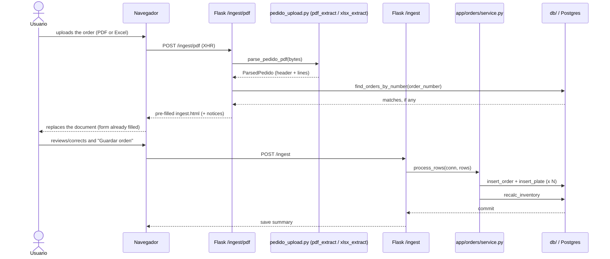
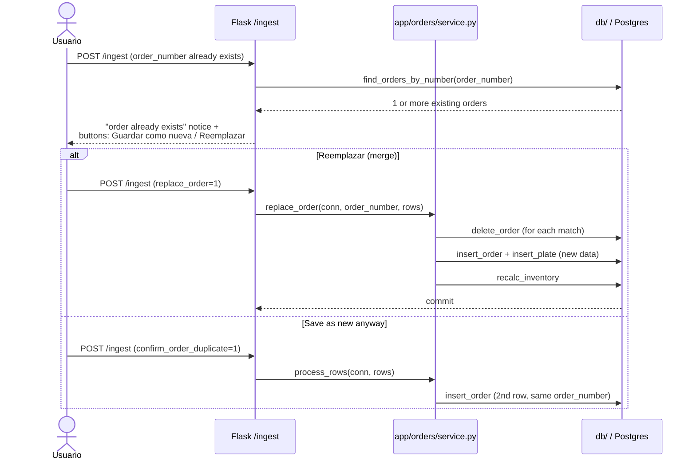

# Web (`app/web/`)

[← back to index](README.md)

Since Phase 1d, `app.py` only creates the `app` object, initializes Sentry
(if `SENTRY_DSN` is set), registers one blueprint per domain and
keeps the 2 routes too small to have their own (`/` and
`/healthz`) — 83 lines in total. The real routes live in the domain
packages; helpers shared by 2+
blueprints (`today_iso`, `_options`, `_padded`, `_validate_order_header`,
`customer_fields_from_form`, etc.) live in `app/web/helpers.py`. Storing and
serving uploaded files (`resolve_upload_path`, `send_stored_file`,
`save_photo`, `save_signature_png`, `UPLOADS_DIR`) lives in
`app/shared/uploads.py`. The `/login`, `/logout` and `/usuarios` routes and the
shared sign-in code live in the auth domain, `app/auth/` (`routes.py`,
`admin_routes.py`, `api.py` and `login.py`); the per-request access check,
`permission_required`, lives in `app/shared/auth.py`. The `/customers`,
`/precios`, `/inventory`, `/produccion` and `/cuadre` routes live in their
domain packages, `app/customers/routes.py`, `app/pricing/routes.py`,
`app/inventory/routes.py`, `app/production/routes.py` (see
[`PRODUCTION.md`](PRODUCTION.md)) and `app/cash_summary/routes.py`; their
templates stay in `app/web/templates/`. The `/ingest`, `/records` and
`/review` routes live in the orders domain, `app/orders/routes/`
(`ingest.py`, `records.py`, `review.py`), which also holds the ingestion
pipeline (`app/orders/service.py`), the pedido parsers and the orders and
plates SQL (`app/orders/repository/`); their templates stay in
`app/web/templates/` too. The `/declaraciones` and `/declaracion` routes live
in the declarations domain, `app/declarations/` (`routes.py` for the staff
screens, `public_routes.py` and `antispam.py` for the public form), which
also holds the submission and review rules (`service.py`), the PDF
(`pdf.py`) and the declarations SQL (`repository.py`); its templates stay
in `app/web/templates/` as well.

## Routes

| Method | Path | Blueprint | What it does | Calls from `core` | Template | Auth |
|---|---|---|---|---|---|---|
| GET | `/` | `app.py` | Redirects to the first tab of `NAV_ITEMS` the user can open (`landing_url()`); if their role has no permission at all, responds 403 with `no_permissions.html` | — | (redirect) / `no_permissions.html` | `@authenticated` |
| GET | `/healthz` | `app.py` | Liveness probe | — | — | open |
| GET/POST | `/login` | `app/auth/routes.py` | Login (queries `users`): on success sets the same `access_token` and `refresh_token` cookies as `/api/auth/login` and redirects to the safe `next` or `landing_url()`; a valid token on GET redirects to `landing_url()` | `login.sign_in`, `login.set_token_cookies` | `login.html` | open |
| POST | `/logout` | `app/auth/routes.py` | Clears the `access_token` cookie and the session, then redirects to `/api/auth/logout/continue` (POST only: a GET responds 405 and closes nothing) | `login.clear_access_cookie` | (redirect) | open |
| POST | `/api/auth/login` | `app/auth/api.py` | JSON login: sets the `access_token` and `refresh_token` cookies (see "JSON API (`/api`)") | `login.sign_in`, `login.set_token_cookies` | (JSON) | open |
| POST | `/api/auth/refresh` | `app/auth/api.py` | Rotates the refresh token and reissues both cookies with the user's current permissions | `refresh_tokens.rotate`, `repository.get_user_by_id` | (JSON) | open (refresh cookie) |
| POST | `/api/auth/logout` | `app/auth/api.py` | Revokes the refresh token and clears both cookies; 204 | `refresh_tokens.revoke` | — | open |
| GET | `/api/auth/me` | `app/auth/api.py` | The user and permissions of the access token, without reading the database | `current_user` | (JSON) | access cookie (401 without it) |
| GET | `/api/auth/refresh/continue` | `app/auth/api.py` | Jinja only: rotates the tokens and redirects to the safe `next` (or `/`); without a refresh cookie, or when the refresh fails, clears both cookies and redirects to `/login` | `login.refresh` | (redirect) | open (refresh cookie) |
| GET | `/api/auth/logout/continue` | `app/auth/api.py` | Jinja only: revokes the refresh cookie's token, clears both cookies and redirects to `/login` | `login.sign_out` | (redirect) | open |
| GET/POST | `/declaracion` | `app/declarations/public_routes.py` | Public sworn-declaration form (QR at the counter), only for people who declare for themselves (PROPIETARIO / POSEEDOR; a `GESTOR` sent by hand is rejected with 400; the endpoint for gestores is planned). POST: honeypot, signed token, Turnstile, per-IP limit (20/hour; customers share the shop's wifi IP), reads 1 to 30 ownership cards (`card_<i>_*`) with a single declarant and a single signature, saves the signature and the **mandatory photos** (the declarant's ID card and the ownership card, front and back of each, and the photo of the used plate(s) of each card, for both deterioration and loss, unless the customer ticks «Perdí mis placas» ("I lost my plates") on that card (`card_<i>_plates_lost`; then that photo is neither requested nor saved and the declaration detail says so); JPG/PNG/WebP detected by content, max. 5 MB each, the browser shrinks them before sending; the body of this POST allows up to 40 MB) in `UPLOADS_DIR`, validates and saves the declaration always as `pending_review` («Por revisar», "To review") **without creating anything** (customer and ownership cards are created when the point of sale approves it). Responds **503** (`declaration_unavailable.html`) while `TURNSTILE_SITE_KEY` and `TURNSTILE_SECRET_KEY` (or `TURNSTILE_BYPASS`) are not set. The declarant's name cannot contain digits (same rule as "Solicitado por" ("Requested by") in `/ingest`, so staff can create the order afterwards): the browser warns (`pattern`) and the server rejects it with 400. The success page is identical for every declaration (with or without alerts): it never reveals status, alerts or the previous owner | `declarations.validate_declaration`, `submit_declaration`, `declarations_repository.count_recent_by_ip` | `declaration.html`, `declaration_received.html`, `declaration_unavailable.html` | **no login** (the only public route that writes) |
| GET | `/ingest` | `ingest.py` | "Registrar" ("Register") form — full capture of a POS order (Phase 3). With `?declaration_id=N` (the button in `/declaraciones`) it arrives **pre-filled from an approved declaration not yet attended** (`production_order_id` NULL), just like the PDF: **it saves nothing**. Header: today's date, order no. and payment method empty (staff decide those), customer = the declarant (the gestor if a gestor acted; otherwise, the customer linked to the cards) with all their data. One `placa` line per ownership card, in order: the card's plate type (empty if not recognized), plate, quantity, reason, brand and value = current rate for the type (empty if none); the city is the card's «matriculado en» ("registered in") (uppercased); if the card does not have it, it stays empty and a notice asks for it for `CARRO PARTICULAR`/`CARRO PÚBLICO` lines. Nonexistent or malformed id → 404; pending, rejected, already attended or **approved with some `PÉRDIDA` card whose notarial authentication has not yet been marked as received** → the normal form with a Spanish error (if already attended, it says with which order and links to its detail; `DETERIORO`-only declarations are never blocked this way) | `orders_repository.distinct_requested_by/cities`, `pricing_repository.current_prices`, `customers_repository.list_customers`, `declarations_repository.get_declaration`, `declarations_repository.list_declaration_cards`, `customers_repository.get_customer` | `ingest.html` | `@permission_required("orders.capture")` |
| POST | `/ingest` | `ingest.py` | Saves order+plates (resolves/creates customer, snapshots prices); handles the duplicate order/plate notices and the opt-in "Reemplazar" ("Replace"). **The city is mandatory on every line** (except "Orden anulada" ("Voided order")): the browser requires it (`required`) and the server rejects a line without a city with "Línea N: elegí la ciudad…" ("Line N: choose the city…") and saves nothing. Only `CARRO PARTICULAR` / `CARRO PÚBLICO` depend on a city (left blank so it is chosen); for the other types the form suggests `COLOMBIA` (editable). If it carries the hidden field `declaration_id`, the server **re-validates** the declaration (exists, approved, not attended and, if it has a `PÉRDIDA` card, with the notarial authentication received; otherwise it saves nothing and returns the form as is with the error); the plates of its cards are **not blocked** as "already exists" (the case is replacing a lost or deteriorated plate; typing the same plate twice in the submission still blocks) and, in the **same transaction** as the save (normal path and "Reemplazar"), the declaration is marked attended by the created order (`declarations_repository.set_declaration_production_order`). The hidden field travels in all re-renders (duplicate order/plate notices, errors). Without `declaration_id` the behavior does not change | `service.process_rows`, `service.replace_order`, `service.find_duplicate_plate_numbers`, `customers_repository.resolve_or_create_customer`, `orders_repository.find_orders_by_number`, `declarations_repository.set_declaration_production_order` | `ingest.html` | `@permission_required("orders.capture")` |
| GET | `/ingest/pdf` | `ingest.py` | Order upload form (PDF or Excel `.xlsx`; field `file`) | — | `ingest_pdf.html` | `@permission_required("orders.capture")` |
| POST | `/ingest/pdf` | `ingest.py` | Parses the order (PDF or `.xlsx`, told apart by **content**, not by extension; also accepts the old field name `pdf`) including footer fields, and re-renders `ingest.html` pre-filled (**saves nothing**). An old `.xls`, a zip that is not Excel or any other file gives a Spanish error (400) | `pedido_upload.parse_uploaded_pedido`, `orders_repository.find_orders_by_number` | `ingest.html` | `@permission_required("orders.capture")` |
| GET | `/review` | `review.py` | Queue of plates with `is_possible_duplicate` | `orders_repository.review_rows` | `review.html` | `@permission_required("duplicates.review")` |
| POST | `/review/update` \| `/resolve` \| `/delete` | `review.py` | Edits/marks as reviewed/deletes a flagged row | `orders_repository.update_plate`, `resolve_plate`, `delete_plate`, `recalc_inventory` | (redirect) | `@permission_required("duplicates.review")` |
| GET | `/inventory` | `app/inventory/routes.py` | Inventory cards by category | `repository.inventory_view`, `ornamental_count` | `inventory.html` | `@permission_required("inventory.manage")` |
| POST | `/inventory/alistado` | `app/inventory/routes.py` | Records a preparation (alistamiento) | `repository.insert_blank_preparation`, `recalc_inventory` | (redirect) | `@permission_required("inventory.manage")` |
| GET | `/precios` | `app/pricing/routes.py` | Editable rate table by plate type (Phase 5a) | `repository.price_list` | `pricing.html` | `@permission_required("pricing.manage")` (seeded for admin only) |
| POST | `/precios/<plate_type>` | `app/pricing/routes.py` | Sets/updates the rate of a type | `repository.set_price` | (redirect) | `@permission_required("pricing.manage")` |
| GET | `/customers` | `app/customers/routes.py` | Customer list, with `?q=` filter by name (Phase 6) | `repository.list_customers` | `customers.html` | `@permission_required("customers.manage")` (seeded for admin only, like `/precios`) |
| GET | `/customers/<id>` | `app/customers/routes.py` | Edit form for a customer | `repository.get_customer` | `customer_detail.html` | `@permission_required("customers.manage")` |
| POST | `/customers/<id>` | `app/customers/routes.py` | Overwrites the customer's attributes (name included, and address/neighborhood/municipality depending on the type) — unlike `repository.resolve_or_create_customer`, this DOES replace an already-stored value | `repository.update_customer` | (redirect) | `@permission_required("customers.manage")` |
| GET | `/usuarios` | `app/auth/admin_routes.py` | User list: user, roles (the labels from `repository.list_roles`, sorted, or "Sin roles" ("No roles")), Activo/Inactivo (Active/Inactive) status and creation date, with the "Nuevo usuario" ("New user") button, an "Editar" ("Edit") per row and the last-action notice (`flash`). It never shows the password hash or the internal name of a role | `repository.list_users`, `repository.list_roles` | `users.html` | `@permission_required("users.manage")` (seeded for admin only) |
| GET/POST | `/usuarios/nuevo` | `app/auth/admin_routes.py` | Creates a user: username (leading/trailing spaces are stripped; 3 to 50 characters: letters, digits, dot, hyphen or underscore), one or more roles and a password of at least 10 characters, repeated. An error re-renders the form with 400 (keeps username and roles, never the password) without writing anything; a duplicate username answers "Ese usuario ya existe." ("That user already exists.") through the UNIQUE constraint. On success, redirects to `/usuarios` with "Usuario creado." | `service.validate_new_user`, `repository.create_user` | `user_form.html` | `@permission_required("users.manage")` |
| GET/POST | `/usuarios/<id>` | `app/auth/admin_routes.py` | Edits a user's roles and the Activo (Active) checkbox (the username cannot be changed). The rules of `service.validate_user_update` (see "Roles and permissions") answer 400 with the message and write nothing; on success, saves roles and status in a single transaction and redirects to the same page with "Cambios guardados." ("Changes saved."). Unknown id → 404 | `service.validate_user_update`, `repository.get_user_by_id`, `repository.set_user_roles`, `repository.update_user` | `user_form.html` | `@permission_required("users.manage")` |
| POST | `/usuarios/<id>/password` | `app/auth/admin_routes.py` | Changes a user's password (at least 10 characters, repeated). An error re-renders the edit page with 400; on success, redirects to `/usuarios/<id>` with "Contraseña actualizada." ("Password updated."). Unknown id → 404 | `service.validate_password`, `repository.set_user_password` | (redirect) / `user_form.html` | `@permission_required("users.manage")` |
| GET | `/usuarios/roles` | `app/auth/admin_routes.py` | "Roles y permisos" ("Roles and permissions"): table Rol (the label, with "(del sistema)" ("(system)") for the seeded roles) / Permisos ("Todos" ("All") for Administrador, otherwise how many codes it has stored) / Usuarios (how many users, active or not, have the role) / Editar, in the order of `repository.list_roles`, with the "Nuevo rol" ("New role") button and the last-action notice. It never shows the internal name of a role | `repository.list_roles` | `roles.html` | `@permission_required("users.manage")` |
| GET/POST | `/usuarios/roles/nuevo` | `app/auth/admin_routes.py` | Creates a custom role: "Nombre del rol" ("Role name") (leading/trailing spaces are stripped; 1 to 60 characters; it cannot repeat another role's name even if case or accents differ) and at least one permission from the catalog (`repository.list_permissions`; an unknown code is ignored). The internal name (`custom_` + 8 hexadecimal characters) is generated by `service.new_role_name`. An error re-renders the form with 400 (keeps name and permissions) without writing anything; on success, redirects to `/usuarios/roles` with "Rol creado." ("Role created.") | `service.clean_permissions`, `service.validate_role`, `repository.create_role` | `role_form.html` | `@permission_required("users.manage")` |
| GET/POST | `/usuarios/roles/<name>` | `app/auth/admin_routes.py` | Edits a role. Administrador is read-only (all checkboxes ticked and disabled, no save button; a POST responds 400 without writing). For the other system roles the name is not changed (any submitted one is ignored) but the permissions are; for custom roles both are changed. Same rules and errors as on create; on success, redirects to the same page with "Cambios guardados.". The change applies on the next request of each user with the role. Unknown name → 404 | `service.clean_permissions`, `service.validate_role`, `repository.get_role`, `repository.update_role` | `role_form.html` | `@permission_required("users.manage")` |
| POST | `/usuarios/roles/<name>/delete` | `app/auth/admin_routes.py` | Deletes a custom role with no users ("Eliminar rol" ("Delete role") button with confirmation, only on custom roles). A system role or one with assigned users (active or not) re-renders the edit page with 400 and the message; on success, redirects to `/usuarios/roles` with "Rol eliminado." ("Role deleted."). Unknown name → 404 | `service.validate_role_delete`, `repository.delete_role` | (redirect) / `role_form.html` | `@permission_required("users.manage")` |
| GET | `/declaraciones` | `app/declarations/routes.py` | List of sworn declarations from the public form: **one row per declaration** with the declarant (name and `acting_as`), the number of ownership cards, the **total plates** (sum of `plate_quantity`), a compact summary (`ABC123 · DEF45G +3`, and the reasons counted per card, `PÉRDIDA` first: `1 deterioro` or `2 pérdida · 1 deterioro`, in red if there is any loss), **a single status badge** (the derived *stage*, `declaration_stage`), alerts (union) with the number of the card that caused them, and date. Every declaration from the public form is left `pending_review` (with or without alerts) and creates nothing until the point of sale approves it. Stages (badge and `?stage=` tabs, computed in SQL in `declarations_repository.list_declarations(stage=...)`): **Por revisar** ("To review") (`to_review`, default tab with counter: `pending_review`), **Falta autenticación** ("Authentication missing") (`awaiting_notarization`: approved, with some `PÉRDIDA` card, `notarized_received_at` NULL and no order), **Lista para pedido** ("Ready for order") (`ready`: approved, no pending notarial step and no order), **Atendidas** ("Attended") (`attended`: already has `production_order_id`) and **Rechazadas** ("Rejected") (`rejected`), plus **Todas** ("All") (`?stage=all`); the old `?status=`/`?attended=` parameters are no longer read. The reason (`PÉRDIDA`/`DETERIORO`) remains a separate badge per card. `?reason=` filter (`all` = Todos by default, `loss` = Pérdida, `deterioration` = Deterioro; **one** card with that reason is enough; also accepts the stored words `PÉRDIDA`/`DETERIORO`; it is combined with the stage and the search and kept across tabs), `?q=` search (declarant or plate/license/owner of **any** card), pending first and a pending counter. The cards are loaded with a single query (`declarations_repository.list_cards_for_declarations`). On narrow screens each row is shown as a card | `declarations_repository.list_declarations(stage, query, reason)`, `declarations_repository.declaration_stage`, `requires_notarization`, `declarations_repository.list_cards_for_declarations` | `declarations.html` | `@permission_required("declarations.review")` (the `production` role gets 403: it handles identity data) |
| GET | `/declaraciones/<id>` | `app/declarations/routes.py` | Detail: the same single stage badge next to the title, declarant block, their single signature and the notarized PDF, and **one section per ownership card** ("Tarjeta de propiedad N de M" ("Ownership card N of M")) with its data, reason, number of plates, its owner (and DUEÑO/POSEEDOR relationship) and, once approved, the customer and card created or linked (link to `/customers/<id>` for admin only, because that screen is admin-only). Each card's reason is a badge (`PÉRDIDA` in red, `DETERIORO` in blue). If pending, a summary "Retenida por X de M tarjetas" ("Held by X of M cards") (only when some card has alerts; a declaration **without alerts** is also reviewed: the "Aprobar" ("Approve") block says "Esta declaración no tiene alertas" ("This declaration has no alerts") and explains that approving creates or links the customer, the gestor if applicable and each ownership card) with links to the cards that hold it and, inside **each** card, the explanation of **its** alerts with the real context (date of the last manufacture and since when it can be repeated, existing cards and their owners, type/document of the existing customer, same name repeated in the declaration). The gestor's alerts (type/document) are copied to all cards and labeled "Gestor ...". Authenticated staff only; alerts are never shown on public pages. If the declaration is **approved and not attended**, the highlighted button **"Crear pedido"** ("Create order") appears at the top (link to `/ingest?declaration_id=<id>`), visible to admin and `point_of_sale` (the point of sale is who reviews: approving, rejecting and reassigning also belong to both roles); if pending, the notice "el punto de venta revisa todas las declaraciones; el pedido se podrá crear cuando el punto de venta apruebe la declaración" ("the point of sale reviews all declarations; the order can be created once the point of sale approves the declaration") is shown, and if rejected nothing appears. If it is approved and has **at least one `PÉRDIDA` card**, the **"Autenticación notarial"** ("Notarial authentication") block appears: while `notarized_received_at` is NULL it says "Pendiente" ("Pending") (download the PDF, hand it to the customer and mark when it returns authenticated), with the "Descargar PDF para autenticación" ("Download PDF for authentication") button and the "Marcar autenticación recibida" ("Mark authentication received") button (`POST .../notarized`), and **instead of "Crear pedido"** the note "Falta la autenticación notarial…" ("Notarial authentication missing…") is shown; once received it shows the date and who recorded it, with "Deshacer" ("Undo") (`POST .../notarized/undo`, hidden if there is already an order) and the "Crear pedido" button comes back. `DETERIORO`-only declarations are never blocked and, if approved, show an optional "Descargar PDF" ("Download PDF") button (`#optional-pdf`). If it already has `production_order_id` the badge is **"Atendida"** with the link to the order (`/records/<id>`, with its order number) instead of the button. The «Declaración» block shows «Tratamiento de datos: Autorizado el <fecha>» ("Data processing: Authorized on <date>") and «Información comercial: Sí / No» ("Commercial information: Yes / No") (or «No registrada» ("Not recorded") on declarations prior to migration 0013). Unknown id redirects to the list | `declarations_repository.get_declaration`, `orders_repository.order_detail`, `declarations_repository.list_declaration_cards`, `orders_repository.last_fabrication_date`, `orders_repository.find_orders_for_plate`, `customers_repository.get_ownership_card*`, `customers_repository.get_customer*` | `declaration_detail.html` | `@permission_required("declarations.review")` |
| GET | `/declaraciones/<id>/file/<kind>` | `app/declarations/routes.py` | Authenticated download (`kind` = `signature` (the declarant's single signature, which covers all cards), `notarized_pdf`, `id_front` or `id_back` (photos of the declarant's ID card; the type comes from the stored extension); each card's photos are served at `GET /declaraciones/<id>/cards/<card_id>/photo/<front|back|used_plates>` (`used_plates` = the photo of the card's used plate(s)), with the same headers and 404 if the card does not belong to that declaration). `GET /declaraciones/<id>/photos.zip` (`@permission_required("declarations.review")`) downloads all the declaration's photos in a ZIP (`cedula-frente/atras`, `tarjeta-N-PLACA-frente/atras`, `tarjeta-N-PLACA-placas-usadas`; skips those no longer on disk; 404 if none remain), `attachment`, `no-store`; the detail shows the «Descargar todas las fotos (ZIP)» ("Download all photos (ZIP)") button when there are photos, via `resolve_upload_path`; `inline`, `nosniff`, `no-store`; 404 if the type, the path or the file do not exist. A file name in the URL is never accepted | `declarations_repository.get_declaration` | (file) | `@permission_required("declarations.review")` |
| POST | `/declaraciones/<id>/approve` | `app/declarations/routes.py` | Approves the **whole** declaration (all or nothing; the "Aprobar declaración" ("Approve declaration") button always appears on pending ones, with or without alerts). Fields: `note` (optional) and a checkbox `reassign_<declaration card id>` for each card with the `card_other_owner` alert (the checkbox only appears on those cards and is sent with the `form="approve-form"` attribute), which are passed as `reassign_card_ids`. A `ValueError` (which names the card: "tarjeta 2 (placa DEF456)" ("card 2 (plate DEF456)")) re-renders the detail with the message (400), keeps the ticked checkboxes and changes nothing | `declarations.approve_declaration` | (redirect) | `@permission_required("declarations.review")` (seeded for admin and `point_of_sale`; `reviewed_by` = the session user; `production` gets 403) |
| POST | `/declaraciones/<id>/reject` | `app/declarations/routes.py` | Rejects the whole declaration without creating anything; the note (`note`) is mandatory | `declarations.reject_declaration` | (redirect) | `@permission_required("declarations.review")` |
| GET | `/declaraciones/<id>/pdf` | `app/declarations/routes.py` | PDF of the declaration to hand to the customer (printed). With any `PÉRDIDA` card it is the one the customer has authenticated at a notary; for `DETERIORO` it is an additional **optional download** (the detail shows a "Descargar PDF" button and does not require authentication). Available for any **approved** declaration; pending or rejected → 404 with a Spanish message. Reads the declarant's signature with `resolve_upload_path` (no signature or missing file → `signature_png=None`) and calls `pdf.build_declaration_pdf(declaration, cards, signature_png, issued_at)`. Response `attachment` `declaracion-<id>.pdf`, `application/pdf`, `nosniff`, `no-store` | `pdf.build_declaration_pdf`, `declarations_repository.list_declaration_cards` | (file) | `@permission_required("declarations.review")` |
| POST | `/declaraciones/<id>/notarized` | `app/declarations/routes.py` | Marks that the customer returned the declaration authenticated (`declarations_repository.set_declaration_notarized_received` with the session's `user_id`). Idempotent (marking twice keeps the first mark). Unknown id → list; declaration not approved or without a `PÉRDIDA` card → detail with error (400), no changes | `declarations_repository.set_declaration_notarized_received` | (redirect) | `@permission_required("declarations.review")` |
| POST | `/declaraciones/<id>/notarized/undo` | `app/declarations/routes.py` | Undoes the previous mark (back to NULL). Rejected (400) if the declaration was already attended by an order | `declarations_repository.set_declaration_notarized_received` | (redirect) | `@permission_required("declarations.review")` |
| GET | `/cuadre` | `app/cash_summary/routes.py` | Cash reconciliation (cuadre de caja): totals by date/payment method in `[desde, hasta]` (default today, Phase 5b) | `service.build_cash_summary` | `cash_summary.html` | `@permission_required("cash_summary.view")` |
| GET | `/cuadre/pdf` | `app/cash_summary/routes.py` | Same report, exported to PDF | `service.build_cash_summary`, `render_cash_summary_pdf` | (PDF download) | `@permission_required("cash_summary.view")` |
| GET | `/records` | `records.py` | Records: recent ones, or search by plate/order | `orders_repository.recent_orders`, `search_plates_by_number`, `search_orders_by_number` | `records.html` | `@permission_required("records.view")` |
| GET | `/records/<id>` | `records.py` | Order detail (view or edit depending on role); preserves `?q=` for the back link | `orders_repository.order_detail` | `record_detail.html` | `@permission_required("records.view")` |
| POST | `/records/<id>/save` | `records.py` | Saves header + plates edit (insert/update/delete) in one transaction; re-resolves `customer_id` from `requested_by` (never rewrites attributes of an existing customer, B5) | `orders_repository.update_order`, `delete_plate`, `normalize.normalize_row`, `customers_repository.resolve_or_create_customer`, `update_plate_full`, `insert_plate`, `recalc_inventory` | `record_detail.html` / redirect | `@permission_required("orders.capture")` |
| POST | `/records/search-pdf` | `records.py` | Uploads an order (PDF or `.xlsx`) and checks its plates against the DB (**read-only**) | `pedido_upload.parse_uploaded_pedido`, `normalize.is_real_plate`, `orders_repository.find_orders_for_plate` | `records.html` | `@permission_required("records.view")` |
| POST | `/records/delete` | `records.py` | Deletes a whole order and its plates | `orders_repository.delete_order`, `recalc_inventory` | (redirect) | `@permission_required("records.delete")` |

`/ingest/pdf` (POST), `GET /ingest?declaration_id=N` and `/records/search-pdf`
**never write to the DB** — explicitly documented as read-only/preview
in their docstrings.

A plate replaced from a declaration does end up with `is_possible_duplicate`
(the exemption only lifts the pre-save block; `process_rows` still flags
every plate that already existed), so it appears in `/review` and in the summary
("Posibles duplicados" ("Possible duplicates")) for staff to confirm it.

## Roles and permissions (`app/shared/auth.py`)

- **Permission catalog**: `app/auth/permissions.py::PERMISSIONS` — every
  action that can be granted to a role, with an English code
  (`orders.capture`, `records.view`, ...) and a Spanish label. The
  permissions of each role live in the `role_permissions` table (see
  [`DATABASE.md`](DATABASE.md)).
- **Several roles per user**: each user's roles live in the `user_roles`
  table (migration `0018`), and a user can have several. Their
  permissions are the **union** of the permissions of all their roles; if
  any of them is `admin`, they have all permissions. All of the user's
  roles count in every session.
- **Seeded roles**: `admin`, `point_of_sale` (PTO.V), `production` —
  values in English on purpose: the role name is never shown to the user,
  it is only compared for permissions, so it is not Spanish business data
  (see `CLAUDE.md`). Up to `app/migrations/0004_translate_role_values_to_english.sql`
  the real values were `produccion`/`punto_venta`. The seeding of
  `role_permissions` reproduces the previous access (the permissions of
  `point_of_sale` and `production` can be changed later in
  `/usuarios/roles`; the ones below are the seeded ones):
  - `admin` **always has all permissions**, whatever
    `role_permissions` stores for it (`effective_permissions`), so no
    admin can end up locked out.
  - `point_of_sale`: `orders.capture` (`/ingest`, `/ingest/pdf`,
    `/records/<id>/save`), `cash_summary.view` (`/cuadre`),
    `declarations.review` (`/declaraciones`), `records.view` and the
    production codes.
  - `production`: `records.view` (read-only) and the production
    codes.
- **Check on every request**: `current_user()` decodes the `access_token`
  cookie (the JWT of `app/shared/tokens.py`) once per request, caches its
  claims (`user_id`, `username`, `perms`) in `flask.g` and returns them, or
  `None` for a missing, invalid or expired token. The permissions come from
  the token claims, computed at login and at every refresh: **no database
  read**.
  - `@permission_required("<code>")` protects each route; if the token's
    permissions don't hold the code → 403. Each route asks for a single code,
    and **no route that writes accepts `records.view`**. The wrapper exposes
    its codes as `required_permissions`.
  - Without a valid token: an `/api` request gets the JSON 401; a genuine
    but **expired** token redirects (302) to
    `/api/auth/refresh/continue?next=<path>`, which rotates the tokens and
    comes back; anything else (no cookie, a forged or malformed token)
    redirects to `/login?next=<path>`. `next` is the requested path for
    GET and HEAD and `/` for any other method, because the redirect turns
    into a GET and a POST-only URL would answer 405.
  - `@authenticated` does the same checks without asking for a permission; only
    `/` uses it.
  - `has_permission(code)` returns `True` only if the token's permissions
    hold the code; without a valid token it returns `False` (never fails).
    Templates use it as `can('...')`.
  - **Behavior change**: a deactivated user, a role change or a role's new
    permissions take effect **within 5 minutes** (the access token's
    lifetime), at the next refresh, instead of on the next request. A role
    change, a deactivation or a password reset in `/usuarios` also revokes
    the user's refresh tokens, so that refresh sends them to `/login`.
  - Arriving from an external link (for example WhatsApp) keeps a
    signed-in user signed in: the token cookies are `SameSite=Lax`, so the
    browser sends them on a top-level GET navigation from another site (an
    expired access token goes through `/api/auth/refresh/continue` as
    usual). It never sends them on a cross-site POST, `fetch` or iframe.
- **Login** — `app/auth/login.py` holds the sign-in code that the Jinja
  `/login` and `/logout` and the JSON `/api/auth/*` share: `authenticate`
  queries `users` (via `app/auth/repository/users.py`) on every login;
  `sign_in` also computes the effective permissions and issues a refresh
  token; `refresh` and `sign_out` rotate and revoke one; and
  `set_token_cookies`/`clear_token_cookies` set and clear the two cookies.
  Jinja `POST /login` sets the same cookies as `/api/auth/login`. Jinja
  `POST /logout` clears the access cookie and the session and ends at
  `GET /api/auth/logout/continue`, which revokes the refresh token (the
  browser only sends the refresh cookie to `/api/auth`). The two
  `continue` endpoints exist only while Jinja pages do (phase 6 of
  [`MIGRATION_PLAN.md`](MIGRATION_PLAN.md) removes them). The user id
  in the access token → `production_orders.created_by`. `AUTH_USERS`/
  `AUTH_ROLES` and the `load_users()`/`load_roles()` functions that parse
  them **are kept** in `login.py`, but only as the code that did the
  historical backfill (`app.schema_migrate`) — live login does not touch
  them.
- **The Flask session only holds the CSRF token** (Flask-WTF); it stores no
  user. An old session cookie that still carries `user`, `user_id` or
  `role` signs nobody in: without an access token the page redirects to
  `/login`, and the stale session is cleared.
- **Token freshness on pages that post**: `_nav.html` exposes the seconds
  left on the access token (`data-token-seconds`, from
  `current_user().expires_at`) and defines `window.platesEnsureFreshToken()`:
  with fewer than 30 seconds left it calls `POST /api/auth/refresh`
  (`X-Requested-With: XMLHttpRequest`, `credentials: "same-origin"`) and,
  on 200, resets the deadline to 300 seconds; it always resolves. A
  `submit` listener on the document waits for it before sending any
  `form[method=post]` of the page (except the logout form), and the XHR of
  `ingest_pdf.html` awaits it before sending, so a form filled in over more
  than 5 minutes is not lost. If the refresh fails the submission goes ahead
  and the server's redirect to `/login` applies.
- **User administration**: administrators (permission
  `users.manage`) create users, assign them roles, activate or
  deactivate them and change their password in `/usuarios`. The rules live in
  `app/auth/service.py`: nobody can deactivate their own user or remove
  their own administrator role, at least one active administrator must always
  remain, the username cannot be changed after
  creation, and a user is never deleted: it is deactivated. Every creation, change
  and password change leaves a line in the log (who, to whom, roles),
  never the password or its hash.
- **Roles and permissions (creating a role)**: in Usuarios → Roles y permisos →
  Nuevo rol (Users → Roles and permissions → New role), an administrator types the role name (it cannot repeat
  another role's name even if case or accents differ) and ticks at least one
  permission; then assigns it in each user's form (`/usuarios/<id>`),
  where the role shows up right away. The internal role name
  (`custom_` + 8 hexadecimal characters) is generated by the app and never shown.
  Administrador cannot be edited (it always has all permissions); the
  names of the system roles (Administrador, Punto de venta,
  Producción) do not change, but the permissions of Punto de venta and Producción
  do. Only custom roles that have no users
  (active or not) can be deleted. The rules live in `app/auth/service.py`
  (`validate_role`, `validate_role_delete`), each change applies within
  5 minutes, at the next refresh of the users with the role, and creating, editing or deleting
  a role leaves a line in the log (who and the internal role name).
- **Navigation**: `app/web/navigation.py::NAV_ITEMS` is the ordered list of
  tabs (endpoint, label, permission, active endpoints). The `app.py` context
  processor exposes `nav_items` (only those the user can
  open) and `can`; `_nav.html` iterates over them. Later tasks add
  their tabs to that list.
- `landing_url()` (where a login without `?next=` lands, and `/`): the first
  entry of `NAV_ITEMS` the user can open. If they have none,
  `/` responds **403** with `no_permissions.html` ("Tu usuario no tiene
  permisos asignados. Pide a un administrador que te asigne un rol." ("Your user has no permissions assigned. Ask an administrator to assign you a role."), with
  the Salir ("Log out") button), with no redirect loop.
- Session signed with `SECRET_KEY` (mandatory, no default), cookie
  `HTTPONLY` + `SAMESITE=Lax` + `SECURE` conditioned on `COOKIE_SECURE`,
  lasting the browser session; it only carries the CSRF token.
- CSRF protection across the whole app (Flask-WTF `CSRFProtect`): every POST carries
  the session token; without it the response is 400 with `csrf_error.html`. See
  "CSRF protection".
- Every 404 (an unknown URL or an `abort(404)`) answers `not_found.html` with
  status 404 and `Cache-Control: no-store`. Under `/api/` it answers the
  JSON error `not_found` instead (see "JSON API (`/api`)").
- Anti open-redirect guard on the login's `?next=`: only relative paths of the
  same origin.

## CSRF protection

`app/web/csrf.py` creates Flask-WTF's `CSRFProtect` and `app.py` activates it
with `csrf.init_app(app)` for the **whole app**: any POST, PUT, PATCH or
DELETE without a valid token is rejected with **400** before the
route runs, so nothing changes.

- Every new form with `method="post"` starts with:

  ```html
  <input type="hidden" name="csrf_token" value="{{ csrf_token() }}">
  ```

- Every JS request that changes data sends the token in the
  `X-CSRFToken` header (like the XHR in `ingest_pdf.html`, which reads it from the
  form's hidden input).
- A missing or invalid token shows `csrf_error.html` with status 400:
  "La sesión expiró, recarga la página e intenta de nuevo." ("The session expired, reload the page and try again.") and a link to
  `/declaracion` (if the submission came from there) or to `/`. It is a standalone page,
  with no `_nav.html` and no database queries, with `Cache-Control: no-store`.
- `/declaracion` is exempt from the automatic check and calls
  `csrf.protect()` by hand, right after raising its body limit to
  40 MB: the automatic check reads the form before the route, with the
  global 12 MB limit, and would reject valid declarations between 12 and 40 MB.
  Its `form_token`, Turnstile, per-IP limit and the friendly 413 stay the same.
- `WTF_CSRF_TIME_LIMIT=None`: the token has no expiry of its own, it lasts
  as long as the session, which is the browser session for staff and
  anonymous visitors alike.
- `/logout` is POST only: no route changes data with a GET.
- The JSON API blueprint (`app/auth/api.py`) is exempt from the token
  (`csrf.exempt(auth_api_bp)` in `app.py`): every POST, PUT, PATCH or DELETE
  under `/api/` must send `X-Requested-With: XMLHttpRequest` instead, which a
  cross-site form cannot set (see "JSON API (`/api`)"). The Jinja routes keep
  the token.
- Tests: the `client` fixture in `tests/web/conftest.py` (and `_fresh_client`
  in `tests/web/test_users.py`) turns CSRF off (`WTF_CSRF_ENABLED=False`) only
  for those tests and restores the value at the end;
  `tests/web/test_csrf.py` tests it turned on, including a walk through
  `app/web/templates/*.html` that requires `csrf_token()` in every POST form.

## JSON API (`/api`)

The JSON API lives under `/api`. Its shared plumbing is `app/shared/api.py`
(`init_api(app)`, called from `app.py`); the auth endpoints are the
`auth_api` blueprint in `app/auth/api.py`, with their Pydantic models in
`app/auth/schemas.py`. It uses the JWT access tokens of
`app/shared/tokens.py` and the refresh tokens of `app/auth/refresh_tokens.py`
(see [`MIGRATION_PLAN.md`](MIGRATION_PLAN.md), "Decisions"). It never touches
the Flask session. The Jinja pages share the same cookies: `/login` sets
them through the same code (`app/auth/login.py`), and every page reads the
access token (see "Roles and permissions").

| Method | Path | Body | Answers |
|---|---|---|---|
| POST | `/api/auth/login` | `{"username": str, "password": str}` (the username is stripped, as in `/login`) | **200** `{"user": {"id", "username", "roles"}, "permissions": [...]}` (effective permissions, sorted) and sets both cookies; **400** `invalid_body` (not a JSON object, or a missing or non-string field); **401** `invalid_credentials` "Usuario o contraseña incorrectos.", the same bytes for an unknown user, a wrong password and an inactive user, with no cookie. Logs `login: user=... roles=...` like `/login` |
| POST | `/api/auth/refresh` | — (reads the `refresh_token` cookie) | **200** with the login body, built from the user's **current** roles and permissions, and both cookies reissued (the refresh token is rotated); **401** `not_authenticated` and both cookies cleared for a missing cookie, an unknown, expired or reused token (reuse revokes the whole family) or a user who no longer exists or is inactive (all their refresh tokens are revoked) |
| POST | `/api/auth/logout` | — | **204**, empty body: revokes the `refresh_token` cookie's token if there is one (an unknown one is a no-op) and clears both cookies. Needs no access token |
| GET | `/api/auth/me` | — (reads the `access_token` cookie) | **200** `{"user": {"id", "username"}, "permissions": [...]}` from the token's claims, with no database read (so no roles: the token carries none); **401** `not_authenticated` for a missing, invalid or expired token |
| GET | `/api/auth/refresh/continue?next=<path>` | — (reads the `refresh_token` cookie) | Jinja only. **302** to `next` (or to `/` when `next` fails `is_safe_next`) with both cookies reissued; without a refresh cookie, or when the refresh fails, **302** to `/login?next=<next>` (the `next` only when it is safe) with both cookies cleared. Never redirects off-site |
| GET | `/api/auth/logout/continue` | — (reads the `refresh_token` cookie) | Jinja only. **302** to `/login`: revokes the refresh cookie's token if there is one and clears both cookies |

Every `/api/auth` response carries `Cache-Control: no-store`.

**Cookies** (set by login and refresh; cleared by setting them to expire
right away with the same name, path and attributes):

| Cookie | Value | Attributes |
|---|---|---|
| `access_token` | the JWT (`issue_access_token`, claims `sub`, `username`, `perms`, `iat`, `exp`); the JWT itself expires after `ACCESS_TOKEN_LIFETIME` (5 minutes, its `exp`) | `HttpOnly`, `SameSite=Lax`, `Max-Age=2592000` (`REFRESH_TOKEN_LIFETIME`, so a page still receives an expired token and can tell a refresh may work), `Path=/` |
| `refresh_token` | the raw opaque refresh token (only its hash is stored) | `HttpOnly`, `SameSite=Lax`, `Max-Age=2592000` (`REFRESH_TOKEN_LIFETIME`), `Path=/api/auth` (logout must receive it to revoke it) |

Both carry `Secure` when `COOKIE_SECURE` is on, the same flag as the session
cookie (`app.py` reads it once into `app.config["COOKIE_SECURE"]`).

**Errors.** Every error under `/api/` answers JSON, never HTML or the
`abort()` description: `{"error": {"code": "...", "message": "..."}}`, with a
fixed English `code`, a Spanish `message` and `Cache-Control: no-store`
(`error_response` and the `ErrorDetail`/`ErrorResponse` models). The HTTP
codes map to `bad_request` (400), `not_authenticated` (401), `forbidden`
(403), `not_found` (404), `method_not_allowed` (405, with `Allow`),
`conflict` (409), `rate_limited` (429, nothing raises it yet) and
`internal_error` (500, registered on `InternalServerError`, so Flask's
exception logging and Sentry still see the error). The endpoints add
`invalid_body`, `invalid_credentials` and `missing_requested_with`. Outside
`/api/` every error keeps its usual response (the 404 page, the CSRF page,
Werkzeug's defaults).

**`X-Requested-With`.** Every POST, PUT, PATCH or DELETE under `/api/`
(login, refresh and logout included) without `X-Requested-With:
XMLHttpRequest` answers **403** `missing_requested_with` before the view
runs. A cross-site form can't set that header, so together with
`SameSite=Lax` (no cookie on a cross-site POST) it replaces the Flask-WTF
token, from which the API blueprint is exempt (see "CSRF protection"). GET
is not checked. With `Lax`, a cross-site link does carry the cookies to the
two Jinja-only GET endpoints: `/api/auth/refresh/continue` only rotates the
tokens and redirects on-site, and `/api/auth/logout/continue` can sign the
user out (nothing worse), the accepted cost of staying signed in from
external links.

**Revocation.** In `/usuarios` (`app/auth/admin_routes.py`), changing a
user's set of roles, deactivating them or resetting their password revokes
all their refresh tokens in the same transaction as the change, so their next
`/api/auth/refresh` answers 401; their access token lasts at most 5 more
minutes. Saving the form unchanged, or reactivating a user, revokes nothing.
Editing a role's permissions doesn't revoke either: holders get the new
permissions at their next refresh.

Tests: `tests/api/` (its `client` fixture keeps CSRF on, to prove the
exemption).

## Public routes

Only these routes respond without an access token: `/login`, `/logout`, `/healthz`,
`/declaracion` (plus `/static`), the JSON auth routes `/api/auth/login`,
`/api/auth/refresh` and `/api/auth/logout` (`/api/auth/me` answers 401
without an access token), and the Jinja-only `/api/auth/refresh/continue`
and `/api/auth/logout/continue` (without a refresh cookie they only clear
the cookies and redirect to `/login`). `tests/web/test_public_routes.py` walks
`app.url_map` and fails if any other route answers 200 to an
anonymous request; adding a public route requires editing its list on purpose.

`/declaracion` switches itself off: without Turnstile keys (nor `TURNSTILE_BYPASS`)
it responds 503, so production exposes nothing until the owner configures
Cloudflare. `app.py` sets `MAX_CONTENT_LENGTH` to 12 MB for the whole app (the
PDFs of `/ingest/pdf` need it; the public form no longer uploads a PDF, only
the PNG signature in base64, about 270 KB); a larger body gets a friendly
413 on that route.

### Public declaration form

This form is **only for people who declare for themselves** ("1 to 1"
procedure): it is not for gestores. A separate public endpoint is planned for
gestores; the service (`app/declarations/service.py`), the database and the `/declaraciones`
review screen already support `acting_as = GESTOR`, but this
form does not offer it.

A declaration has **a single declarant** (the person who fills in the
form, owner or possessor) and **from 1 to `MAX_CARDS` (30) ownership
cards**, all belonging to the declarant. Only the declarant signs, once: the signature
covers all cards. Sections: 1 Calidad en la que actúa (PROPIETARIO /
POSEEDOR) (Capacity in which they act), 2 Datos del declarante (Declarant data), 3 Tarjetas de propiedad (Ownership cards), legal text
(4 to 6), 7 Autorización de tratamiento de datos personales (Authorization for personal data processing) and 8 Firma (Signature).

Section 7 shows the authorization text of Law 1581 of 2012
(title and two paragraphs, as worded by INGSE; no words are modified), with
the email `ovelez@ingse.co` and the policy
(`https://placasvehiculares.ingse.co/#placas`, opens in another tab) as
links. It asks for two things, both mandatory and **unticked** on load: the checkbox
`accept_data_policy` and the choice `marketing_consent` (`SI` / `NO`; either
one lets the form be submitted, but one must be chosen). The server repeats the
validation: `marketing_consent` with any other value counts as not
answered. Both are kept when returning with errors. The text lives in
constants of `app/declarations/service.py` (`DATA_POLICY_*`, `MARKETING_*`), which
both the form and the PDF read. The original document's
Nombre / C.C. / Empresa / Firma / Fecha block (Name / ID no. / Company / Signature / Date) is not repeated: the form
already asks for name, ID number and signature, and the date is kept in `accepted_data_policy_at`.

Each "Tarjeta de propiedad N" ("Ownership card N") block carries the card's data (plate,
transit license, engine, chassis, vehicle type, registered in, brand),
the **reason** (DETERIORO / PÉRDIDA) per card and the **number of plates**
(1 or 2). The plate type limits the quantity with
`normalize.max_plates_per_card`: cars (private and public) allow 1
or 2 (default 2) and the other types only 1. The type-to-maximum map travels to the
page as JSON in `data-max-by-type`. The **total of plates** is shown
summed and read-only; it is never typed or sent.

Cards carry no data from another owner: the declarant is the owner or
possessor of all of them. If someone sends `acting_as = GESTOR` by hand, the server
rejects it as a normal validation error (400, before saving
files): it redraws the form with "Este formulario es solo para
personas que declaran por sí mismas…" ("This form is only for people who declare for themselves…") and never calls `submit_declaration`. Any
`card_<i>_owner_*` fields that arrive are ignored. **The form has no
file field**: next to each card's reason there is a note ("Si
declaras pérdida, INGSE te entregará este documento en el mostrador para que lo
autentiques en una notaría." ("If you declare a loss, INGSE will hand you this document at the counter for you to have it authenticated at a notary.")) that is visible without JavaScript and that the script
hides while that card's reason is not PÉRDIDA. The success page
repeats the notice generically, without revealing status.

**What happens on submit:** all declarations arrive «Por revisar»
(`pending_review`), whether or not they have alerts. Submitting does not create customers or ownership
cards: the point of sale reviews the declaration in `/declaraciones` and, when
approving it, the customer and the cards are created. The sender always sees the same
page («Recibimos tu declaración», "We received your declaration"), with no status or alerts.

Per-IP limit: `MAX_SUBMISSIONS_PER_IP_PER_HOUR` = 20 (single constant in
`app/declarations/public_routes.py`).

POST fields (`application/x-www-form-urlencoded`): `form_token`, `website` (honeypot),
`cf-turnstile-response`, `acting_as`, `declarant_<field>`, `signature` (PNG data
URL), `accept_terms`, `accept_data_policy`, `marketing_consent` and, for each card with index `i`:
`card_<i>_plate_number`, `_transit_license`, `_engine_number`,
`_chassis_number`, `_vehicle_type`, `_registered_in`, `_vehicle_brand`,
`_reason` and `_plate_quantity`. The person fields are `name`, `document_type`,
`document_number`, `address`, `neighborhood`, `municipality`, `phone`, `email`.

The indices are set by the browser and can end up **sparse** (0, 2, 5) when
cards are removed; the server reads those that arrive, in numeric order. A
submission with more than `MAX_CARDS` distinct indices is rejected (400, before building anything or saving files),
and so is one without any card. A non-numeric quantity
is converted to 0 so that validation rejects it. After a validation
error all the blocks are redrawn with what the person
typed (the signature is not returned: it must be signed again). Without
JavaScript the page still shows the first card, but adding or removing
cards and the per-type limits require JavaScript.

## Templates

There is no shared `base.html` — each page is an independent HTML
document that includes `_nav.html` and duplicates its own `<style>`.

| Template | What it renders |
|---|---|
| `_nav.html` | Shared nav: iterates over `nav_items` (the `NAV_ITEMS` entries the user can open, see `app/web/navigation.py`) and ends with the Salir (Log out) button. |
| `no_permissions.html` | 403 page for `/` when the user's role has no permission at all: includes `_nav.html` (only Salir remains) and the text "Tu usuario no tiene permisos asignados. Pide a un administrador que te asigne un rol." |
| `declarations.html` | Declaration list: tabs by stage (Por revisar with counter / Falta autenticación / Lista para pedido / Atendidas / Rechazadas / Todas), search, reason filter (Todos / Pérdida / Deterioro), one row per declaration (declarant, cards, total plates, summary), ONE stage badge (`Por revisar`, `Falta autenticación`, `Lista para pedido`, `Atendida`, `Rechazada`) and the alert badges (`Placa reciente`, `Tarjeta de otro dueño`, `Datos no cuadran`, `Tipo de cliente`, `Documento distinto`); on narrow screens the table stacks into cards. |
| `declaration_detail.html` | Detail of a declaration: summary of the hold, declarant, files, one section per ownership card with its alerts, the "Crear pedido" / "Atendida" block (depending on the status and `production_order_id`; replaced by the note "Falta la autenticación notarial" while there are `PÉRDIDA` cards without authentication received), the thumbnails of the ID card and of each card's photos (declarations prior to the photos do not have them), the "Autenticación notarial" block (PDF, mark/undo), reason badges per card, and the approve (with the reassignment checkboxes) and reject forms. |
| `customer_detail.html` | Edit a customer (`/customers/<id>`); for `CLIENTE` customers it adds the read-only table "Tarjetas de propiedad" ("Ownership cards") (license, plate, vehicle type, registered in, brand; with text if there are none) from `customers_repository.list_ownership_cards_for_customer`. |
| `users.html` | User list (`/usuarios`): last-action notice, "Roles y permisos" link (to `/usuarios/roles`), "Nuevo usuario" button and a Usuario / Roles / Estado / Creado table (User / Roles / Status / Created) with "Editar" per row. |
| `user_form.html` | Create (`/usuarios/nuevo`: username, roles, repeated password) and edit a user (`/usuarios/<id>`: roles and Activo checkbox, plus the "Cambiar contraseña" ("Change password") form); shows the notice and the error in its box. |
| `roles.html` | Role list (`/usuarios/roles`): last-action notice, "Nuevo rol" button and a Rol / Permisos / Usuarios table with "Editar" per row. |
| `role_form.html` | Create (`/usuarios/roles/nuevo`) and edit a role (`/usuarios/roles/<name>`): "Nombre del rol" (disabled on system roles) and one checkbox per permission; Administrador is shown read-only, and custom roles also have the "Eliminar rol" form. Shows the notice and the error in its box. |
| `_orders_table.html` | Orders table reused by the "recent" view and by the order search results. |
| `login.html` | Login card (no nav). |
| `csrf_error.html` | 400 page for a missing or invalid CSRF token (no nav, no login): "La sesión expiró, recarga la página e intenta de nuevo." and a link to `/declaracion` or to `/`. See "CSRF protection". |
| `not_found.html` | 404 page for unknown URLs and `abort(404)` (no nav, no login, no database): "La página que buscas no existe o ya no está disponible." and a "Volver al inicio" link to `/`, or to `/declaracion` for a visitor without a session under `/declaracion/...`. It never shows the URL or the `abort()` message. |
| `declaration.html` | Public declaration form, only for people who declare for themselves (no nav, no login): one declarant, 1 to 30 repeatable ownership cards (block cloned from a `<template>`) and a single signature. The field names are the contract with `app/declarations/public_routes.py` (see "Public declaration form"). |
| `declaration_received.html` | Generic confirmation "Recibimos tu declaración" (identical for every declaration, with or without alerts). |
| `declaration_unavailable.html` | 503 page when the public form is switched off (Turnstile keys missing). |
| `ingest.html` | Full POS capture form (Phase 3): order fieldset (receipt/customer/payment method mandatory/guide #/order #/dates/person in charge/observations) + table of lines with `reason`/`vehicle_brand`/`unit_price` per plate. `unit_price` is pre-filled by JS from a rate table embedded as JSON (`prices`); the customer fieldset is auto-completed by JS when a name matches the embedded customer list (`customers`). By customer type (`toggleCustomerFields`): Propietario/Poseedor only for `CLIENTE`; Dirección/Barrio/Municipio only for `GESTOR` or `CLIENTE`; `TRÁNSITO` and `EMPRESA` keep only name, document, phone and email (the server enforces it again in `customer_fields_from_form`). A value the customer already has stored is locked (selects with a mirror hidden input); the lock is only added, it never enables a field that the type's rule disabled. The 3 possible pre-save notices (`notices` from the PDF or from the declaration —with its own title `notices_title`—, `order_duplicates`, plate `duplicates`) + post-save summary panel (which, if the order attended a declaration, says "La declaración #N quedó marcada como atendida" ("Declaration #N was marked as attended")). When it comes from a declaration it carries the hidden input `declaration_id` and a note with a link to the declaration. It keeps ALL typed fields (order + customer + per line) across the round trip of a notice, via the single "sticky" dict (`_sticky_header_from_form`/`_sticky_lines_from_form` in `ingest.py`). |
| `ingest_pdf.html` | PDF upload via XHR with a progress bar; replaces the document with the response (pre-filled `ingest.html`, including the footer fields since Phase 4). |
| `records.html` | Text search (plate or order) + PDF search (never saves). |
| `record_detail.html` | Order detail — editable form with `can('orders.capture')` (Phase 3: includes the same POS fields as `ingest.html`), read-only summary for everyone else. Both branches preserve `back_query` for the "Volver a Registros" ("Back to Records") link. If the plate is linked to an ownership card (`plates.ownership_card_id`), a read-only note "Tarjeta: <licencia>" ("Card: <license>") is shown under the number. |
| `review.html` | Queue of flagged plates, each row with Guardar/Revisada/Eliminar (Save/Reviewed/Delete). |
| `inventory.html` | Disponible/Consumido (Available/Consumed) cards by category + preparation form. |
| `pricing.html` (Phase 5a) | One row per plate type (`price_list`) with its current rate ("sin tarifa" ("no rate") if it has none) + inline form to set it. Admin-only. |
| `cash_summary.html` (Phase 5b) | `desde`/`hasta` range form (default today) + tables by date/payment method with subtotals and grand total, "SIN FORMA DE PAGO" ("NO PAYMENT METHOD") bucket as a normal row, and a notice section listing every plate with a missing `unit_price`. Export button to `/cuadre/pdf`. |

## Flow 1 — Upload an order (PDF or Excel) and save it as a new order



## Flow 2 — Re-upload the PDF of an old order: detect and merge/replace



This second flow exists because of the real case documented in
[`DOMAINS.md`](DOMAINS.md#servicepy-appordersservicepy) (WCY449/order 1030): an old replacement
without a plate number cannot be detected by the normal duplicate
check, so the **order** check runs first and independently.

**Note (Phase 2, not drawn above to avoid cluttering the diagrams)**: before
each `process_rows`/`replace_order`, the route calls
`customers_repository.resolve_or_create_customer(conn, requested_by, **form_attributes)`
in the same transaction — so a new customer ends up with its complete
attributes (`app/orders/service.py` internally calls the same function again
with only the name, which no longer does anything because the customer was just
created). `process_rows`/`replace_order` also receive
`created_by`, the access token's user id.
