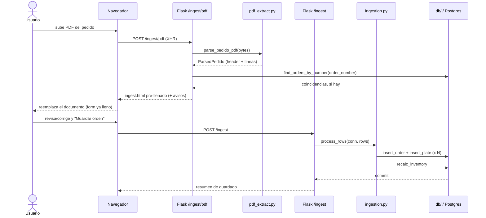
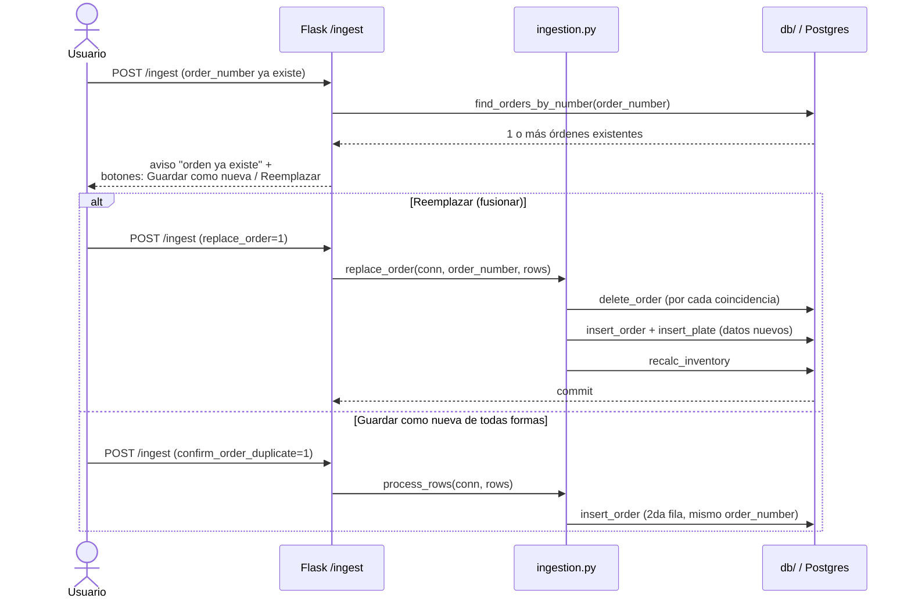

# Web (`app/web/`)

[← volver al índice](README.md)

Desde la Fase 1d, `app.py` solo crea el objeto `app`, inicializa Sentry
(si `SENTRY_DSN` está seteada), registra un blueprint por dominio y
retiene las 2 rutas demasiado chicas para tener el suyo propio (`/` y
`/healthz`) — 83 líneas en total. Las rutas reales viven en
`app/web/blueprints/`, un módulo por dominio; helpers compartidos por 2+
blueprints (`today_iso`, `_options`, `_padded`, `_validate_order_header`,
`customer_fields_from_form`, etc.) viven en `app/web/helpers.py`.

## Rutas

| Método | Path | Blueprint | Qué hace | Llama de `core` | Template | Auth |
|---|---|---|---|---|---|---|
| GET | `/` | `app.py` | Redirige a Registrar (`point_of_sale`/`admin`) o Registros (resto) | — | (redirect) | `@consulta_allowed` |
| GET | `/healthz` | `app.py` | Liveness probe | — | — | abierta |
| GET/POST | `/login` | `auth_routes.py` | Login (consulta `users`, Fase 2) | `auth.authenticate` | `login.html` | abierta |
| GET/POST | `/logout` | `auth_routes.py` | Cierra sesión | — | (redirect) | abierta |
| GET | `/ingest` | `ingest.py` | Form "Registrar" — captura completa de orden POS (Fase 3) | `db.distinct_requested_by/cities`, `db.current_prices`, `db.list_customers` | `ingest.html` | `@pos_allowed` |
| POST | `/ingest` | `ingest.py` | Guarda orden+placas (resuelve/crea cliente, snapshotea precios); gestiona los avisos de orden/placa duplicada y el "Reemplazar" opt-in | `ingestion.process_rows`, `ingestion.replace_order`, `ingestion.find_duplicate_plate_numbers`, `db.resolve_or_create_customer`, `db.find_orders_by_number` | `ingest.html` | `@pos_allowed` |
| GET | `/ingest/pdf` | `ingest.py` | Form de upload de PDF | — | `ingest_pdf.html` | `@pos_allowed` |
| POST | `/ingest/pdf` | `ingest.py` | Parsea el PDF (incl. campos de pie de página, Fase 4) y re-renderiza `ingest.html` pre-llenado (**no guarda nada**) | `pdf_extract.parse_pedido_pdf`, `db.find_orders_by_number` | `ingest.html` | `@pos_allowed` |
| GET | `/review` | `review.py` | Cola de placas con `is_possible_duplicate` | `db.review_rows` | `review.html` | `@login_required` |
| POST | `/review/update` \| `/resolve` \| `/delete` | `review.py` | Edita/marca revisada/borra una fila flagged | `db.update_plate`, `resolve_plate`, `delete_plate`, `recalc_inventory` | (redirect) | `@login_required` |
| GET | `/inventory` | `inventory.py` | Cards de inventario por categoría | `db.inventory_view`, `ornamental_count` | `inventory.html` | `@login_required` |
| POST | `/inventory/alistado` | `inventory.py` | Registra un alistamiento | `db.insert_blank_preparation`, `recalc_inventory` | (redirect) | `@login_required` |
| GET | `/precios` | `pricing.py` | Tabla de tarifas por tipo de placa, editable (Fase 5a) | `db.price_list` | `pricing.html` | `@login_required` (admin-only, nunca `@pos_allowed`) |
| POST | `/precios/<plate_type>` | `pricing.py` | Fija/actualiza la tarifa de un tipo | `db.set_price` | (redirect) | `@login_required` |
| GET | `/customers` | `customers.py` | Lista de clientes, con filtro `?q=` por nombre (Fase 6) | `db.list_customers` | `customers.html` | `@login_required` (admin-only, mismo nivel que `/precios`) |
| GET | `/customers/<id>` | `customers.py` | Form de edición de un cliente | `db.get_customer` | `customer_detail.html` | `@login_required` |
| POST | `/customers/<id>` | `customers.py` | Sobreescribe los atributos del cliente (nombre incluido, y dirección/barrio/municipio según el tipo) — a diferencia de `db.resolve_or_create_customer`, esto SÍ reemplaza un valor ya guardado | `db.update_customer` | (redirect) | `@login_required` |
| GET | `/cuadre` | `cash_summary.py` | Cuadre de caja: totales por fecha/forma de pago en `[desde, hasta]` (default hoy, Fase 5b) | `cash_summary.build_cash_summary` | `cash_summary.html` | `@pos_allowed` |
| GET | `/cuadre/pdf` | `cash_summary.py` | Mismo reporte, exportado a PDF | `cash_summary.build_cash_summary`, `render_cash_summary_pdf` | (descarga PDF) | `@pos_allowed` |
| GET | `/records` | `records.py` | Registros: recientes, o búsqueda por placa/orden | `db.recent_orders`, `search_plates_by_number`, `search_orders_by_number` | `records.html` | `@consulta_allowed` |
| GET | `/records/<id>` | `records.py` | Detalle de orden (ver o editar según rol); preserva `?q=` para el link de volver | `db.order_detail` | `record_detail.html` | `@consulta_allowed` |
| POST | `/records/<id>/save` | `records.py` | Guarda edición de header + placas (insert/update/delete) en una transacción; re-resuelve `customer_id` desde `requested_by` (nunca reescribe atributos de un cliente existente, B5) | `db.update_order`, `delete_plate`, `normalize.normalize_row`, `db.resolve_or_create_customer`, `update_plate_full`, `insert_plate`, `recalc_inventory` | `record_detail.html` / redirect | `@pos_allowed` |
| POST | `/records/search-pdf` | `records.py` | Sube un PDF y chequea sus placas contra la BD (**solo lectura**) | `pdf_extract.parse_pedido_pdf`, `normalize.is_real_plate`, `db.find_orders_for_plate` | `records.html` | `@consulta_allowed` |
| POST | `/records/delete` | `records.py` | Borra una orden completa y sus placas | `db.delete_order`, `recalc_inventory` | (redirect) | `@login_required` |

`/ingest/pdf` (POST) y `/records/search-pdf` **nunca escriben en la BD** —
documentado explícitamente como solo-lectura/preview en sus docstrings.

## Roles y permisos (`auth.py`)

- **Roles**: `admin`, `point_of_sale` (PTO.V), `production` — valores en
  inglés a propósito: `users.role` nunca se muestra al usuario, solo se
  compara para permisos, así que no es dato de negocio en español (ver
  `CLAUDE.md`). Hasta `app/migrations/0004_translate_role_values_to_english.sql`
  los valores reales eran `produccion`/`punto_venta`.
- **`FULL_ACCESS_ROLES = {admin}`** — solo `admin` puede escribir fuera de
  `/ingest`/`/cuadre`. `production` originalmente tenía acceso completo, se
  degradó a solo lectura (hoy el único rol de solo lectura); se mantiene
  como rol separado por si necesita volver a divergir.
- **`POS_ROLES = {admin, point_of_sale}`** (Fase 2) — el nivel intermedio de
  `point_of_sale`: puede capturar ventas (`/ingest`, `/ingest/pdf`,
  `/records/<id>/save`) y consultar el cuadre de caja (`/cuadre`,
  `/cuadre/pdf`), pero nada más de escritura (`/review/*`,
  `/inventory/alistado`, `/records/delete`, `/precios` siguen siendo
  `@login_required`, admin-only).
- **Login vía tabla `users` (Fase 2)** — `app/web/auth.py::authenticate`
  consulta `users` (vía `app/core/db/users.py`) en cada login, ya no lee
  `AUTH_USERS`/`AUTH_ROLES`. Esas dos variables de entorno y las funciones
  `load_users()`/`load_roles()` que las parsean **se mantienen**, pero
  solo como el código que hizo el backfill histórico (`app.schema_migrate`)
  — no los toca el login en vivo. La sesión guarda `user`/`role` y, desde
  la Fase 2, `user_id` (`users.id`) → `production_orders.created_by`; una
  sesión de antes de este cambio (sin `user_id`) se trata como stale y
  fuerza un login nuevo, no un error.
- **Decoradores**: `@login_required` (default para cualquier ruta que
  escribe fuera del alcance de POS — 403 si el rol no es full-access) vs.
  `@consulta_allowed` (deja pasar cualquier rol autenticado — **nunca
  aplicar a algo que escribe**) vs. `@pos_allowed` (Fase 2/3, deja pasar
  `POS_ROLES` — 403 para `producción`, el único rol de solo lectura).
- Sesión firmada con `SECRET_KEY` (obligatoria, sin default), cookie
  `HTTPONLY` + `SAMESITE=Lax` + `SECURE` condicionada a `COOKIE_SECURE`,
  12 horas de duración.
- Guard anti open-redirect en `?next=` del login: solo rutas relativas del
  mismo origen.
- `landing_url()` (a dónde cae un login sin `?next=`): `POS_ROLES` cae en
  Registrar (`/ingest`, su punto de entrada diario); el resto cae en
  Registros (`producción` no puede llegar a `/ingest` de ningún modo, así
  que mandarla ahí solo rebotaría en un 403).

## Templates

No hay `base.html` compartido — cada página es un documento HTML
independiente que incluye `_nav.html` y duplica su propio `<style>`.

| Template | Qué renderiza |
|---|---|
| `_nav.html` | Nav compartido; "Registrar"/"Cuadre" solo si el rol está en `pos_roles`, "Revisión"/"Inventario"/"Precios" solo si está en `full_access_roles`. |
| `_orders_table.html` | Tabla de órdenes reusada por la vista "recientes" y por los resultados de búsqueda por orden. |
| `login.html` | Card de login (sin nav). |
| `ingest.html` | Form de captura POS completa (Fase 3): fieldset de orden (comprobante/cliente/forma de pago obligatoria/guía#/pedido#/fechas/responsable/observaciones) + tabla de líneas con `reason`/`vehicle_brand`/`unit_price` por placa. `unit_price` se pre-llena por JS desde una tarifa embebida como JSON (`prices`); el fieldset de cliente se auto-completa por JS al matchear un nombre contra la lista de clientes embebida (`customers`). Por tipo de cliente (`toggleCustomerFields`): Propietario/Poseedor solo para `CLIENTE`; Dirección/Barrio/Municipio solo para `GESTOR` o `CLIENTE`; `TRÁNSITO` y `EMPRESA` conservan solo nombre, documento, teléfono y correo (el servidor lo vuelve a forzar en `customer_fields_from_form`). Un dato que el cliente ya tiene guardado queda bloqueado (los selects con un input oculto espejo); el bloqueo solo se agrega, nunca habilita un campo que la regla del tipo deshabilitó. Los 3 posibles avisos pre-guardado (`notices` del PDF, `order_duplicates`, `duplicates` de placa) + panel de resumen post-guardado. Mantiene TODOS los campos tipeados (orden + cliente + por línea) al ida-y-vuelta de un aviso, vía el único dict "sticky" (`_sticky_header_from_form`/`_sticky_lines_from_form` en `ingest.py`). |
| `ingest_pdf.html` | Upload de PDF vía XHR con barra de progreso; reemplaza el documento con la respuesta (`ingest.html` pre-llenado, incluidos los campos de pie de página desde la Fase 4). |
| `records.html` | Búsqueda por texto (placa u orden) + búsqueda por PDF (nunca guarda). |
| `record_detail.html` | Detalle de orden — form editable para `pos_roles` (Fase 3: incluye los mismos campos POS que `ingest.html`), resumen de solo lectura para el resto. Ambos branches preservan `back_query` para el link "Volver a Registros". Si la placa está enlazada a una tarjeta de propiedad (`plates.ownership_card_id`), debajo del número se muestra una nota de solo lectura "Tarjeta: <licencia>". |
| `review.html` | Cola de placas flagged, cada fila con Guardar/Revisada/Eliminar. |
| `inventory.html` | Cards de Disponible/Consumido por categoría + form de alistamiento. |
| `pricing.html` (Fase 5a) | Una fila por tipo de placa (`price_list`) con su tarifa actual ("sin tarifa" si no tiene) + form inline para fijarla. Admin-only. |
| `cash_summary.html` (Fase 5b) | Form de rango `desde`/`hasta` (default hoy) + tablas por fecha/forma de pago con subtotales y total general, bucket "SIN FORMA DE PAGO" como fila normal, y una sección de aviso listando toda placa con `unit_price` faltante. Botón de exportar a `/cuadre/pdf`. |

## Flujo 1 — Subir un PDF y guardarlo como orden nueva

## Flujo 2 — Re-subir el PDF de una orden vieja: detectar y fusionar/reemplazar

Este segundo flujo existe por el caso real documentado en
[`CORE.md`](CORE.md#ingestionpy-antes-processpy-renombrado-en-la-fase-1d) (WCY449/pedido 1030): una reposición vieja
sin número de placa no puede detectarse por el chequeo normal de
duplicados, así que el chequeo de **orden** corre primero y de forma
independiente.

**Nota (Fase 2, no dibujada arriba para no saturar los diagramas)**: antes
de cada `process_rows`/`replace_order`, la ruta llama
`db.resolve_or_create_customer(conn, requested_by, **atributos_del_form)`
en la misma transacción — así un cliente nuevo queda con sus atributos
completos (`ingestion.py` internamente vuelve a llamar la misma función
solo con el nombre, que ya no hace nada porque el cliente acaba de
crearse). `process_rows`/`replace_order` también reciben
`created_by=session.get("user_id")`.
